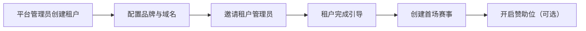
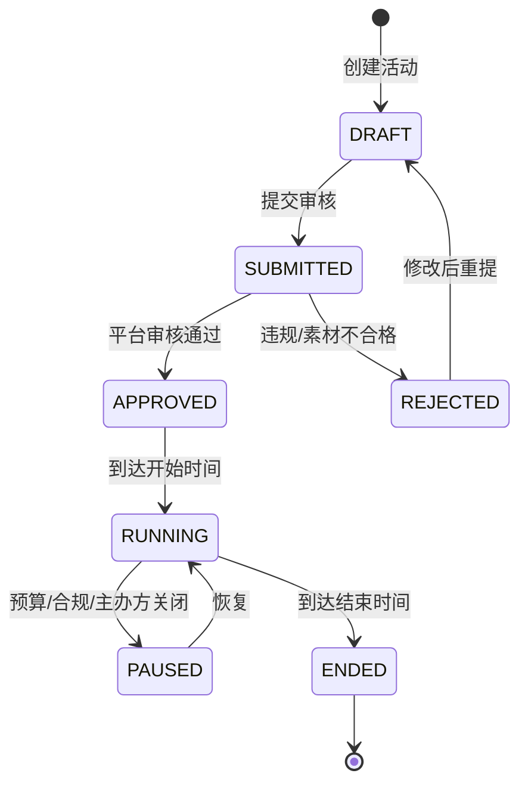
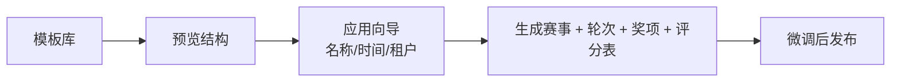
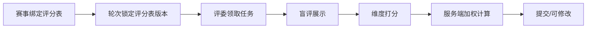

# BTR P1 产品需求文档（PRD）

> 版本：v1.0 ｜ 状态：待评审 ｜ 周期：0–4 个月
> 上游：《满血版方案 2.0 · 赛事云与赛事生态》
> 目标：把单租户赛事系统升级为**可开通、可赞助、可复用、可评审**的免费赛事云 MVP。

---

## 1. 背景与目标

### 1.1 背景

当前 BTR 是单租户部署，所有主办方/机构共用一套数据与品牌，无法按客户开通、隔离，也无法承接赞助；赛事配置靠人工重复搭建；评审只有单一总分，缺少公信力设计。

### 1.2 P1 目标

| 目标 | 衡量 |
|---|---|
| 多租户可用 | 平台可开通租户，租户数据隔离，独立域名/品牌 |
| 赞助可验证 | 赞助位、曝光/点击、投放报告、账单可查 |
| 建赛提速 | 模板应用/赛事克隆，建赛 ≤ 30 分钟 |
| 评审可信 | 评分表 + 盲评，分数可解释、可审计 |
| 可验证交付 | 3 场真实社会赛事（企业/协会/品牌）+ 3 个赞助试点，30 个免费主办方 |

### 1.3 P1 不做

- 主办方订阅/付费墙（主办方永久免费）
- 报名费代收、商品商城（P1.5/P2，见《交易与商品模块PRD》）
- 在线支付（P1 赞助走线下合同；平台在线收款放 P1.5）
- 自助竞价/RTB、复杂人群定向（P2）
- 多轮次/多赛道/团队赛的完整 UI（P2，但 P1 先落数据模型）
- 模板市场交易与分成（P3，P1 只做官方/私有模板）
- AI 查重、申诉仲裁、评委库（P2/P3）
- 原生 App

---

## 2. 角色与权限

### 2.1 角色定义

| 层级 | 角色 | 说明 |
|---|---|---|
| 平台 | `PLATFORM_ADMIN` | 平台运营：开通/封禁租户、审核赞助、库存排期 |
| 平台 | `PLATFORM_FINANCE` | 赞助账单、发票、回款确认 |
| 平台 | `PLATFORM_SPONSOR_MANAGER` | 赞助商与活动审核、素材合规 |
| 赞助商 | `SPONSOR_ADMIN` | 投放、素材、报告、账单 |
| 赞助商 | `SPONSOR_VIEWER` | 只读报告 |
| 租户 | `TENANT_OWNER` | 租户所有者：品牌、成员、全部赛事、赞助位开关/分成 |
| 租户 | `TENANT_ADMIN` | 租户管理员：成员、赛事、评审 |
| 租户 | `ORGANIZER` | 赛事运营：只能管理被分配的赛事 |
| 租户 | `JUDGE` | 评委：打分、评语 |
| 租户 | `PLAYER` | 选手：报名、作品、成绩 |
| 公开 | 匿名 | 公开主页、榜单、证书验真 |

### 2.2 权限矩阵

| 功能 | PLATFORM_ADMIN | PLATFORM_FINANCE | SPONSOR_ADMIN | TENANT_OWNER | TENANT_ADMIN | ORGANIZER | JUDGE | PLAYER |
|---|---|---|---|---|---|---|---|---|
| 开通/封禁租户 | ✔ | ✘ | ✘ | ✘ | ✘ | ✘ | ✘ | ✘ |
| 赞助商管理 | ✔ | ✘ | ✘ | ✘ | ✘ | ✘ | ✘ | ✘ |
| 赞助活动审批 | ✔ | ✘ | ✘ | ✘ | ✘ | ✘ | ✘ | ✘ |
| 投放/素材 | ✔ | ✘ | ✔ | ✘ | ✘ | ✘ | ✘ | ✘ |
| 赞助报告 | ✔ | ✔ | ✔ | 本租户 | 本租户 | ✘ | ✘ | ✘ |
| 赞助账单 | ✔ | ✔ | 查看/申请 | ✘ | ✘ | ✘ | ✘ | ✘ |
| 租户品牌/域名 | ✔ | ✘ | ✘ | ✔ | ✔ | ✘ | ✘ | ✘ |
| 成员管理 | ✔ | ✘ | ✘ | ✔ | ✔ | ✘ | ✘ | ✘ |
| 赛事 CRUD | ✔ | ✘ | ✘ | ✔ | ✔ | 仅分配 | ✘ | ✘ |
| 模板应用/克隆 | ✔ | ✘ | ✘ | ✔ | ✔ | ✔ | ✘ | ✘ |
| 评分表管理 | ✔ | ✘ | ✘ | ✔ | ✔ | ✔ | ✘ | ✘ |
| 打分 | ✘ | ✘ | ✘ | ✘ | ✘ | ✘ | 仅任务 | ✘ |
| 报名/作品 | ✘ | ✘ | ✘ | ✘ | ✘ | ✘ | ✘ | ✔ |
| 证书生成 | ✔ | ✘ | ✘ | ✔ | ✔ | ✔ | ✘ | ✘ |
| 赛事赞助位开关 | ✔ | ✘ | ✘ | ✔ | ✔ | ✘ | ✘ | ✘ |
| 赞助分成查看 | ✔ | ✔ | ✘ | ✔ | ✔ | ✘ | ✘ | ✘ |

### 2.3 租户与赞助商上下文

- 用户全局唯一（`sys_user`），通过 `tenant_member` 加入多个租户。
- 赞助商用户通过 `sponsor_member` 关联 `sponsor_id`，不隶属租户。
- JWT 载荷：`uid`、`tenantId`、`sponsorId`、`roles`（当前上下文）、`platformRole`。
- 切换租户：重新签发 token（`POST /auth/switch-tenant`）。
- 请求解析顺序：域名 → `X-Tenant-Code` → token 内 `tenantId`。
- 平台管理员访问租户数据需显式 `?tenantId=`，并写审计。
- 赞助商只能访问自己的 campaign、creative、report、invoice。

---

## 3. 核心流程

### 3.1 租户开通（免费）



### 3.2 赞助投放



### 3.3 模板建赛



### 3.4 评分流程



---

## 4. 功能需求

## 4.1 多租户

### 4.1.1 平台控制台

**页面：`/platform/tenants`**

- 列表：租户名、编码、类型、状态、赛事数、参赛者数、赞助位、创建时间。
- 筛选：状态、类型、赞助位、关键词、创建区间。
- 操作：开通、查看、暂停、恢复、关闭、导出。
- 批量：批量发通知、批量导出。

**页面：`/platform/tenants/new`（开通向导）**

1. 基本信息：名称、编码（唯一）、类型（企业/协会/政府/园区/社区/执行公司）、联系人。
2. 品牌：Logo、主题色、域名（可后配）。
3. 管理员：邮箱/账号，发送邀请。
4. 赞助位：默认开启/关闭（第三方租户建议默认关闭）。
5. 确认：生成租户 + 默认配置 + 欢迎通知。

**页面：`/platform/tenants/{id}`**

- 概览：状态、赛事数、参赛者数、赞助位状态、累计分成。
- Tab：基本信息 / 成员 / 域名 / 赞助位 / 用量 / 审计。
- 危险操作：暂停、关闭（二次确认 + 输入租户编码）。

### 4.1.2 租户设置

**页面：`/admin/settings/tenant`**

- 品牌：名称、Logo、favicon、主题色、页脚、登录页文案。
- 域名：绑定自定义域名、DNS 验证、SSL 状态、设为主域名。
- 成员：邀请、改角色、停用、转让所有者。
- 默认配置：时区、语言、邮件模板、证书默认模板。

### 4.1.3 隔离规则

- 所有业务表含 `tenant_id`，查询自动注入。
- 跨租户访问返回 404（不暴露存在性）。
- 平台管理员跨租户操作必须带 `tenantId` 且写审计。
- 文件路径按 `tenant/{id}/` 前缀隔离，赞助素材按 `sponsor/{id}/` 隔离，下载走签名 URL。
- 缓存 key 带 `tenant:{id}:` 前缀。
- 定时任务按租户遍历，单租户失败不影响其他租户。

### 4.1.4 接口

| 方法 | 路径 | 说明 |
|---|---|---|
| POST | `/api/v1/platform/tenants` | 开通租户 |
| GET | `/api/v1/platform/tenants` | 租户列表（分页/筛选） |
| GET | `/api/v1/platform/tenants/{id}` | 租户详情 |
| PUT | `/api/v1/platform/tenants/{id}` | 修改基本信息 |
| POST | `/api/v1/platform/tenants/{id}/suspend` | 暂停 |
| POST | `/api/v1/platform/tenants/{id}/activate` | 恢复 |
| POST | `/api/v1/platform/tenants/{id}/close` | 关闭（软删） |
| GET/PUT | `/api/v1/tenant/profile` | 当前租户信息 |
| GET/PUT | `/api/v1/tenant/brand` | 品牌配置 |
| GET/POST | `/api/v1/tenant/domains` | 域名列表/新增 |
| POST | `/api/v1/tenant/domains/{id}/verify` | 触发 DNS 验证 |
| DELETE | `/api/v1/tenant/domains/{id}` | 解绑 |
| GET/POST | `/api/v1/tenant/members` | 成员列表/邀请 |
| PUT | `/api/v1/tenant/members/{uid}/role` | 改角色 |
| PUT | `/api/v1/tenant/members/{uid}/status` | 停用/启用 |
| POST | `/api/v1/auth/switch-tenant` | 切换租户并重签 token |

**开通请求示例**

```json
{
  "code": "univ-demo",
  "name": "示例科技",
  "type": "UNIVERSITY",
  "sponsorDefaultEnabled": false,
  "owner": { "account": "admin@demo.edu", "nickname": "赛事管理员" },
  "brand": { "logoUrl": "", "primaryColor": "#4A6CF7" }
}
```

**约束**

- `code` 全局唯一，创建后不可改。
- 域名全局唯一，验证通过前不生效。
- 关闭租户进入 30 天回收站，期间可恢复；到期后异步清理。

### 4.1.5 验收

- 新建租户 5 分钟内可登录并建赛。
- A 租户无法通过任何接口读到 B 租户数据（含 ID 遍历）。
- 自定义域名访问后品牌与数据均正确。
- 暂停租户后，前台提示「服务已暂停」，后台仅所有者可登录处理违规与数据导出。

---

## 4.2 赞助商与广告位（核心变现）

### 4.2.1 模式

- **主办方永久免费**：不设套餐、不设付费墙、不按赛事收费。
- **公平使用**：存储、短信、证书有软额度，用于防滥用，不阻断正常社会赛事。
- **收入来自赞助商**：冠名、广告位、人才、数据、执行服务。
- **P1 做直客赞助**：平台销售签合同，后台配置投放；不做自助竞价/RTB。
- **报名费与商品不在 P1**：报名费代收放 P1.5，商品商城放 P2，详见《交易与商品模块PRD》。

### 4.2.2 可售库存

| 库存位 | 位置 | 形式 | P1 |
|---|---|---|---|
| `home.banner` | 公开站首页 | 图片/文案 | P1.5 |
| `list.native` | 赛事列表原生位 | 卡片 | ✔ |
| `contest.title` | 赛事详情页冠名 | Logo + 文案 + 链接 | ✔ |
| `contest.banner` | 赛事详情页横幅 | 图片 | ✔ |
| `rank.sponsor` | 榜单页底部 | 图片/文案 | ✔ |
| `certificate.logo` | 证书 PDF + 验真页 | Logo | ✔ |
| `email.footer` | 通知邮件底部 | 文案 | ✔ |
| `talent.board` | 人才榜/招聘 | 列表 | P2 |

**展示规范**

- 所有赞助内容必须标注「赞助」或「广告」，不得伪装成赛事官方信息。
- 图片尺寸、文件大小、文案长度按库存位固定，上传时校验。
- 单页同屏赞助位 ≤ 2 个；同一用户每日曝光频次可配置。
- 主办方可关闭本赛事赞助位；关闭后不展示、不分成。
- 平台保留内容审核与下架权。

### 4.2.3 赞助商与活动模型

| 对象 | 说明 |
|---|---|
| Sponsor | 赞助商主体：名称、行业、联系人、合同、状态 |
| Campaign | 投放活动：类型、预算、周期、目标赛事/赛道/地区 |
| Placement | 库存位绑定：campaign + slot + contest + 权重 + 排期 |
| Creative | 素材：图片、文案、落地页、UTM、二维码 |
| Approval | 审核记录：提交、通过、驳回、下架、原因 |

**活动类型**

- `TITLE`：赛事冠名
- `DISPLAY`：广告位曝光
- `TALENT`：招聘/人才榜
- `DATA`：数据报告合作
- `ACTIVATION`：赞助执行/线下活动

**定向能力（P1）**

- 赛事、租户、赛道、地区、时间。
- 不做个人画像定向；不做基于敏感属性的定向。

### 4.2.4 归因与报告

- **曝光**：素材进入视口 ≥ 50% 且持续 ≥ 1 秒，去重（用户/设备/日）。
- **点击**：跳转落地页，带 UTM；二维码带渠道参数。
- **转化**：报名、提交作品、简历查看、优惠码核销。
- 事件写 `ad_event`，按日聚合到 `ad_daily`。
- 报告维度：活动、赞助商、赛事、库存位、日期。
- 指标：曝光、触达人数、点击、CTR、报名转化、简历查看、核销、eCPM。
- 反作弊：机器人过滤、无效点击剔除、IP/UA 异常检测。
- **数据边界**：赞助商只能看聚合数据；个人信息需本人授权。

### 4.2.5 账单与分成

- 平台向赞助商开账单，P1 线下合同 + 人工确认回款。
- 主办方分成：赞助收入的 10%–30%，按赛事/活动记录。
- 分成台账：应分、已分、待分，支持按月结算与导出。
- 赞助合同、发票、回款凭证归档。

### 4.2.6 页面

**平台侧**

| 页面 | 内容 |
|---|---|
| `/platform/sponsors` | 赞助商列表、行业、合同、累计投放、状态 |
| `/platform/sponsors/{id}` | 详情：联系人、活动、账单、报告 |
| `/platform/campaigns` | 活动列表、审核队列、状态、预算消耗 |
| `/platform/campaigns/{id}` | 活动详情：素材、排期、库存、报告 |
| `/platform/inventory` | 库存日历：各赛事/库存位可售与已占 |
| `/platform/sponsor-revenue` | 赞助收入、分成台账、回款 |

**赞助商侧**

| 页面 | 内容 |
|---|---|
| `/sponsor` | 概览：进行中活动、曝光/点击、预算消耗 |
| `/sponsor/campaigns` | 活动列表、新建、编辑、提交审核 |
| `/sponsor/campaigns/{id}` | 素材上传、排期、预览、报告 |
| `/sponsor/reports` | 报告列表、筛选、导出 PDF/Excel |
| `/sponsor/invoices` | 账单、回款状态、开票申请 |

**租户侧**

| 页面 | 内容 |
|---|---|
| `/admin/sponsor` | 赞助位开关、可售库存、分成台账 |
| 赛事编辑页 | 单赛事赞助位开关、指定赞助商（可选） |

**公开侧**

- 按库存位渲染赞助内容，带「赞助」标识。
- 无赞助时不留空位、不报错。
- 点击走 `/r/{code}` 跳转并记录。

### 4.2.7 接口

| 方法 | 路径 | 说明 |
|---|---|---|
| GET/POST | `/api/v1/platform/sponsors` | 赞助商列表/新建 |
| GET/PUT | `/api/v1/platform/sponsors/{id}` | 详情/编辑 |
| GET | `/api/v1/platform/campaigns` | 活动列表/审核队列 |
| POST | `/api/v1/platform/campaigns/{id}/approve` | 审核通过 |
| POST | `/api/v1/platform/campaigns/{id}/reject` | 驳回 |
| GET | `/api/v1/platform/inventory` | 库存日历 |
| GET | `/api/v1/platform/sponsor-revenue` | 收入与分成 |
| POST | `/api/v1/platform/sponsor-invoices/{id}/mark-paid` | 回款确认 |
| GET/POST | `/api/v1/sponsor/campaigns` | 我的活动 |
| GET/PUT | `/api/v1/sponsor/campaigns/{id}` | 活动详情/编辑 |
| POST | `/api/v1/sponsor/campaigns/{id}/submit` | 提交审核 |
| POST | `/api/v1/sponsor/campaigns/{id}/creatives` | 上传素材 |
| GET | `/api/v1/sponsor/reports` | 报告（campaign/date） |
| GET | `/api/v1/sponsor/invoices` | 账单 |
| GET/PUT | `/api/v1/tenant/sponsor-settings` | 赞助位开关 |
| GET | `/api/v1/tenant/sponsor-revenue` | 分成台账 |
| GET | `/api/v1/public/placements?slot=&contestId=` | 拉取赞助位 |
| POST | `/api/v1/public/ad/impression` | 曝光上报（批量） |
| GET | `/api/v1/r/{code}` | 点击跳转 + 记录 |

**活动创建示例**

```json
{
  "name": "2027 春季计算机赛季冠名",
  "type": "TITLE",
  "budget": 200000,
  "startAt": "2027-03-01",
  "endAt": "2027-06-30",
  "target": { "tenantIds": [12, 18], "tracks": ["software"], "regions": ["杭州"] },
  "placements": [
    { "slot": "contest.title", "weight": 100 },
    { "slot": "rank.sponsor", "weight": 50 }
  ]
}
```

**报告响应示例**

```json
{
  "campaignId": 88,
  "period": { "from": "2027-03-01", "to": "2027-03-31" },
  "impressions": 1280000,
  "reach": 210000,
  "clicks": 9600,
  "ctr": 0.0075,
  "registrations": 820,
  "submissions": 410,
  "resumeViews": 0,
  "ecpm": 31.2
}
```

### 4.2.8 验收

- 赞助位正确展示且带「赞助」标识。
- 曝光/点击与原始日志误差 < 2%。
- 活动结束后 24 小时内生成报告。
- 违规素材无法上线（审核拦截）。
- 主办方关闭赞助位后立即停止展示与计费。
- 无赞助时页面无空位、无报错。
- 赞助商 A 无法读取赞助商 B 的活动与报告。
- 分成台账金额 = 赞助收入 × 分成比例，可追溯。

### 4.2.9 定价参考（P1 销售用）

| 方式 | 价格 |
|---|---|
| 单场冠名 | ¥20k–80k |
| 赛季包 | ¥100k–300k |
| 年度会员 | ¥30k–300k |
| CPM | ¥20–50 |
| 主办方分成 | 10%–30% |

---

## 4.3 赛事模板与克隆

### 4.3.1 模板类型

| 类型 | 说明 | P1 |
|---|---|---|
| 官方模板 | 平台维护，所有租户可用 | ✔ |
| 租户私有模板 | 租户自己沉淀 | ✔ |
| 市场模板 | 创作者发布、分成 | P3 |

### 4.3.2 模板内容

```json
{
  "contest": {
    "title": "{{year}} 程序设计大赛",
    "mode": "ONLINE",
    "judgePerWork": 3,
    "aggregateMode": "TRIM"
  },
  "rounds": [
    {
      "name": "初赛",
      "signupDays": 14,
      "submitDays": 21,
      "judgeDays": 7,
      "confirmDays": 3
    }
  ],
  "tracks": [{ "name": "软件", "quota": 100 }],
  "awards": [
    { "name": "一等奖", "quota": 3, "prizeAmount": 1000 },
    { "name": "二等奖", "quota": 6, "prizeAmount": 500 }
  ],
  "rubric": {
    "name": "通用评分表",
    "mode": "WEIGHTED",
    "items": [
      { "key": "innovation", "label": "创新性", "weight": 0.3, "min": 0, "max": 100 },
      { "key": "completion", "label": "完成度", "weight": 0.4, "min": 0, "max": 100 },
      { "key": "presentation", "label": "展示", "weight": 0.3, "min": 0, "max": 100 }
    ]
  },
  "page": { "theme": "default", "sections": ["intro", "rules", "timeline", "awards"] }
}
```

### 4.3.3 应用与克隆

**应用模板**

1. 选择模板 → 预览结构（轮次/奖项/评分表）。
2. 填写赛事名称、时间策略：
   - `FIXED`：指定固定日期。
   - `RELATIVE`：相对今天偏移（如报名 14 天后截止）。
   - `SHIFT`：按模板基准日整体平移。
3. 选择是否同时创建评分表、奖项、公开页。
4. 生成赛事（默认 DRAFT），进入编辑页。

**克隆赛事**

- 复制：基本信息、轮次、赛道、奖项、评分表、页面结构、邮件模板。
- 不复制：报名、作品、评分、日志、证书。
- 时间整体平移，名称加「（副本）」。

### 4.3.4 页面

| 页面 | 内容 |
|---|---|
| `/admin/templates` | 模板库：卡片、分类、搜索、官方/私有筛选、应用/预览 |
| `/admin/templates/{id}` | 模板详情：结构预览、轮次/奖项/评分表、版本历史 |
| `/admin/templates/apply/{id}` | 应用向导：名称、时间策略、生成项 |
| `/admin/contests/{id}/clone` | 克隆弹窗：新名称、日期平移、复制项 |
| `/admin/contests/{id}/save-as-template` | 另存为模板：名称、分类、可见范围 |

### 4.3.5 接口

| 方法 | 路径 | 说明 |
|---|---|---|
| GET | `/api/v1/templates` | 模板列表（scope/category/keyword） |
| GET | `/api/v1/templates/{id}` | 模板详情 |
| POST | `/api/v1/templates` | 另存为模板 |
| PUT | `/api/v1/templates/{id}` | 编辑（仅私有） |
| DELETE | `/api/v1/templates/{id}` | 删除（仅私有） |
| POST | `/api/v1/templates/{id}/apply` | 应用模板 |
| GET | `/api/v1/templates/{id}/versions` | 版本历史 |
| POST | `/api/v1/contests/{id}/clone` | 克隆赛事 |

**应用请求示例**

```json
{
  "name": "2027 程序设计大赛",
  "timeStrategy": "RELATIVE",
  "baseDate": "2027-03-01",
  "createRubric": true,
  "createAwards": true,
  "createPage": true
}
```

### 4.3.6 验收

- 从模板建赛 ≤ 3 步、≤ 30 分钟完成发布。
- 克隆赛事不产生任何报名/作品/评分数据。
- 模板版本变更不影响已创建赛事。
- 私有模板仅本租户可见。

---

## 4.4 评分表与盲评

### 4.4.1 评分表模型

**模式**

- `TOTAL`：单一总分 + 评语（兼容旧逻辑）。
- `WEIGHTED`：多维度，每项权重，服务端加权。

**规则**

- 权重和必须为 1.000（容差 ±0.001）。
- 单维度 `min < max`，范围 0–100。
- 维度数量 1–20。
- 评分表版本化：`rubric` + `rubric_version`。
- 轮次绑定后在 `JUDGING` 阶段锁定，不可改；如需修改必须新建版本并显式切换（仅未产生评分时允许）。

### 4.4.2 盲评等级

| 等级 | 隐藏内容 |
|---|---|
| `L0` | 不隐藏 |
| `L1` | 昵称、头像 |
| `L2` | 昵称、头像、单位、职位/行业 |
| `L3` | 全部身份信息 + 外部链接 + 联系方式 |

- 盲评在服务端过滤，不依赖前端隐藏。
- 管理员与仲裁角色可见完整信息，但操作写审计。
- 评委提交后仍不可见其他评委分数。

### 4.4.3 页面

**`/admin/rubrics`**

- 列表：名称、模式、维度数、被引用次数、状态、更新时间。
- 操作：新建、复制、编辑、停用。

**`/admin/rubrics/{id}`（编辑器）**

- 基本信息：名称、模式、说明。
- 维度表：拖拽排序、名称、说明、权重、分值区间、必填。
- 实时校验：权重合计进度条，非 1.000 时禁用保存。
- 预览：评委视角效果。
- 版本：保存生成新版本；历史可查看、可复制。

**`/admin/contests/{id}/rounds/{rid}/rubric`**

- 绑定评分表、盲评等级、聚合方式。
- 显示锁定状态与已评分数量。
- 切换版本需二次确认。

**`/judge/score/{workId}`（评委打分页）**

- 左：作品列表（已评/未评）。
- 中：作品预览（按盲评等级过滤）。
- 右：维度评分 + 评语 + 总分实时预览。
- 底部：上一件 / 保存草稿 / 提交 / 下一件。
- 键盘：`←/→` 切换，`Ctrl+Enter` 提交。

### 4.4.4 接口

| 方法 | 路径 | 说明 |
|---|---|---|
| GET | `/api/v1/rubrics` | 评分表列表 |
| POST | `/api/v1/rubrics` | 新建 |
| GET | `/api/v1/rubrics/{id}` | 详情（含最新版本） |
| PUT | `/api/v1/rubrics/{id}` | 编辑（生成新版本） |
| POST | `/api/v1/rubrics/{id}/duplicate` | 复制 |
| POST | `/api/v1/rounds/{id}/rubric` | 绑定评分表 + 盲评等级 |
| GET | `/api/v1/rounds/{id}/rubric` | 查看绑定 |
| GET | `/api/v1/judge/tasks?roundId=` | 任务列表 |
| GET | `/api/v1/judge/works/{id}` | 作品详情（按盲评过滤） |
| POST | `/api/v1/judge/scores` | 提交评分 |
| GET | `/api/v1/judge/scores/{workId}` | 我的评分（用于修改） |

**提交评分**

```json
{
  "workId": 1001,
  "items": [
    { "key": "innovation", "score": 85 },
    { "key": "completion", "score": 90 },
    { "key": "presentation", "score": 80 }
  ],
  "comment": "完成度高，展示清晰"
}
```

**服务端计算**

```text
total = Σ(item.score × item.weight)
```

- 客户端不提交总分，防止篡改。
- 分数保留 2 位小数。
- 同一 `workId + judgeId` 唯一，重复提交为更新。
- 评分表锁定后拒绝写入。

**盲评响应示例（L2）**

```json
{
  "workId": 1001,
  "title": "智能巡检机器人",
  "description": "...",
  "files": [{ "name": "demo.mp4", "url": "..." }],
  "author": { "nickname": "选手 A", "school": null, "avatar": null }
}
```

### 4.4.5 验收

- 权重不为 1 时无法保存。
- 评委看不到未分配给自己的作品。
- L2 盲评下接口不返回单位字段（抓包验证）。
- 评分表锁定后提交返回明确错误。
- 加权结果与手工计算一致（误差 ≤ 0.01）。

---

## 4.5 通知中心（P1 附带）

### 4.5.1 范围

- 站内信：报名成功、作品提交成功、评审开始、成绩公布、赞助审核结果、活动开始/结束、报告生成、赞助账单到期。
- 渠道：站内信 + 邮件（短信 P2）。
- 偏好：用户可按类型开关邮件。

### 4.5.2 页面与接口

- 顶部铃铛 + 未读数；`/notifications` 列表；标记已读/全部已读。
- `GET /api/v1/notifications?page=&size=&type=`
- `PUT /api/v1/notifications/{id}/read`
- `PUT /api/v1/notifications/read-all`
- `GET/PUT /api/v1/notification-prefs`

### 4.5.3 验收

- 关键事件 1 分钟内到达站内信。
- 未读数准确，跨设备一致。
- 邮件失败不影响站内信。

---

## 4.6 证书（P1 附带）

### 4.6.1 范围

- 证书模板：背景图、文字位置、变量（姓名/赛事/奖项/日期/编号）。
- 批量生成：按获奖名单异步生成 PDF。
- 验真页：`/verify/{code}` 展示赛事、奖项、姓名（脱敏）、颁发时间、状态。

### 4.6.2 接口

| 方法 | 路径 | 说明 |
|---|---|---|
| GET/POST | `/api/v1/certificate-templates` | 模板列表/新建 |
| PUT | `/api/v1/certificate-templates/{id}` | 编辑 |
| POST | `/api/v1/certificates/generate` | 批量生成（异步） |
| GET | `/api/v1/certificates/mine` | 我的证书 |
| GET | `/api/v1/public/certificates/{code}` | 公开验真 |
| POST | `/api/v1/certificates/{id}/revoke` | 撤销 |

### 4.6.3 验收

- 1000 张证书 10 分钟内生成完成。
- 验真页可访问且不泄露手机号/邮箱。
- 撤销后验真页显示「已撤销」。

---

## 5. 数据模型（新增/变更）

### 5.1 新增表

| 表 | 关键字段 | 说明 |
|---|---|---|
| `tenant` | id, code, name, type, status, contact, created_at | 租户（免费） |
| `tenant_domain` | id, tenant_id, domain, verified, ssl_status, is_primary | 域名 |
| `tenant_config` | id, tenant_id, config_key, config_value | 租户配置 |
| `tenant_member` | id, tenant_id, user_id, role, status | 成员 |
| `usage_event` | id, tenant_id, metric, quantity, ref_id, occurred_at | 公平使用计量（非计费） |
| `usage_daily` | id, tenant_id, metric, stat_date, quantity | 日聚合（防滥用） |
| `sponsor` | id, name, industry, status, owner_user_id, contract_no, created_at | 赞助商 |
| `sponsor_member` | id, sponsor_id, user_id, role, status | 赞助商成员 |
| `campaign` | id, sponsor_id, name, type, budget, status, start_at, end_at, target_json | 投放活动 |
| `campaign_placement` | id, campaign_id, slot, contest_id, tenant_id, weight, start_at, end_at | 库存绑定 |
| `creative` | id, campaign_id, slot, image_url, text, link, utm, status | 素材 |
| `ad_event` | id, campaign_id, placement_id, event_type, user_id, ip, ua, occurred_at | 曝光/点击事件 |
| `ad_daily` | id, campaign_id, stat_date, impressions, clicks, reach, conversions | 日报表 |
| `sponsor_invoice` | id, sponsor_id, campaign_id, amount, status, due_at, paid_at | 赞助账单 |
| `payment` | id, invoice_id, method, amount, reference, confirmed_by, confirmed_at | 回款 |
| `revenue_share` | id, tenant_id, contest_id, campaign_id, ratio, amount, status, settled_at | 主办方分成 |
| `contest_template` | id, tenant_id, name, scope, category, status, version, payload_json, cover | 模板 |
| `template_version` | id, template_id, version, payload_json, created_at | 模板版本 |
| `rubric` | id, tenant_id, name, mode, status, current_version | 评分表 |
| `rubric_version` | id, rubric_id, version, items_json, created_at | 评分表版本 |
| `round_rubric` | id, round_id, rubric_version_id, blind_level, locked_at | 轮次绑定 |
| `score_item` | id, score_id, item_key, score, weight | 维度分 |
| `certificate_template` | id, tenant_id, name, background_url, layout_json | 证书模板 |
| `certificate` | id, tenant_id, contest_id, award_id, user_id, code, pdf_url, status, issued_at | 证书 |
| `notification` | id, tenant_id, user_id, type, title, body, link, read_at | 站内信 |
| `audit_log` | id, tenant_id, actor_id, action, target_type, target_id, before_json, after_json, ip, created_at | 审计 |

### 5.2 现有表变更

| 表 | 变更 |
|---|---|
| `sys_user` | 增加 `platform_role`；保留全局账号 |
| `contest` | 增加 `tenant_id`、`template_id`、`round_count` |
| `contest_signup` | 增加 `tenant_id`、`round_id`、`track_id`（默认值回填） |
| `contest_work` | 增加 `tenant_id`、`round_id`、`track_id` |
| `contest_score` | 增加 `tenant_id`、`rubric_version_id`、`weighted_score` |
| `contest_judge_assign` | 增加 `tenant_id`、`round_id` |
| `notice` / `sys_log` / `sys_email_record` | 增加 `tenant_id` |

### 5.3 P1 兼容策略（关键）

P1 不启用多轮/多赛道 UI，但**数据模型先落**：

1. 新增 `contest_round` 与 `contest_track`。
2. 历史赛事迁移为 1 个默认轮次（状态由 `contest.status` 映射）。
3. 历史赛事迁移为 1 个默认赛道。
4. `signup` / `work` 回填默认 `round_id` / `track_id`。
5. 状态机仍由 `contest` 驱动；P2 再切到 `round`。
6. 所有新表带 `tenant_id`，历史数据归属「默认租户」。

> 这样 P2 做多轮次时不需要再改一次核心表。

---

## 6. API 规范

### 6.1 通用约定

- 前缀 `/api/v1`。
- 响应：`{ code, message, data }`，`code=0` 成功。
- 分页：`page`（从 1 开始）、`size`（默认 20，最大 100）。
- 排序：`sort=field,asc|desc`，字段白名单。
- 时间：ISO-8601，服务端统一 `Asia/Shanghai`。
- 幂等：写接口支持 `Idempotency-Key`，24 小时内去重。
- 租户：域名 / `X-Tenant-Code` / token。
- 审计：所有写操作记录 `audit_log`。

### 6.2 错误码

| code | 含义 |
|---|---|
| 0 | 成功 |
| 40001 | 参数错误 |
| 40101 | 未登录 |
| 40301 | 公平使用额度不足 |
| 40302 | 当前能力不可用（如赞助位已关闭） |
| 40303 | 租户已暂停 |
| 40304 | 赞助活动未通过审核 |
| 40401 | 资源不存在（含跨租户） |
| 40901 | 状态冲突（如评分表已锁定） |
| 40902 | 重复提交 |
| 40903 | 库存位已被占用 |
| 42901 | 请求过于频繁 |
| 50001 | 服务内部错误 |

### 6.3 示例

**公平额度错误**

```json
{ "code": 40301, "message": "存储使用已达公平额度，请清理文件或联系平台", "data": { "metric": "storage.bytes", "limit": 10737418240, "used": 10737418240 } }
```

**幂等冲突**

```json
{ "code": 40902, "message": "请求已处理", "data": { "requestId": "..." } }
```

---

## 7. 页面清单

| # | 页面 | 端 | 优先级 |
|---|---|---|---|
| 1 | 平台租户列表 | 平台后台 | P0 |
| 2 | 租户开通向导 | 平台后台 | P0 |
| 3 | 租户详情 | 平台后台 | P0 |
| 4 | 赞助商列表 | 平台后台 | P0 |
| 5 | 赞助商详情 | 平台后台 | P0 |
| 6 | 赞助活动审核队列 | 平台后台 | P0 |
| 7 | 库存日历 | 平台后台 | P0 |
| 8 | 赞助收入与分成 | 平台后台 | P1 |
| 9 | 租户设置（品牌/域名/成员） | 管理后台 | P0 |
| 10 | 租户赞助位设置 | 管理后台 | P0 |
| 11 | 模板库 | 管理后台 | P0 |
| 12 | 模板详情/预览 | 管理后台 | P0 |
| 13 | 应用模板向导 | 管理后台 | P0 |
| 14 | 克隆赛事 | 管理后台 | P0 |
| 15 | 另存为模板 | 管理后台 | P1 |
| 16 | 评分表列表 | 管理后台 | P0 |
| 17 | 评分表编辑器 | 管理后台 | P0 |
| 18 | 轮次评分绑定 | 管理后台 | P0 |
| 19 | 评委打分页 | 评委端 | P0 |
| 20 | 赞助商概览 | 赞助商端 | P0 |
| 21 | 赞助活动列表/编辑 | 赞助商端 | P0 |
| 22 | 赞助报告 | 赞助商端 | P0 |
| 23 | 赞助账单 | 赞助商端 | P1 |
| 24 | 通知中心 | 全端 | P1 |
| 25 | 证书模板/生成 | 管理后台 | P1 |
| 26 | 证书验真页 | 公开 | P1 |

---

## 8. 关键页面线框（文字版）

### 8.1 平台租户列表

```
┌──────────────────────────────────────────────────────────────┐
│ 租户管理                    [+ 开通租户]  [导出]             │
├──────────────────────────────────────────────────────────────┤
│ 状态[全部] 类型[全部] 关键词[____]  赞助位[全部]             │
├──────────────────────────────────────────────────────────────┤
│ 租户        类型   状态   赛事  参赛者  赞助位  操作         │
│ 示例科技    企业   正常    8    1,200   开启    ⋯            │
│ 某协会      协会   正常    3      400   关闭    ⋯            │
└──────────────────────────────────────────────────────────────┘
```

### 8.2 评分表编辑器

```
┌──────────────────────────────────────────────────────────────┐
│ 编辑评分表：软件赛道决赛        [预览] [保存新版本]          │
├──────────────────────────────────────────────────────────────┤
│ 模式： ( ) 总分制   (•) 维度加权                             │
│ 权重合计：██████████████████ 100.0% ✔                       │
├──────────────────────────────────────────────────────────────┤
│ ≡ 创新性    权重[30%] 分值[0-100] 必填[✔]  [删除]            │
│ ≡ 完成度    权重[40%] 分值[0-100] 必填[✔]  [删除]            │
│ ≡ 展示效果  权重[30%] 分值[0-100] 必填[✔]  [删除]            │
│ [+ 添加维度]                                                 │
└──────────────────────────────────────────────────────────────┘
```

### 8.3 评委打分页

```
┌──────────┬────────────────────────────┬──────────────────────┐
│ 作品列表 │ 作品预览（L2 盲评）        │ 评分                 │
│ ● 已评   │ 标题 / 描述 / 附件         │ 创新性  [====85====] │
│ ○ 未评   │                            │ 完成度  [====90====] │
│ ○ 未评   │                            │ 展示    [====80====] │
│          │                            │ 评语 [__________]    │
│          │                            │ 总分：85.50          │
│          │                            │ [保存] [提交] [下一件]│
└──────────┴────────────────────────────┴──────────────────────┘
```

### 8.4 赞助活动编辑

```
┌──────────────────────────────────────────────────────────────┐
│ 赞助活动：2027 春季计算机赛季冠名   [提交审核] [预览]        │
├──────────────────────────────────────────────────────────────┤
│ 状态：草稿   预算：¥200,000   周期：2027-03-01 ~ 2027-06-30  │
│ 类型：冠名   赞助商：XX 科技                                  │
├──────────────────────────────────────────────────────────────┤
│ 库存位            赛事/范围          权重   已排期           │
│ 赛事冠名          12 家企业/机构      100    3/1-6/30         │
│ 榜单赞助条        全部               50     3/1-6/30         │
│ 证书 Logo         全部               100    3/1-6/30         │
├──────────────────────────────────────────────────────────────┤
│ 素材： [上传图片] [文案] [落地页] [UTM]                      │
│ 预估：曝光 120 万  点击 9,600  CTR 0.8%                       │
└──────────────────────────────────────────────────────────────┘
```

---

## 9. 非功能需求

| 项 | 要求 |
|---|---|
| 性能 | 读接口 p95 < 300ms，写接口 p95 < 500ms；榜单 1000 作品 < 800ms |
| 可用性 | 99.9%/月；发布可回滚 |
| 隔离 | 跨租户访问 404；文件、缓存、日志均带租户前缀 |
| 安全 | 密码 BCrypt；JWT 短令牌 + 刷新轮换；RBAC；审计；上传白名单 + 扫描 |
| 合规 | 个人信息最小化；未成年人保护；数据导出与删除；日志脱敏 |
| 兼容 | 现有单租户数据迁移为默认租户，URL 不变 |
| 可观测 | 租户维度指标：QPS、错误率、用量、赞助曝光/点击 |
| 浏览器 | Chrome/Edge/Safari 最近两个版本；移动端 360px 起 |

---

## 10. 埋点与指标

| 事件 | 用途 |
|---|---|
| `tenant.created` | 开通漏斗 |
| `tenant.activated` | 首场赛事创建 |
| `sponsor.created` | 赞助商漏斗 |
| `campaign.submitted` | 活动提审 |
| `campaign.approved` | 审核通过率 |
| `placement.impression` | 曝光 |
| `placement.click` | 点击与 CTR |
| `sponsor.report.generated` | 报告交付 |
| `template.applied` | 模板复用率 |
| `contest.cloned` | 克隆使用率 |
| `rubric.created` | 评审标准化 |
| `judge.score.submitted` | 评审进度 |
| `sponsor_invoice.paid` | 赞助回款 |

**P1 核心指标**

- 租户开通 → 首场赛事转化率 ≥ 60%
- 模板建赛占比 ≥ 50%
- 3 个赞助试点、赞助收入 ≥ ¥300,000
- 库存填充率 ≥ 60%
- 曝光/点击统计误差 < 2%
- 赞助报告按时交付率 100%
- 评分表使用率 ≥ 80%

---

## 11. 里程碑

| Sprint | 周期 | 内容 | 验收 |
|---|---|---|---|
| S1 | 第 1–3 周 | 租户模型、平台控制台、租户设置、数据隔离 | A/B 租户互不可见 |
| S2 | 第 4–6 周 | 赞助商、活动、库存位、曝光/点击、报告、账单、分成 | 赞助位可投可测 |
| S3 | 第 7–9 周 | 模板库、应用向导、赛事克隆、另存为模板 | 30 分钟建赛 |
| S4 | 第 10–12 周 | 评分表编辑器、轮次绑定、盲评、评委打分页 | 加权正确、盲评不泄露 |
| S5 | 第 13–15 周 | 证书、通知、公开主页、赞助位公开渲染、埋点 | 证书可验真、赞助可展示 |
| S6 | 第 16 周 | 迁移、压测、安全测试、3 场真实社会赛事 + 赞助报告 | 上线验收 |

**Definition of Done**

- 接口有 OpenAPI 文档与错误码。
- 关键路径有集成测试；跨租户隔离有专项测试。
- 页面通过 1280/768/390 三档验收。
- 埋点上报正确。
- 审计日志可查。
- 文档与代码一致。

---

## 12. 风险与依赖

| 风险 | 应对 |
|---|---|
| 没有规模，赞助卖不动 | 先做 3–5 场标杆赛事，卖赛季包，保量补偿 |
| 赞助收入集中 | 单客户收入占比 ≤ 25%，发展中小赞助商 |
| 广告伤害体验 | 原生植入、频次控制、明确标注、主办方可关闭 |
| 主办方/场地方政策限制 | 赞助披露、禁止品类清单、主办方与场地审批 |
| 数据隐私 | 只用聚合数据；简历与画像需本人授权；可撤回 |
| 广告欺诈 | 曝光去重、无效点击剔除、异常 IP/UA 检测 |
| 免费导致滥用 | 公平使用额度、机构认证、异常限流 |
| 多租户改造范围大 | 先落 `tenant_id` 与默认租户，分表分批迁移 |
| 域名/SSL 自动化复杂 | P1 支持手动配置 + 平台代配，自动化放 P1.5 |
| 在线支付合规 | P1 只做线下合同与回款，避免支付牌照与对账复杂度 |
| 模板结构演进 | payload 用 JSON + 版本号，向后兼容 |
| 评分表锁定争议 | 未产生评分前允许切换版本，之后只能新建轮次 |
| 旧数据迁移 | 迁移脚本可重复执行 + 全量备份 + 回滚演练 |
| 团队产能 | 严格按 Sprint 交付，P1 不做多轮/团队 UI |

**依赖**

- 《大型项目优化方案》Phase 0：Flyway、ShedLock、Actuator、OpenAPI、CI。
- 对象存储（证书/文件/赞助素材）。
- 邮件服务（通知）。
- 域名与 SSL 能力。
- 曝光/点击埋点与 CDN 日志。
- 赞助合同、发票与法务审核流程。

---

## 13. 待决策

1. **主办方是否永久免费？** 建议：是；用公平使用额度防滥用，不设付费墙。
2. **P1 赞助销售方式？** 建议：直客 + 线下合同 + 人工回款，不做自助竞价。
3. **赞助位默认开关？** 建议：官方赛事默认开，第三方租户默认关（opt-in），开启后参与分成。
4. **是否允许按个人画像定向？** 建议：否；P1 只按赛事/赛道/地区/时间定向。
5. **主办方分成比例？** 建议：20%（区间 10%–30%，按赛事规模浮动）。
6. **赞助数据归属？** 建议：聚合数据与赞助商共享；原始日志归平台；个人数据需本人授权。
7. **是否开放简历库给赞助商？** 建议：P2 再做，且必须本人逐次授权。
8. **证书编号规则？** 建议：`BTR-{tenantCode}-{year}-{seq}` + HMAC 校验位。

---

## 14. 交付清单

**后端**

- 租户/成员/域名/配置
- 赞助商/活动/库存位/素材/曝光点击/报告/账单/分成
- 模板/版本/应用/克隆
- 评分表/版本/绑定/盲评/维度分
- 证书/通知/审计
- 公平使用额度与用量统计
- 迁移脚本 + 默认租户回填

**前端**

- 平台控制台：租户 3 页 + 赞助 5 页
- 租户设置 2 页 + 赞助位设置 1 页
- 赞助商端 4 页（概览/活动/报告/账单）
- 模板 5 页
- 评分表 3 页 + 评委打分页
- 通知中心 + 证书 2 页
- 公开页赞助位渲染

**测试**

- 跨租户隔离专项
- 赞助商 A/B 数据隔离专项
- 赞助位渲染与「赞助」标识专项
- 曝光/点击统计准确性专项
- 活动审核与违规拦截专项
- 分成计算专项
- 模板应用/克隆数据正确性
- 评分加权与盲评泄露专项
- 迁移回滚演练

---

*本文档为 P1 开发依据；接口字段以 OpenAPI 为准，页面交互以设计稿为准。*
