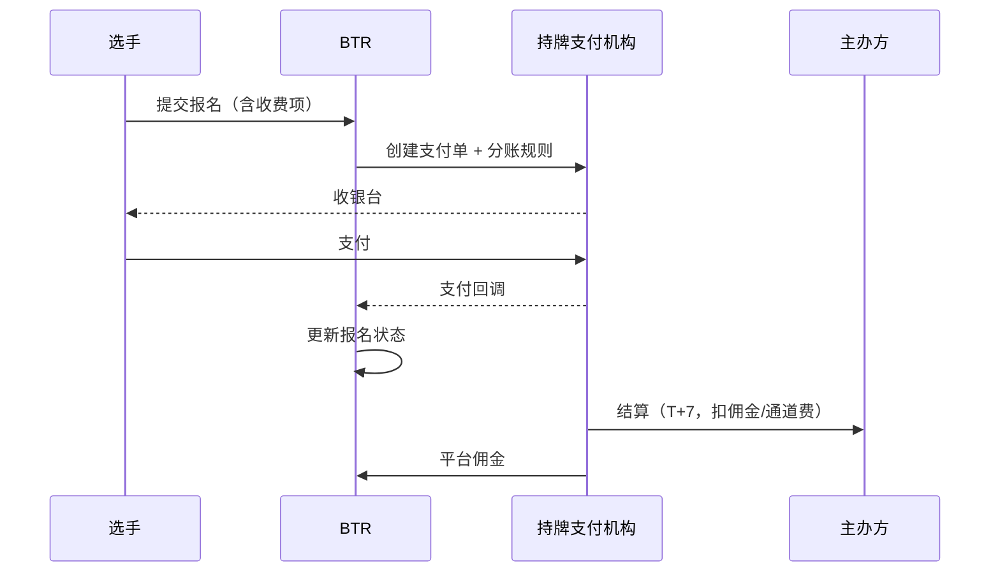
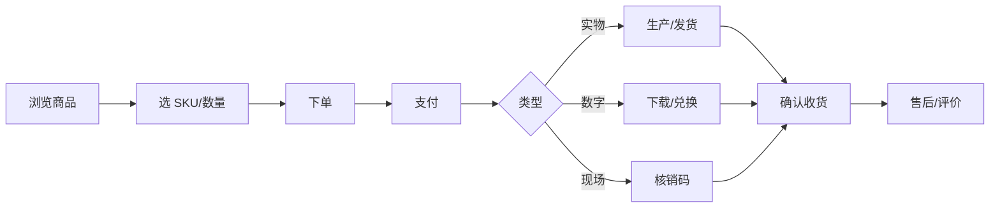
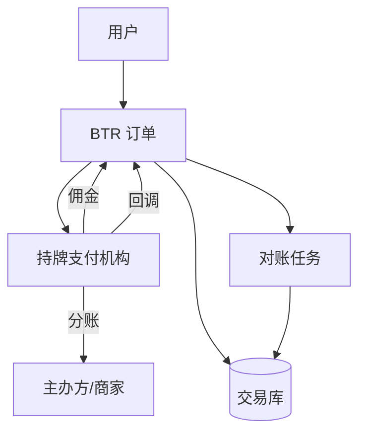

# BTR 交易与商品模块 PRD（报名费 + 商城）

> 版本：v1.0 ｜ 状态：待评审
> 上游：《满血版方案 2.0》《P1 产品需求文档》
> 定位：在赞助之外，增加「报名费佣金」与「商品」两条交易收入；不改变主办方免费开平台的原则。
> 阶段：P1.5 报名费代收 → P2 商品商城。

---

## 0. 结论先行

1. **可以做，但必须走持牌支付机构**，平台不沉淀资金，避免“二清”合规风险。
2. **报名费抽成 2%–5%（建议 3%）**，另计支付通道费；免费赛事不受影响。
3. **商品先做预售 / 按需印刷（POD）/ 赞助商寄售**，不自建仓，不压库存。
4. **报名费与商品分离**：商品不得绑定报名资格，避免变相强制消费。
5. **社会赛事主办方通常有营业执照**，收款主体更容易；小微社群/个人主办方仍需要“协会授权 / 合作企业 / 服务商代收”方案。

---

## 1. 商业模式

### 1.1 收入结构（3 年目标）

| 收入 | 说明 | 占比 |
|---|---|---|
| 赞助 | 冠名、广告位、联名证书 | 55% |
| 报名费佣金 | 代收报名费抽成 2%–5% | 20% |
| 商品 | 周边、参赛包、数字商品、赞助商商品 | 15% |
| 人才与数据 | 招聘、报告 | 7% |
| 服务与生态 | 执行、模板、插件 | 3% |

### 1.2 原则

- 主办方开平台免费；只有产生交易时才收费。
- 平台只赚服务费/佣金/商品差价，不赚资金利差。
- 所有价格、退款规则、佣金比例在下单前明示。
- 未成年人报名与购买需监护人同意。
- 赞助商品与官方商品明确标识，不混淆。

---

## 2. 报名费代收与佣金

### 2.1 流程



### 2.2 收费设置

| 项 | 规则 |
|---|---|
| 是否收费 | 主办方开关，默认免费 |
| 金额 | 主办方设置，建议 0–500 元；超过阈值需平台审核 |
| 早鸟价 | 可按时间段设置 |
| 团体价 | 按人数阶梯 |
| 优惠码 | 固定减免/百分比，可限次数 |
| 退款规则 | 报名截止前全额；截止后按比例/不退，需明示 |
| 发票 | 主办方开报名费发票；平台开服务费发票 |

### 2.3 佣金与结算

| 项 | 规则 |
|---|---|
| 平台佣金 | 2%–5%，默认 3% |
| 通道费 | 约 0.6%，由主办方承担，从结算中扣除 |
| 结算周期 | 赛事结束后 T+7 |
| 风险准备金 | 新主办方首 3 场留存 10%，30 天后释放 |
| 退款 | 原路退回；佣金按比例退回；通道费通常不退 |
| 结算账户 | 主办方对公账户/协会账户/合作企业账户 |

**结算公式**

```text
主办方结算 = 报名费收入 - 平台佣金 - 通道费 - 退款 - 风险准备金
平台收入   = 平台佣金
```

### 2.4 页面

**主办方**

| 页面 | 内容 |
|---|---|
| `/admin/finance/fee` | 收费开关、金额、早鸟/团体价、退款规则 |
| `/admin/finance/registrations` | 报名订单、支付状态、退款 |
| `/admin/finance/settlements` | 结算单、扣费明细、开票 |
| `/admin/finance/invoices` | 服务费发票申请 |

**选手**

| 页面 | 内容 |
|---|---|
| 报名页 | 费用明细、退款规则、支付按钮 |
| 支付结果页 | 成功/失败/待支付、下一步 |
| 我的报名 | 支付状态、退款入口、发票申请 |

**平台**

| 页面 | 内容 |
|---|---|
| `/platform/finance/transactions` | 交易流水、异常、对账 |
| `/platform/finance/commissions` | 佣金规则、佣金收入 |
| `/platform/finance/settlements` | 结算审核、打款确认 |
| `/platform/finance/disputes` | 退款纠纷、仲裁 |

### 2.5 接口

| 方法 | 路径 | 说明 |
|---|---|---|
| GET/PUT | `/api/v1/tenant/fee-settings` | 收费设置 |
| POST | `/api/v1/payments/registration` | 创建报名支付单 |
| GET | `/api/v1/payments/{id}` | 支付状态 |
| POST | `/api/v1/payments/callback/{provider}` | 支付回调（验签+幂等） |
| POST | `/api/v1/refunds` | 发起退款 |
| GET | `/api/v1/tenant/settlements` | 结算单 |
| GET | `/api/v1/tenant/commissions` | 佣金明细 |
| POST | `/api/v1/tenant/invoices` | 服务费开票申请 |
| GET | `/api/v1/platform/transactions` | 平台交易流水 |
| POST | `/api/v1/platform/settlements/{id}/confirm` | 确认打款 |
| POST | `/api/v1/platform/disputes/{id}/resolve` | 纠纷处理 |

### 2.6 数据模型

| 表 | 关键字段 |
|---|---|
| `fee_rule` | id, tenant_id, contest_id, enabled, amount, early_bird_json, group_json, refund_policy |
| `payment_order` | id, tenant_id, biz_type, biz_id, amount, currency, status, provider, provider_order_no, expires_at |
| `payment_transaction` | id, payment_order_id, type, amount, provider_txn_no, raw_json, occurred_at |
| `refund_order` | id, payment_order_id, amount, reason, status, provider_refund_no, created_at |
| `commission_rule` | id, tenant_id, rate, channel_fee_rate, effective_from, effective_to |
| `settlement` | id, tenant_id, contest_id, period, gross, commission, channel_fee, refund, reserve, net, status |
| `settlement_item` | id, settlement_id, payment_order_id, amount, type |
| `merchant_account` | id, tenant_id, subject_type, subject_name, license_no, bank_account, status |
| `invoice` | id, tenant_id, type, amount, title, tax_no, status, file_url |

### 2.7 验收

- 免费赛事不出现支付步骤。
- 支付成功后报名状态实时更新；失败可重试。
- 退款原路退回，状态可查。
- 结算金额 = 收入 - 佣金 - 通道费 - 退款 - 准备金。
- 支付回调幂等，重复回调不重复记账。
- 平台不持有资金池（资金由持牌机构分账/直付）。
- 未成年人支付有监护人确认。

---

## 3. 商品商城

### 3.1 商品类型

| 类型 | 例子 | 模式 | 履约 |
|---|---|---|---|
| 赛事周边 | T 恤、徽章、帆布袋、手办 | 预售/POD | 快递 |
| 参赛包 | 号码布、纪念品、资料袋 | 预售 | 快递/现场领 |
| 数字商品 | 证书打印、作品集、高清回放 | 按需生产 | 下载/邮寄 |
| 赞助商商品 | 样品、联名款、优惠券 | 寄售/兑换 | 快递/核销 |
| 奖牌奖杯 | 定制奖牌、奖杯 | 按需定制 | 快递/现场颁 |

### 3.2 经营模式

| 模式 | 说明 | 适合 |
|---|---|---|
| 平台自营 | 平台选品、定价、发货 | 标品、官方周边 |
| 主办方自营 | 主办方上架、发货 | 赛事专属周边 |
| 赞助商寄售 | 赞助商供货、平台代销 | 品牌商品、样品 |
| 按需印刷 POD | 下单后生产 | T 恤、海报、证书 |
| 预售 | 凑单后生产 | 手办、纪念品 |

**P2 只做**：POD + 预售 + 赞助商寄售；不做自建仓。

### 3.3 流程



### 3.4 定价与分成

| 项 | 规则 |
|---|---|
| 商品售价 | 商家设置，平台审核 |
| 平台佣金 | 5%–10%（实物），10%–15%（数字） |
| 运费 | 买家承担或满额包邮 |
| 结算 | 确认收货 T+7 |
| 退款 | 7 天无理由（法定例外）；质量问题商家承担运费 |
| 优惠 | 优惠券、满减、赞助商兑换码 |

### 3.5 库存与履约

- SKU 维度管理库存；预售不占库存。
- 超卖保护：下单锁库存 15 分钟，未支付释放。
- 发货时限：现货 48h，预售按页面承诺。
- 物流：对接快递鸟/快递 100，回传单号。
- 现场领取：核销码 + 工作人员扫码。
- 数字商品：签名下载链接，限时/限次。

### 3.6 售后

- 7 天无理由退货（定制/数字/鲜活等法定例外除外）。
- 质量问题：商家承担来回运费。
- 超时未发货：买家可取消，全额退。
- 纠纷：平台介入，证据留痕。
- 退款原路退回。

### 3.7 页面

**选手/买家**

| 页面 | 内容 |
|---|---|
| 赛事页商城入口 | 官方周边、参赛包、数字商品 |
| `/shop` | 商品列表、分类、搜索 |
| `/shop/{id}` | 详情、SKU、库存、评价 |
| `/cart` | 购物车 |
| `/checkout` | 地址、优惠、支付 |
| `/orders` | 订单、物流、售后 |
| `/orders/{id}` | 详情、退款/退货 |

**主办方/赞助商**

| 页面 | 内容 |
|---|---|
| `/admin/shop/products` | 商品、SKU、库存、上下架 |
| `/admin/shop/orders` | 订单、发货、退款 |
| `/admin/shop/settlements` | 结算、佣金 |
| `/sponsor/shop` | 寄售商品、兑换码、核销 |

**平台**

| 页面 | 内容 |
|---|---|
| `/platform/shop/products` | 商品审核、违规下架 |
| `/platform/shop/orders` | 全量订单、纠纷 |
| `/platform/shop/settlements` | 结算审核 |

### 3.8 接口

| 方法 | 路径 | 说明 |
|---|---|---|
| GET | `/api/v1/shop/products` | 商品列表（contest/category/keyword） |
| GET | `/api/v1/shop/products/{id}` | 商品详情 |
| POST | `/api/v1/shop/orders` | 创建订单（锁库存） |
| POST | `/api/v1/shop/orders/{id}/pay` | 支付 |
| GET | `/api/v1/shop/orders/mine` | 我的订单 |
| POST | `/api/v1/shop/orders/{id}/cancel` | 取消 |
| POST | `/api/v1/shop/orders/{id}/refund` | 退款/退货 |
| POST | `/api/v1/admin/shop/products` | 新建商品 |
| PUT | `/api/v1/admin/shop/products/{id}` | 编辑/上下架 |
| GET | `/api/v1/admin/shop/orders` | 订单管理 |
| POST | `/api/v1/admin/shop/orders/{id}/ship` | 发货 |
| GET | `/api/v1/admin/shop/settlements` | 结算 |
| POST | `/api/v1/platform/shop/products/{id}/review` | 商品审核 |

### 3.9 数据模型

| 表 | 关键字段 |
|---|---|
| `product` | id, tenant_id, merchant_id, contest_id, type, title, description, status, category |
| `product_sku` | id, product_id, name, price, cost, stock, spec_json, sku_code |
| `product_media` | id, product_id, url, sort |
| `inventory_log` | id, sku_id, change, reason, ref_id, created_at |
| `cart` / `cart_item` | id, user_id, sku_id, quantity |
| `shop_order` | id, order_no, user_id, tenant_id, amount, discount, shipping_fee, status, address_json |
| `shop_order_item` | id, order_id, sku_id, title, price, quantity |
| `shipment` | id, order_id, carrier, tracking_no, status |
| `after_sale` | id, order_id, type, reason, amount, status, evidence_json |
| `merchant` | id, tenant_id, type, name, license_no, settlement_account, status |
| `product_review` | id, product_id, user_id, rating, content, status |

### 3.10 验收

- 下单锁库存，超时释放，不超卖。
- 支付成功后订单状态正确，重复回调不重复发货。
- 数字商品下载链接可失效、可限次。
- 退款原路退回，库存回滚。
- 商家结算 = 商品收入 - 佣金 - 退款 - 运费。
- 商品审核可拦截违规品类。
- 物流单号可查。

---

## 4. 支付与资金架构



**关键原则**

1. **不碰资金池**：平台不作为收款主体沉淀资金。
2. **分账/直付**：优先用支付机构的服务商分账能力；无法分账时，让主办方作为收款商户。
3. **主体合规**：企业/协会用营业执照或登记证签约；社区/个人主办方无营业执照时，用合作企业或服务商代收。
4. **对账**：每日与支付机构对账，差异挂起人工处理。
5. **幂等**：支付、退款、结算回调全部幂等。
6. **风控**：限额、频次、设备、黑名单、异常退款。

---

## 5. 合规与风控

| 项 | 要求 |
|---|---|
| 支付牌照/二清 | 只与持牌机构合作；平台不代收代付沉淀资金 |
| 商户准入 | 营业执照/协会登记证/法人信息；KYC |
| 税务/发票 | 平台服务费开票；商品由商家开票；报名费由主办方开票 |
| 消费者权益 | 价格明示、7 天无理由（法定例外）、退款原路 |
| 未成年人 | 监护人同意；大额支付限制；退款通道 |
| 广告法 | 商品描述禁用绝对化用语；赞助商品标识 |
| 禁售品类 | 博彩、网贷、烟草、成人内容、违规培训等 |
| 数据隐私 | 收货信息最小化；加密存储；导出脱敏 |
| 反刷单 | 设备/账号/地址/行为聚类；异常订单人工审核 |
| 售后 | SLA、纠纷仲裁、证据留痕 |

---

## 6. 指标

| 层级 | 指标 |
|---|---|
| 报名费 | GMV、支付成功率、退款率、take rate、结算周期 |
| 商品 | GMV、客单价、转化率、退货率、毛利率、库存周转、发货时效 |
| 平台 | 单赛事交易收入、ARPU、纠纷率、对账差异率 |
| 风控 | 异常支付率、拒付率、刷单率、投诉率 |

---

## 7. 路线图

| 阶段 | 周期 | 内容 | 验收 |
|---|---|---|---|
| P1.5 | 8–10 周 | 收费设置、支付、回调、退款、佣金、结算、发票 | 一场收费赛事跑通 |
| P2 | 10–12 周 | 商品、SKU、库存、订单、支付、POD/预售、发货、售后 | 100 单无超卖 |
| P2.5 | 6–8 周 | 赞助商寄售、兑换码、核销、数字商品 | 赞助商商品可结算 |
| P3 | 视情况 | 自营仓、会员、分销、跨境 | 按需 |

---

## 8. 风险

| 风险 | 应对 |
|---|---|
| 二清合规 | 持牌机构分账/直付；法务前置 |
| 小微主办方无商户号 | 合作企业/服务商代收；协会授权 |
| 报名费太低 | 不靠单场，靠赛事密度；设最低建议价 |
| 退款纠纷 | 规则前置、原路退、平台仲裁 |
| 库存/超卖 | 预售/POD；锁库存；超卖赔付 |
| 物流破损 | 保价、包装标准、商家责任 |
| 税务/发票 | 三类主体分别开票；财务对账 |
| 刷单/套现 | 风控规则、人工审核、延迟结算 |
| 未成年人 | 监护人同意、限额、退款 |

---

## 9. 待决策

1. **报名费抽成比例？** 建议 3%（区间 2%–5%）。
2. **通道费谁承担？** 建议主办方承担，从结算扣除。
3. **结算周期？** 建议 T+7；新主办方留 10% 30 天。
4. **小微主办方无营业执照怎么签约？** 建议合作企业或服务商代收，法务评估。
5. **商品先做哪种模式？** 建议 POD + 预售 + 赞助商寄售，不自建仓。
6. **商品佣金比例？** 建议实物 5%–10%，数字 10%–15%。
7. **是否允许主办方自由定价？** 建议允许，但设上限与审核。
8. **发票由谁开？** 平台服务费平台开；报名费主办方开；商品商家开。
9. **是否做自有品牌周边？** 建议 P3，先验证需求。

---

## 10. 与现有模块的关系

- **赛事**：收费开关挂在赛事/轮次上，免费赛事零影响。
- **报名**：支付成功才置为 `APPROVED`（或 `PAID` 子状态）；退款触发状态回退。
- **赞助**：赞助商商品可进商城；赞助位可导流商品。
- **证书**：证书打印/作品集作为数字商品。
- **通知**：支付成功、退款、发货、结算通知。
- **审计**：所有资金操作写 `audit_log`，保留原始回调报文。
