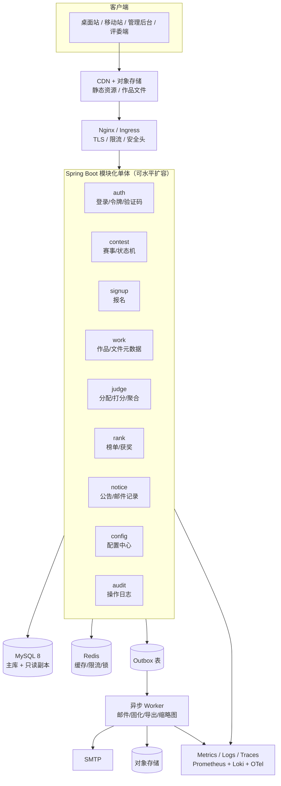

# BTR 赛事平台 · 大型项目优化方案

> 定位：把一个「已上线、能跑通业务」的单体应用，升级为「可多人协作、可多实例部署、可观测、可演进」的大型项目。
> 依据：当前目录下的《开发文档》《软件功能说明》《前端可用性改造方案》《admin-config-design》。
> 说明：当前工作区只有文档，没有源码，因此本文是**可执行的优化蓝图**；标注了文件级落点，拿到仓库后可按阶段直接实施。

---

## 0. 结论先行

1. **不要现在拆微服务。** 当前体量（14 张表、单实例、单库）拆微服务只会把复杂度从代码转移到运维。正确路径是 **模块化单体（Modular Monolith）+ 异步 Worker + 对象存储**，等某个模块真的成为瓶颈再拆。
2. **优先级不是「加功能」，而是「去人工」。** 部署靠 Python SFTP 脚本、迁移靠手工 SQL、调度靠单实例 `@Scheduled`、排障靠 `journalctl`——这四件事决定了项目能不能被别人接手。
3. **先补「可观测 + 可回滚 + 可迁移」三块地基**，再谈性能与前端重构。没有指标和迁移工具时，任何优化都无法验证、无法回退。

---

## 1. 现状评估

### 1.1 已经做得好的部分

| 项 | 评价 |
|---|---|
| 业务闭环 | 赛事 → 报名 → 作品 → 评审 → 公示 → 归档，完整且规则清晰 |
| 规则收口 | `ContestAccessPolicy` / `ContestWorkflow` / `ScoreAggregator` 三处单点，方向正确 |
| 文档 | 开发文档覆盖架构、数据、API、部署、安全，超过多数同体量项目 |
| 生产验证 | 已上线运行，有真实部署拓扑与故障恢复脚本 |

### 1.2 成熟度打分（10 分制）

| 维度 | 现状 | 目标 | 主要差距 |
|---|---|---|---|
| 架构与边界 | 6 | 8 | 分层靠约定，无架构约束测试；Controller 可能直连 Mapper |
| 数据与一致性 | 5 | 9 | 无 Flyway；`DROP TABLE` 脚本与运行路径混用；无状态迁移日志；无 Outbox |
| 性能与容量 | 6 | 8 | 榜单/统计可能 N+1；缓存降级策略在多实例下不一致；无压测基线 |
| 可靠性与可观测 | 4 | 9 | 只有 health；无指标/追踪/告警；单实例调度；无优雅停机 |
| 安全与合规 | 6 | 8 | Refresh Token 无法单独吊销；上传无扫描；生产 IP 进了公开文档 |
| 交付工程化 | 3 | 9 | 无 CI/CD；SFTP 脚本部署；无 staging；无镜像与回滚 |
| 前端工程化 | 4 | 7 | 原生 JS 无构建；规则在 14 个页面重复；无 E2E；公共页 SEO 弱 |
| 文档与协作 | 7 | 9 | 多份文档互相矛盾；无 ADR/术语表/文档责任人 |

> 结论：**业务 7 分，工程 4 分。** 优化重心应放在工程侧，而不是继续堆业务功能。

---

## 2. 目标蓝图

### 2.1 演进原则

1. **模块化单体优先**：按领域分包，模块间只通过应用服务/事件通信，为将来拆分保留缝。
2. **规则继续单点收口**：可见性、状态机、算分之外，再收口「权限」「错误码」「分页」「审计」。
3. **一切自动化**：迁移、构建、测试、部署、回滚、备份验证，全部进流水线。
4. **可观测先行**：任何性能优化前，先有 p95、错误率、慢查询、队列积压。
5. **渐进可回滚**：每个阶段独立上线，数据库变更遵循 expand → migrate → contract。

### 2.2 目标架构



**关键取舍**

- 应用保持**无状态**：JWT + Redis，不依赖本地 session，才能多实例。
- 定时任务用 **ShedLock / 数据库抢占**，不再假设单实例。
- 邮件、导出、快照生成走 **Outbox + Worker**，不阻塞请求。
- 文件从本地 `./uploads` 迁到**对象存储**，应用只存元数据。

---

## 3. 优化清单（按域）

### 3.1 架构与代码组织

**问题**

- 现在按 `controller/service/mapper/entity` 技术分层，模块边界靠自觉；赛事、报名、作品、评审互相调用会逐步耦合成「大泥球」。
- 没有架构约束测试，重构时容易破坏分层。
- 错误码只有 `code=0`，其余靠 message 字符串，前端无法稳定判断。

**方案**

| 动作 | 落点 | 验收 |
|---|---|---|
| 改为「按领域分包」 | `com.btr.platform.{contest,signup,work,judge,rank,auth,notice,config,audit}`，每包内 `api/app/domain/infra` | 新增功能只改一个领域包 |
| 加 ArchUnit 约束 | `src/test/java/.../ArchitectureTest` | CI 中禁止 `api` 直接依赖 `infra`、禁止跨领域直接调 Mapper |
| 统一错误码 | `common/ErrorCode` 枚举 + `BizException(code, message)` + `GlobalExceptionHandler` | 文档有错误码表，前端按 code 分支 |
| 统一分页/排序规范 | `PageQuery`（`page/size/sort`，size ≤ 100）+ `PageResult` | 所有列表接口一致，禁止无上限查询 |
| 接口契约 | springdoc-openapi 生成 `/v3/api-docs`，作为前后端唯一契约 | 前端不再靠读代码猜字段 |

**ArchUnit 示例**

```java
@ArchTest
static final ArchRule api_should_not_touch_infra =
    noClasses().that().resideInAPackage("..api..")
        .should().dependOnClassesThat().resideInAPackage("..infra..");

@ArchTest
static final ArchRule domain_should_not_depend_on_spring_web =
    noClasses().that().resideInAPackage("..domain..")
        .should().dependOnClassesThat().resideInAPackage("org.springframework.web..");
```

### 3.2 数据与一致性

**问题**

- 无 Flyway/Liquibase，迁移靠手工执行 `migrate.sql`，多环境必然漂移。
- 建表脚本含 `DROP TABLE`，与运行路径混在一起，误执行即清库。
- 状态迁移没有审计表，出问题只能翻应用日志。
- 邮件发送与业务事务耦合，失败后无法重试；`ensureWinnersSnapshot` 的幂等靠「已有名单不覆盖」，边界较脆。
- `sys_log` / `sys_email_record` 只增不减，长期会拖慢查询。

**方案**

1. **引入 Flyway**
   - `V1__baseline.sql` 固化当前结构；之后所有变更走 `V2__add_xxx.sql`。
   - 生产启动只允许 `flyway migrate`；`init.sql` 仅用于本地/新环境，且不进运行包。
   - 禁止在迁移脚本中出现 `DROP TABLE` / `TRUNCATE`（CI 用 grep 拦截）。

2. **补索引与约束**（按查询路径，而非按字段）

   | 表 | 建议索引 |
   |---|---|
   | `contest` | `(status, signup_end)`、`(status, review_start)`、`(status, review_end)`、`(is_public, status)` |
   | `contest_signup` | `UNIQUE(user_id, contest_id)`、`(contest_id, status)` |
   | `contest_work` | `(contest_id, status)`、`UNIQUE(signup_id)` |
   | `contest_score` | `UNIQUE(work_id, judge_id)`、`(contest_id, judge_id)` |
   | `contest_winner` | `(contest_id, rank_no)`、`(award_id)` |
   | `sys_log` | `(created_at)`、`(user_id, created_at)` |
   | `sys_email_record` | `(status, created_at)`、`(recipient)` |
   | `notice_read` | `UNIQUE(user_id, notice_id)` |

3. **状态迁移日志**：新增 `contest_status_log(id, contest_id, from_status, to_status, trigger_type, operator_id, created_at)`，每次 `ContestWorkflow` 迁移写一条，排障和审计都靠它。

4. **Outbox 模式**：业务事务内写 `outbox_event(id, event_type, payload, status, retry_count, next_retry_at, created_at)`，Worker 轮询发送邮件/生成快照；失败指数退避，天然可重试、可观测。

```sql
CREATE TABLE outbox_event (
    id BIGINT AUTO_INCREMENT PRIMARY KEY,
    event_type VARCHAR(64) NOT NULL,
    payload JSON NOT NULL,
    status VARCHAR(16) NOT NULL DEFAULT 'PENDING',
    retry_count INT NOT NULL DEFAULT 0,
    next_retry_at DATETIME NULL,
    created_at DATETIME NOT NULL DEFAULT CURRENT_TIMESTAMP,
    KEY idx_outbox_due (status, next_retry_at)
);
```

5. **幂等**：所有写接口用唯一约束 + 捕获重复键；`finalize`、`recompute`、`send-mail` 支持幂等键。

6. **数据生命周期**：`sys_log` / `sys_email_record` 按月分区或定期归档到冷表；保留策略写进运维手册（如日志 180 天、邮件记录 365 天）。

7. **备份与恢复**：每日全量 + binlog，季度做一次**恢复演练**；明确 RPO ≤ 15 分钟、RTO ≤ 1 小时。

### 3.3 性能与容量

| 问题 | 方案 | 验收 |
|---|---|---|
| 榜单/进度可能 N+1 | 批量查询 + 内存聚合；`ScoreAggregator` 输入一次性取全 | 单赛事 1000 作品榜单 p95 < 300ms |
| 榜单缓存击穿 | 逻辑过期 + 单飞（singleflight）或 Redis 分布式锁 | 缓存过期瞬间无雪崩 |
| 进程内缓存降级 | 多实例下会读到不一致数据：改为 Caffeine 5s 短 TTL，或直接失败降级 | 多实例榜单一致 |
| 大文件上传 | 对象存储 + 预签名 URL + 分片 | 100MB 上传不占应用内存 |
| 导出 Excel 同步生成 | 异步任务 + 下载中心 | 导出不阻塞请求，可查进度 |
| 静态资源 | 构建产物 hash 命名 + 长缓存 + Brotli | 首屏 JS gzip < 200KB |
| 公共页 SEO | 现在靠 `fetch` 注入头尾，爬虫拿不到内容：改为构建时预渲染或服务端模板 | 首页/详情页可被抓取 |
| 无压测 | k6 场景：报名洪峰、榜单读洪峰、批量上传 | 有基线报告，扩容有依据 |

**压测场景建议**

- 报名开放瞬间：500 并发/S，验证唯一约束与限流。
- 榜单读：2000 QPS，验证缓存与只读副本。
- 评审截止：评委集中提交，验证 `contest_score` upsert 与聚合。

### 3.4 可靠性与可观测

**问题**：只有 `/health`；无指标、无追踪、无告警；多实例调度会重复执行；重启可能中断请求。

**方案**

1. **Actuator + Micrometer**
   ```yaml
   management:
     endpoints:
       web:
         exposure:
           include: health,info,metrics,prometheus
     endpoint:
       health:
         probes:
           enabled: true
         show-details: when_authorized
   ```
   自定义 `HealthIndicator`：DB、Redis、磁盘、对象存储。

2. **结构化日志 + TraceId**：JSON 日志，MDC 注入 `traceId`，响应头回传 `X-Trace-Id`；日志聚合到 Loki/ELK。

3. **分布式追踪**：OpenTelemetry Agent 接入，重点埋点：状态迁移、算分、邮件、文件上传。

4. **Dashboard 与告警**（最低集）
   - HTTP：QPS、p95/p99、5xx 率
   - JVM：堆、GC、线程池
   - DB：连接池占用、慢查询数
   - 业务：报名数、作品数、评分进度、邮件失败率
   - 调度：上次巡检时间、迁移失败数
   - 告警：5xx > 1%、p95 > 1s、调度延迟 > 2min、磁盘 > 80%

5. **多实例就绪**
   - ShedLock 包住 `ContestStatusScheduler`：
     ```java
     @SchedulerLock(name = "contest_status_scheduler", lockAtMostFor = "PT5M")
     @Scheduled(fixedDelay = 60_000)
     public void tick() { ... }
     ```
   - 优雅停机：`server.shutdown=graceful`，配合 K8s/Systemd 的 preStop。
   - 健康探针区分 liveness / readiness（DB 不可用不应重启进程）。

6. **故障演练**：Redis 宕机、MySQL 主从切换、对象存储超时、SMTP 不可用，验证降级与恢复。

### 3.5 安全与合规

| 风险 | 现状 | 方案 |
|---|---|---|
| Refresh Token 无法单独吊销 | 无状态刷新令牌 | 刷新令牌入库（哈希存储）+ 轮换 + 重用检测；改密/改角色时 `token_version+1` |
| 上传文件 | 类型白名单 + 50MB | 增加内容嗅探、ClamAV 扫描、图片重编码、下载域名隔离、`Content-Disposition` |
| 配置密钥 | `sys_config` 存 SMTP 密码，加密方式未定 | 用 KMS/Vault 或 `CONFIG_SECRET` 派生密钥；密钥轮换方案写进文档 |
| 生产信息外泄 | 公网 IP/端口/路径写进公开文档 | 移入私有运维手册；公开文档只留占位符 |
| Web 安全头 | 未见 | CSP、HSTS、`X-Content-Type-Options`、`Referrer-Policy`、CORS 白名单 |
| 依赖漏洞 | 无扫描 | Dependabot/Renovate + SCA + 镜像扫描 |
| 管理员账号 | 单因子 | P2：管理员 2FA、敏感操作二次确认、IP 白名单 |
| 审计 | 有 `sys_log` | 补「谁在何时改了什么值」的前后值快照（尤其改分、改状态、改配置） |
| PII | 邮箱/手机明文 | 日志脱敏、导出脱敏、保留期限与删除流程 |

### 3.6 交付与质量

**问题**：部署依赖 `btr-*.py` SFTP 脚本；无 CI/CD、无 staging、无镜像、无自动回滚；测试以单测为主，缺 MySQL 集成测试。

**方案**

1. **流水线**（GitHub Actions / GitLab CI 均可）
   ```
   lint → unit → integration(Testcontainers) → build → SAST/SCA → image → push
        → deploy staging → smoke → 人工审批 → deploy prod（蓝绿/金丝雀）
   ```
2. **容器化**：多阶段 Dockerfile，镜像只含 JRE + jar；`docker-compose` 作为单机编排，K8s 留到多节点再上。
3. **环境对齐**：dev / staging / prod 同镜像、同迁移脚本，仅配置不同；staging 用脱敏数据。
4. **数据库变更门禁**：expand → deploy → migrate → contract，禁止一次发布同时改结构和删字段。
5. **测试金字塔**

   | 层 | 工具 | 覆盖重点 |
   |---|---|---|
   | 单元 | JUnit 5 | 状态机、算分、可见性、错误码 |
   | 切片 | `@WebMvcTest` / `@MybatisTest` | Controller 鉴权、参数校验、SQL |
   | 集成 | Testcontainers（MySQL/Redis） | 迁移脚本、唯一约束、事务、并发 |
   | 契约 | OpenAPI diff | 前后端字段兼容 |
   | E2E | Playwright | 五状态 × 四角色主路径 |
   | 性能 | k6 | 报名洪峰、榜单读、评审提交 |

   目标：领域层覆盖率 ≥ 80%，整体 ≥ 60%。

6. **回滚**：镜像保留最近 5 个版本；一键切回；数据库变更必须向后兼容。

### 3.7 前端工程化

**问题**：14 个页面各自实现状态判断；无构建；版本号手工 bump；无 E2E；公共页 SEO 弱。

**分两步走**

- **短期（1 个月，低风险）**
  - 保留原生技术栈，但改成 ES Modules，抽出 `core/`（api、auth、state、format、ui）。
  - 把 `contestAction / contestTiming / formatScore` 变成唯一实现，删除各页复制。
  - 设计令牌（颜色、间距、字号）+ 组件（卡片、徽章、空态、弹窗）统一。
  - 构建时生成 hash 版本号，替代 `?v=20261107c` 手工维护。
  - Playwright 覆盖「五状态 × 匿名/选手/评委/管理员」主路径。

- **中期（3 个月，按团队规模决定）**
  - 引入 Vite + TypeScript（渐进迁移，不一次性重写）。
  - 公共页改为预渲染/SSR，保证 SEO 与首屏。
  - 性能预算：LCP < 2.5s、CLS < 0.1、首屏 JS < 200KB、Lighthouse 可访问性 ≥ 90。

**不建议**：在没有 2 人以上前端、没有设计系统的情况下直接上 React/Vue 重写——会把「页面重复」换成「状态管理复杂度」。

### 3.8 文档与协作

1. **docs-as-code**：`docs/` 分目录，README 做索引；每篇加 front-matter（`status/owner/last-updated/applies-to`）。
2. **ADR**：关键决策单独记录（为什么不用状态机框架、为什么保留独立移动站、为什么先模块化单体）。
3. **OpenAPI 为准**：接口文档从代码生成，手工文档只写业务语义，避免二次维护。
4. **Runbook**：发布、回滚、扩容、故障处理、备份恢复，每项有步骤和验证命令。
5. **术语表**：DRAFT/筹备中、REVIEW/进行中、JUDGING/打分中……先统一语言，再统一代码。
6. **文档一致性检查**：CI 里 grep 文档引用的类名/接口路径是否还存在；至少保证「文档说有、代码没有」能被发现。

---

## 4. 路线图

### Phase 0 · 止血与基线（1–2 周）

| # | 事项 | 产出 | 退出标准 |
|---|---|---|---|
| 1 | Flyway baseline | `V1__baseline.sql` | 新库/存量库都能一键迁移 |
| 2 | ShedLock | 调度加锁 | 双实例启动只执行一次 |
| 3 | Actuator + Prometheus | `/actuator/prometheus` | Grafana 能看到 QPS/p95/错误率 |
| 4 | springdoc OpenAPI | `/v3/api-docs` | 前端可按契约联调 |
| 5 | 错误码表 | `ErrorCode` + 文档 | 前端不再解析 message |
| 6 | 安全止血 | 移除公开文档中的生产信息；改密 bump `token_version` | 安全清单勾选 |
| 7 | CI 最小版 | lint + test + build + image | 每次 push 自动跑 |
| 8 | 备份演练 | 恢复记录 | 能在 1 小时内恢复 |

### Phase 1 · 工程化（1–2 个月）

- 按领域分包 + ArchUnit
- Testcontainers 集成测试
- Outbox + Worker（邮件/导出/快照）
- 对象存储替换本地 `uploads`
- 缓存策略重做（逻辑过期、单飞、多实例一致）
- 结构化日志 + TraceId + 告警
- staging 环境 + 蓝绿发布
- 索引补齐 + 慢查询治理

**退出标准**：发布不需要手工 SFTP；故障能在 5 分钟内定位到模块；核心接口 p95 有基线。

### Phase 2 · 规模化（2–4 个月）

- 只读副本承接榜单/列表读流量
- 异步导出中心 + 下载鉴权
- 日志/邮件记录分区与归档
- 全文检索（MySQL FULLTEXT 或 Meilisearch）替代 LIKE
- 前端 ES Modules + 组件化 + Playwright
- 公共页预渲染（SEO）
- 压测与容量规划（报名洪峰、评审截止）

**退出标准**：双实例稳定运行；压测达标；发布可金丝雀/自动回滚。

### Phase 3 · 平台化（可选，6 个月+）

- 多租户（企业/协会/社区独立空间）或开放 API
- 奖项/评审规则可配置化（插件式）
- 数据分析（报名转化、评审效率、作品热度）
- 管理员 2FA、细粒度 RBAC

---

## 5. 度量与 SLO

| 指标 | 目标 |
|---|---|
| 可用性 | 99.9%/月 |
| API p95 | < 300ms（读）、< 500ms（写） |
| 5xx 率 | < 0.5% |
| 调度延迟 | < 2 分钟 |
| 邮件成功率 | > 98%（不含 SKIPPED） |
| RPO / RTO | 15 分钟 / 1 小时 |
| 部署频率 | 每周 ≥ 1 次 |
| 变更失败率 | < 15% |
| MTTR | < 30 分钟 |
| 领域层测试覆盖 | ≥ 80% |

---

## 6. 不要做什么（避免过度设计）

| 诱惑 | 为什么不 |
|---|---|
| 立刻拆微服务 | 当前团队与流量不支持；分布式事务、链路追踪、网关治理成本远大于收益 |
| 上 Kubernetes | 单机/双机用 systemd + Docker Compose 足够；K8s 解决的是编排问题，不是本项目的瓶颈 |
| 引入 Elasticsearch | 数据量小时 MySQL FULLTEXT 足够；先解决索引与分页 |
| 一次性重写前端 | 14 页重写风险高；先抽公共模块，再渐进迁移 |
| 过早多租户 | 会污染所有表与权限模型；等真有第二个机构入驻再做 |
| 为了「大型」而堆中间件 | 每引入一个组件，就要多一份监控、备份、值班成本 |

---

## 7. 立刻可做的 10 件事（两周内）

1. `V1__baseline.sql` + Flyway，禁止运行期执行 `DROP TABLE`。
2. `@SchedulerLock` 包住状态机定时器。
3. 接 Actuator + Prometheus，先看四个指标：QPS、p95、5xx、DB 连接数。
4. springdoc 生成 OpenAPI，替换手工接口表。
5. 建 `ErrorCode` 枚举，补错误码文档。
6. 改密/改角色时 `token_version+1`；Refresh Token 入库并可吊销。
7. 按 3.2 的表补索引，开慢查询日志。
8. CI 跑 `mvn verify` + 构建镜像；部署脚本降级为 break-glass。
9. 把生产 IP/路径/账号从公开文档移到私有 Runbook。
10. 做一次 MySQL 恢复演练并记录耗时。

---

## 8. 落地建议

- **先做 Phase 0，不要跳步。** 没有迁移工具和指标，后面的优化都无法验证。
- **每个 Phase 结束做一次复盘**：哪些指标改善了、哪些假设被推翻、文档是否需要更新。
- **优化项要绑定验收标准**，例如「p95 < 300ms」而不是「优化榜单性能」。
- **保持业务规则单点收口**：新增的权限、错误码、分页、审计也应各只有一个入口。

> 下一步如果提供源码仓库，我可以直接落地 Phase 0：生成 Flyway baseline、ShedLock 配置、Actuator/OpenAPI 依赖与配置、CI 工作流、索引迁移脚本，以及对应的集成测试。
