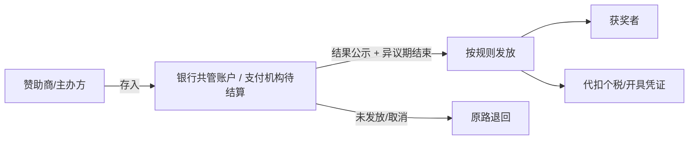
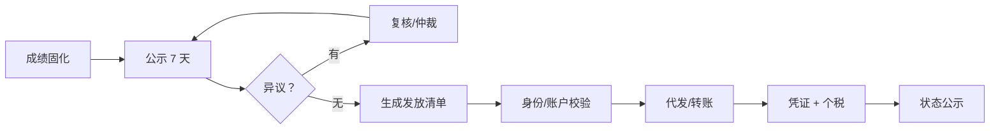
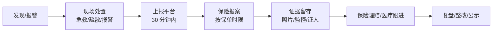

# BTR 奖金奖品与线下安全保障方案

> 适用：社会赛事（企业、协会、政府/园区、品牌、社区）
> 目标：让参赛者敢报名、赞助商敢投钱、主办方敢办线下赛、平台不被事故拖垮。
> 原则：**平台不碰资金池、不替代保险、不承诺保本；用合同、托管、保险、准入四层做保障。**

---

## 0. 结论：四层保障

| 层 | 解决什么 | 关键动作 |
|---|---|---|
| 合同层 | 谁欠谁、违约怎么办 | 三方协议、奖金条款、违约责任、争议解决 |
| 资金层 | 奖金是否真的存在 | 银行共管/支付机构待结算、先托管后开赛、按结果释放 |
| 保险层 | 人身/财产/取消风险 | 公众责任险、团体意外险、活动取消险、设备险 |
| 平台层 | 准入与留痕 | 资质审核、安全清单、徽章公示、事故上报、黑名单 |

**一句话：奖金先到位再开赛，线下先投保再发布。**

---

## 1. 奖金保障

### 1.1 资金路径（推荐）

**核心规则**

1. **奖金到位才开赛**：奖金未托管/未到账，赛事不能进入报名或公示收费。
2. **按结果释放**：公示期 + 异议期结束、无争议后释放。
3. **平台不碰钱**：平台只做指令与留痕，资金在银行/持牌机构账户。
4. **公开状态**：赛事页展示「奖金已托管 / 已发放」，可查不可篡改。

### 1.2 三种落地模式

| 模式 | 适用 | 做法 | 风险 |
|---|---|---|---|
| A 银行共管 | 中大型赛事、政府/协会 | 主办方/赞助商/银行三方共管，按指令释放 | 开户流程长 |
| B 支付机构待结算 | 线上赛事、中小赛事 | 持牌机构分账/冻结，结果后释放 | 依赖机构能力 |
| C 主办方自付 + 保证金 | 小额、快速开赛 | 主办方存入保证金/提供担保，平台监督 | 保障弱，仅低风险 |

**建议**：A/B 为主，C 只用于低金额、低风险赛事，并在页面标注保障等级。

### 1.3 奖金条款（合同必须写）

- 奖金总额、各奖项金额、发放时间（如公示结束后 15 个工作日）。
- 税费承担：按当地税务规定代扣代缴，页面明示「税前/税后」。
- 发放方式：银行转账/代发，是否需要本人账户。
- 违约：逾期利息、平台曝光、限制开赛、保证金扣划。
- 争议：申诉期、仲裁/诉讼地。
- 取消赛事：全额退回或按比例，明确时间。
- 不可抗力：延期/取消的处理。

### 1.4 发放流程

- 发放清单：姓名、奖项、金额、税前/税后、账户、凭证。
- 身份校验：证件/手机号/账户一致；团队奖指定领奖人。
- 未领取：30 天内联系，逾期按规则处理（保留/退回/捐赠）。
- 凭证：转账回单、签收单、个税凭证，归档可查。

### 1.5 违约与兜底

| 情况 | 处理 |
|---|---|
| 赞助商未打款 | 赛事不开赛/不公示；合同违约；平台限制合作 |
| 主办方挪用 | 保证金扣划；暂停租户；法律追偿；黑名单 |
| 赛事取消 | 按规则原路退回；已发生费用扣除需明示 |
| 获奖者争议 | 异议期冻结；仲裁后释放 |
| 平台审核失职 | 内部追责；保障基金（如设立）先行赔付 |

> **平台保障基金**只在法律结构清晰、资金充足时设立；否则不要对外承诺“平台兜底”。

### 1.6 税务与合规

- 奖金属于应税所得，按当地规定代扣代缴（通常由主办方/支付方处理）。
- 页面明示税前/税后，避免“到手缩水”纠纷。
- 团队奖的分配规则提前写清。
- 收费报名 + 奖金排名必须是**技能评审**，不能是抽奖/博彩结构。
- 不得承诺“稳赚/保本/必得”。

---

## 2. 奖品保障

### 2.1 奖品类型

| 类型 | 例子 | 保障重点 |
|---|---|---|
| 实物 | 电脑、设备、周边、奖杯 | 供货、验收、物流、破损 |
| 数字 | 会员、课程、兑换码 | 有效期、兑换率、失效补发 |
| 服务 | 实习、培训、咨询 | 履约时间、名额、变更 |
| 赞助商商品 | 样品、联名款 | 供货、品牌审核、售后 |

### 2.2 供货与验收

1. 赞助商在开赛前提供**供货承诺函**（型号、数量、时间、售后）。
2. 实物奖品到货后验收：数量、型号、序列号、外观、拍照留档。
3. 高价值奖品贴标/单独保管；必要时平台/第三方仓托管。
4. 数字奖品提前测试兑换码，准备 5%–10% 备份。
5. 奖品清单在赛事页公示（型号/数量/领取方式）。

### 2.3 发放与未领取

- 现场发放：签收单 + 拍照 + 身份核验。
- 邮寄：保价、物流单号、签收确认。
- 数字：短信/邮件发放，限时领取。
- 未领取：30 天保留，逾期按规则退回赞助商或捐赠。
- 破损/错发：48 小时内补发或等价替换。

### 2.4 违约

- 赞助商未供货：平台介入、替换等价奖品、合同违约、限制后续合作。
- 奖品与公示不符：主办方补差/替换，页面更正并说明。
- 奖品质量/售后：按消费者权益与合同处理。

---

## 3. 线下赛事人身安全保障

### 3.1 风险分级

| 等级 | 场景 | 要求 |
|---|---|---|
| L1 低风险 | 室内、<200 人、无激烈运动 | 安全清单 + 公众责任险 + 基础急救 |
| L2 中风险 | 200–1000 人、户外/运动/设备 | 安全方案 + 安保 + 医疗点 + 意外险 |
| L3 高风险 | >1000 人、大型群众性活动、高风险项目 | 政府报批 + 专业安保 + 医疗团队 + 应急演练 + 全套保险 |

> 具体人数阈值与报批要求按当地法规（如大型群众性活动安全管理、消防、公安、卫健）执行。

### 3.2 准入资质（平台审核）

- 主办方营业执照/协会登记证/政府批文。
- 场地租赁合同/授权书。
- 消防、安保、医疗、应急方案。
- 保险保单（公众责任险 + 意外险，L2/L3 必选）。
- 高风险项目专项资质（如攀岩、马拉松、水上、无人机）。
- 未成年人活动：监护人同意、看护比例。

**没有保险与安全方案，线下赛事不能发布。**

### 3.3 保险配置

| 险种 | 保障 | 建议 |
|---|---|---|
| 公众责任险 | 第三方人身/财产损失 | 所有线下赛必选 |
| 团体意外险 | 参赛者/工作人员/志愿者 | 按人头投保，名单导入 |
| 活动取消险 | 天气/不可抗力/政府要求 | 中大型赛事建议 |
| 雇主责任险 | 工作人员 | 有雇员时 |
| 设备/展品险 | 设备、展品、道具 | 高价值设备 |
| 食品安全责任险 | 提供食品 | 有餐饮时 |

**投保要点**

- 被保险人：主办方 + 平台（如合同要求）+ 场地方。
- 保险期间：搭建/彩排/正式/撤场全覆盖。
- 保障范围：意外身故/伤残/医疗、第三者责任。
- 免责条款：高风险运动、既往病、酒驾等，提前告知。
- 保单验真：保险公司官网/客服核验，防止假保单。

### 3.4 场地与消防

- 容量核定：人数 ≤ 场地核定容量。
- 出口/疏散通道：宽度、数量、畅通、标识。
- 消防：灭火器、消火栓、喷淋、报警、禁烟。
- 电气：负荷、线缆、配电、备用电源。
- 搭建：结构安全、防风、承重、验收。
- 无障碍与医疗通道。

### 3.5 人流与安保

- 预约/限流/分时入场。
- 检票/手环/证件核验。
- 安保人数按人数与风险配置；L3 用专业安保。
- 重点区域：入口、舞台、签售、奖品区、出口。
- 监控/广播/对讲；应急照明。
- 儿童/老人/残障人士通道与走失预案。

### 3.6 医疗与应急

- 医疗点：位置、人员、AED、急救包、担架。
- 最近医院：路线、车程、联系人。
- 急救通道：不被占用，救护车可进。
- 应急指挥：总指挥、通讯录、备用电源。
- 演练：L2/L3 至少一次桌面/现场演练。
- 急救电话：120/110/119，现场张贴。

### 3.7 天气、设备、食品

- 户外：高温/暴雨/大风/雷电预案，延期/取消阈值。
- 设备：检查、操作资质、围挡、急停。
- 食品：资质、留样、过敏原标识、禁止酒精/违规。
- 夜间：照明、反光标识、巡逻。

### 3.8 未成年人

- 监护人同意书。
- 看护比例与专属区域。
- 不得安排高风险项目。
- 走失/突发疾病预案。
- 信息最小化收集。

### 3.9 签到与保险名单

- 报名即采集紧急联系人（可选/必填按风险）。
- 签到/签退，实时人数。
- 投保名单与签到名单一致。
- 未投保者不得进入高风险区域。

### 3.10 事故处理

**事故上报要素**

- 时间、地点、人物、经过、伤情、处置、证人、照片/监控。
- 24 小时内提交书面报告；重大事故立即上报。
- 统一对外口径，保护隐私，不隐瞒、不推责。
- 保险报案、理赔、整改闭环。

---

## 4. 平台产品设计

### 4.1 奖金托管模块

| 功能 | 说明 |
|---|---|
| 奖金池创建 | 总额、奖项、发放时间、税费说明 |
| 入金 | 赞助商/主办方存入共管/待结算账户 |
| 状态 | 未托管/已托管/待发放/已发放/已退回 |
| 释放 | 公示+异议期后，按清单发放 |
| 公示 | 赛事页展示托管状态与发放进度 |
| 争议 | 冻结、复核、仲裁、留痕 |

### 4.2 奖品模块

| 功能 | 说明 |
|---|---|
| 奖品清单 | 名称、型号、数量、价值、来源 |
| 供货承诺 | 赞助商上传承诺函/合同 |
| 验收 | 到货验收、拍照、序列号 |
| 发放 | 现场签收/邮寄/数字兑换 |
| 未领取 | 提醒、保留、退回 |
| 售后 | 破损、错发、质量 |

### 4.3 安全保障模块

| 功能 | 说明 |
|---|---|
| 风险分级 | 问卷自动判定 L1/L2/L3 |
| 资质上传 | 营业执照、场地、消防、批文 |
| 保险 | 保单上传、验真、名单、到期提醒 |
| 安全方案 | 模板化填写，平台审核 |
| 签到 | 扫码签到/签退、实时人数 |
| 事故上报 | 移动端上报、照片、时间线 |
| 徽章 | 「奖金已托管」「已投保」「安全审核通过」 |

### 4.4 页面

**主办方**

| 页面 | 内容 |
|---|---|
| `/admin/finance/prize-pool` | 奖金池、入金、发放、凭证 |
| `/admin/prizes` | 奖品清单、供货、验收、发放 |
| `/admin/safety` | 风险分级、资质、保险、方案 |
| `/admin/safety/checkin` | 签到、实时人数、名单 |
| `/admin/incidents` | 事故上报、跟进 |

**平台**

| 页面 | 内容 |
|---|---|
| `/platform/escrow` | 托管账户、入金、释放、异常 |
| `/platform/safety-review` | 资质/保险/方案审核 |
| `/platform/incidents` | 事故台账、理赔、处罚 |
| `/platform/blacklist` | 违规主办方/赞助商 |

**公开**

- 赛事页徽章：「奖金已托管」「已投保」「安全审核通过」。
- 奖金发放进度、奖品清单、保险信息摘要。
- 安全须知、紧急联系人、退改规则。

### 4.5 接口

| 方法 | 路径 | 说明 |
|---|---|---|
| POST | `/api/v1/prize-pools` | 创建奖金池 |
| POST | `/api/v1/prize-pools/{id}/deposit` | 入金（托管） |
| GET | `/api/v1/prize-pools/{id}` | 状态/明细 |
| POST | `/api/v1/prize-pools/{id}/release` | 发放 |
| POST | `/api/v1/prize-pools/{id}/freeze` | 争议冻结 |
| POST | `/api/v1/prizes` | 奖品清单 |
| POST | `/api/v1/prizes/{id}/accept` | 验收 |
| POST | `/api/v1/prizes/{id}/deliver` | 发放 |
| POST | `/api/v1/safety/assessment` | 风险分级 |
| POST | `/api/v1/safety/insurance` | 保单上传/验真 |
| POST | `/api/v1/safety/plan` | 安全方案 |
| POST | `/api/v1/safety/checkin` | 签到 |
| POST | `/api/v1/incidents` | 事故上报 |
| GET | `/api/v1/public/contests/{id}/guarantees` | 公开保障信息 |

### 4.6 数据模型

| 表 | 关键字段 |
|---|---|
| `prize_pool` | id, contest_id, total, funded, escrow_type, account_ref, status, release_rule |
| `prize_item` | id, contest_id, sponsor_id, type, name, spec, quantity, value, status |
| `escrow_txn` | id, pool_id, type, amount, provider_txn_no, status, occurred_at |
| `payout` | id, pool_id, winner_id, award_id, amount, tax, status, proof_url |
| `insurance_policy` | id, contest_id, type, insurer, policy_no, coverage, valid_from, valid_to, file_url, verified |
| `safety_plan` | id, contest_id, level, venue, capacity, medical, security, emergency, status |
| `safety_check` | id, contest_id, item, result, reviewer, checked_at |
| `checkin` | id, contest_id, user_id, time, type, emergency_contact |
| `incident` | id, contest_id, type, severity, description, response, report_url, status |

### 4.7 徽章与公示

- 「奖金已托管」：需托管凭证 + 平台核验。
- 「已投保」：保单验真 + 保障期间覆盖赛事。
- 「安全审核通过」：L1/L2/L3 对应清单完成。
- 徽章可撤销；撤销需公示原因。
- 禁止虚假宣传，违者下架/封禁。

---

## 5. 合同与文本

### 5.1 三方协议（平台/主办方/赞助商）

- 奖金金额、入金时间、托管方式、释放条件。
- 奖品型号/数量/供货时间/验收标准。
- 保险与安全责任。
- 违约、赔偿、争议解决。
- 数据与品牌授权。

### 5.2 参赛者协议

- 赛事规则、评审方式、奖金/奖品发放。
- 风险告知（线下）、健康承诺、保险说明。
- 肖像/作品授权、隐私政策。
- 未成年人监护人同意。

### 5.3 平台规则

- 奖金未托管不得开赛。
- 线下无保险不得发布。
- 事故必须上报。
- 违规处罚：警告、下架、冻结结算、封禁、黑名单。

---

## 6. 运营 SOP

### 赛前

- [ ] 奖金池创建、入金、凭证核验
- [ ] 奖品供货承诺、验收计划
- [ ] 风险分级、资质、保险、安全方案
- [ ] 场地/消防/医疗/安保确认
- [ ] 参赛者协议、风险告知
- [ ] 应急演练（L2/L3）

### 赛中

- [ ] 签到/签退、实时人数
- [ ] 医疗点/安保/急救通道
- [ ] 天气/设备/食品检查
- [ ] 事故上报通道畅通
- [ ] 奖金/奖品状态公示

### 赛后

- [ ] 成绩公示、异议期
- [ ] 奖金发放、个税、凭证
- [ ] 奖品发放/邮寄/兑换
- [ ] 保险理赔/事故闭环
- [ ] 复盘、整改、黑名单

---

## 7. 指标

| 指标 | 目标 |
|---|---|
| 奖金托管率 | 100%（收费/有奖金赛事） |
| 奖金按时发放率 | ≥ 99% |
| 保险覆盖率 | 100%（线下） |
| 安全审核通过率 | 100%（发布前） |
| 事故上报及时率 | 100%（30 分钟内） |
| 理赔结案率 | ≥ 95% |
| 虚假徽章 | 0 |

---

## 8. 风险与边界

| 风险 | 边界 |
|---|---|
| 平台承诺兜底 | 不轻易承诺；只做托管/监督，不做信用背书 |
| 资金池/二清 | 不碰资金；银行/持牌机构托管 |
| 假保单 | 官方验真 + 平台复核 |
| 保险免责 | 提前告知；高风险项目专项投保 |
| 事故责任 | 主办方主责；平台审核/留痕；合同划分 |
| 未成年人 | 监护人同意、限制高风险 |
| 收费+奖金 | 技能评审，不做抽奖/博彩结构 |
| 税务 | 代扣代缴，税前税后明示 |

---

## 9. 路线图

| 阶段 | 内容 |
|---|---|
| P2 | 奖金托管、奖品清单、保险上传、安全清单、徽章 |
| P2.5 | 签到、事故上报、保险验真、结算联动 |
| P3 | 保险合作、安全服务商、保障基金、理赔协助 |

---

## 10. 待决策

1. 奖金托管用银行共管还是支付机构待结算？建议按客户规模双轨。
2. 平台是否设立保障基金？建议先不设，避免信用背书。
3. 线下赛事是否强制保险？建议 L2/L3 强制，L1 鼓励。
4. 保险合作方与佣金模式？建议持牌经纪/代理合作。
5. 事故责任如何划分？建议合同明确主办方主责、平台审核责任。
6. 徽章标准与撤销机制？建议平台统一审核、可撤销并公示。

---

## 11. 我的推荐（决策建议）

### 11.1 四项决策

| 决策 | 推荐 | 理由 | 何时复盘 |
|---|---|---|---|
| 奖金托管 | **默认支付机构分账/待结算；单场 ≥50 万或政府/国企项目走银行共管** | 支付机构接入快、可 API 对账；银行共管信任强但开户慢、人工重 | 每季度看托管规模与异常 |
| 平台保障基金 | **前 12–18 个月不设** | 免费模式下没有利润垫；兜底会引发道德风险与监管问题；先用保险+托管+保证金 | 年赛事 ≥1,000 场后再评估 |
| 线下强制保险 | **全部线下赛强制；L1 基础险，L2/L3 加强险** | 一次重大事故足以摧毁品牌；保险成本相对赛事预算很低 | 每半年看理赔与保费 |
| 保险合作方 | **1 家主合作 + 1 家备选，持牌经纪/代理，非独家** | 产品全、出单快、理赔有服务；平台不做承保、不押独家 | 每年招标/比价 |

### 11.2 具体配置

**奖金托管**

- 单场奖金 < 50 万：支付机构分账/待结算，结果公示后释放。
- 单场奖金 ≥ 50 万：银行共管账户，三方指令释放。
- 小额低风险：主办方保证金 + 平台监督，页面标注「基础保障」。
- 任何模式：平台不碰资金、不做二清、不承诺保本。

**保险**

- L1：公众责任险 + 基础意外险（可用平台团体保单）。
- L2：公众责任险 + 团体意外险 + 医疗点 + 安保。
- L3：上述 + 活动取消险 + 设备险 + 专业医疗/安保 + 应急演练。
- 所有保单平台验真，保障期覆盖搭建到撤场。

**合作方选择标准**

1. 持牌（保险经纪/代理），可核验。
2. 有赛事/演出/体育保险经验。
3. 支持线上投保、名单导入、实时出单。
4. 理赔响应 ≤ 24 小时，有本地服务网络。
5. 条款透明，免责清晰，佣金可披露。
6. 非独家，可替换。

### 11.3 保障等级（对用户展示）

| 等级 | 条件 | 展示 |
|---|---|---|
| 基础保障 | 主办方资质 + 安全清单 + 基础保险 | 「已投保」 |
| 标准保障 | 基础 + 奖金托管 + 平台安全审核 | 「奖金已托管 · 已投保」 |
| 旗舰保障 | 标准 + 银行共管 + 全险 + 专业安保 + 理赔协助 | 「旗舰保障」 |

> 等级越高，越容易获得赞助与报名信任；平台按服务收费，不按“兜底”收费。

### 11.4 90 天落地顺序

1. **第 1 月**：签 1 家保险经纪；确定公众责任险/意外险产品；线下赛事上线「无保险不发布」。
2. **第 2 月**：接 1 家支付机构分账/待结算；上线奖金托管与状态徽章。
3. **第 3 月**：跑 3 场线下赛；验证投保、签到、事故上报、理赔流程；再决定是否接银行共管。

### 11.5 一句话

**用保险和托管解决 99% 的风险，用合同解决责任，用准入和徽章解决信任；平台不做保险公司，也不做资金池。**
