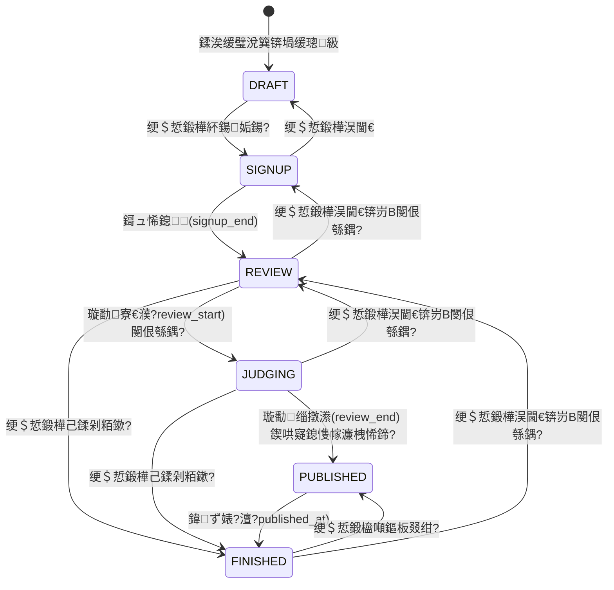

# BTR 璧涗簨骞冲彴 路 寮€鍙戞枃妗?

> 鐗堟湰锛歷1.0.0 锝?鏈€鍚庢洿鏂帮細2026-11-05 锝?浠撳簱锛歡ithub.com/VOID12235/BRT

---

## 1. 椤圭洰姒傝堪

BTR 璧涗簨骞冲彴锛坆tr-platform锛夋槸涓€涓潰鍚戜紒涓氥€佽涓氬崗浼氥€佺ぞ鍖虹殑绀句細璧涗簨鍏ㄦ祦绋嬬鐞嗙郴缁燂紝瑕嗙洊**璧涗簨鍒涘缓 鈫?鎶ュ悕 鈫?浣滃搧鎻愪氦 鈫?璇勫鎵撳垎 鈫?鎴愮哗鍏ず 鈫?棰佸**鐨勫畬鏁寸敓鍛藉懆鏈燂紝鍚屾椂鎻愪緵绠＄悊鍚庡彴銆佺Щ鍔ㄧ銆佽瘎濮斿伐浣滃彴涓夊鍓嶇鐣岄潰銆?

### 1.1 鏍稿績鑳藉姏

| 妯″潡 | 鑳藉姏 |
|---|---|
| 璧涗簨绠＄悊 | 璧涗簨鍒涘缓/缂栬緫/鍒犻櫎銆佺姸鎬佹満鑷姩鎺ㄨ繘銆佽禌棰橀檮浠躲€佸椤归厤缃?|
| 鎶ュ悕绯荤粺 | 鍦ㄧ嚎鎶ュ悕銆佹姤鍚嶅鏍搞€佸弬璧涗俊鎭鐞?|
| 浣滃搧绯荤粺 | 鍦ㄧ嚎鎻愪氦/淇敼浣滃搧銆佷綔鍝侀攣瀹氥€佹墦鍒嗕腑浣滃搧鍙鎬ф帶鍒?|
| 璇勫绯荤粺 | 璇勫鍒嗛厤锛堟暣浣?鎸変綔鍝侊級銆佸璇勫鎵撳垎銆佹垚缁╄仛鍚堛€佺鐞嗗憳鏀瑰垎 |
| 姒滃崟鍏ず | 鎴愮哗鎺掑悕銆佽幏濂栧悕鍗曘€佸叕绀烘湡锛? 澶╄嚜鍔ㄧ粨鏉燂級 |
| 鐢ㄦ埛浣撶郴 | 娉ㄥ唽/鐧诲綍銆丣WT銆佸浘褰㈤獙璇佺爜銆侀偖绠遍獙璇佺爜銆佹壘鍥炲瘑鐮併€佽鑹叉潈闄?|
| 鍐呭绠＄悊 | 鍏憡锛堝瘜鏂囨湰锛夈€侀偖浠惰褰曘€佺郴缁熸棩蹇?|
| 閰嶇疆涓績 | 绔欑偣淇℃伅銆侀偖浠躲€佹暟鎹簱銆佸紑鍏炽€佷笂浼犻檺鍒躲€佸畨鍏ㄧ瓥鐣ャ€佹ā鏉?|

### 1.2 瑙掕壊

| 瑙掕壊 | 璇存槑 | 鏉冮檺鑼冨洿 |
|---|---|---|
| PLAYER锛堥€夋墜锛?| 鏅€氬弬璧涚敤鎴?| 鎶ュ悕銆佹彁浜?淇敼浣滃搧銆佹煡鐪嬫鍗曘€佷釜浜轰腑蹇?|
| JUDGE锛堣瘎濮旓級 | 璇勫浜哄憳 | 浠呮墦鍒嗕腑鍙婁互鍚庨樁娈垫煡鐪嬩綔鍝併€佹墦鍒嗐€佸啓璇勮 |
| ADMIN锛堢鐞嗗憳锛?| 骞冲彴杩愯惀 | 鍏ㄩ儴绠＄悊鍔熻兘锛屽彲寮哄埗鍙樻洿璧涗簨鐘舵€併€佹敼鍒嗐€佸浐鍖栫粨鏋?|

---

## 2. 鎶€鏈爤

| 灞?| 鎶€鏈?| 鐗堟湰/璇存槑 |
|---|---|---|
| 璇█ | Java | 21 |
| 妗嗘灦 | Spring Boot | 4.1.2 |
| ORM | MyBatis-Plus | spring-boot4-starter + jsqlparser |
| 瀹夊叏 | Spring Security + JJWT | JWT 璁块棶浠ょ墝 2h / 鍒锋柊 7d |
| 鏁版嵁搴?| MySQL 8 | 寮€鍙?/ 鐢熶骇缁熶竴锛汬2 渚濊禆淇濈暀鐢ㄤ簬鍚庣画娴嬭瘯 |
| 缂撳瓨 | Redis | 楠岃瘉鐮併€侀檺娴?|
| 閭欢 | Spring Mail | SMTP SSL锛?63 绛夛級 |
| 鏋勫缓 | Maven | package 鈫?fat jar |
| 鍓嶇 | 鍘熺敓 HTML/CSS/JS | 鏃犳瀯寤哄伐鍏凤紝闈欐€侀儴缃?|
| 閮ㄧ讲 | Nginx + systemd | CentOS / Ubuntu |

鍓嶇寮€婧愮粍浠讹細ECharts锛堝浘琛級銆亀angEditor锛堝瘜鏂囨湰锛夈€乹rcodejs锛堜簩缁寸爜锛夈€丆ropper锛堝ご鍍忚鍓級銆乨ocx-preview / jszip / xlsx.full.min锛堟枃妗ｅ湪绾块瑙堬級銆丏Player锛堣棰戞挱鏀撅級銆?

---

## 3. 绯荤粺鏋舵瀯

### 3.1 鍒嗗眰鏋舵瀯

```mermaid
flowchart TB
    subgraph 鍓嶇
        A1["绠＄悊鍚庡彴 admin/"]
        A2["绉诲姩绔?m/"]
        A3["璇勫宸ヤ綔鍙?judge/"]
    end
    Nginx["Nginx锛堥潤鎬?+ /api/ 鍙嶅悜浠ｇ悊锛?]
    subgraph 鍚庣 Spring Boot :8082
        C1["Controller 灞?br/>Auth/Contest/Signup/Work/<br/>Judge/Admin/Rank/Config..."]
        C2["Service 灞?br/>涓氬姟閫昏緫 + 鐘舵€佹満"]
        C3["Mapper 灞?br/>MyBatis-Plus"]
    end
    DB[("MySQL :3306<br/>btr 搴?)]
    RD[("Redis :6379")]
    SMTP["SMTP 閭欢鏈嶅姟"]

    A1 & A2 & A3 --> Nginx
    Nginx --> C1
    C1 --> C2 --> C3 --> DB
    C2 --> RD
    C2 --> SMTP
```

### 3.2 閮ㄧ讲鎷撴墤锛堢敓浜э級

```
鍏綉 YOUR_SERVER_IP:20757
        鈹?
        鈻?
Nginx锛?etc/nginx/sites-available/btr + btr-20757锛?
鈹溾攢鈹€ 闈欐€佽祫婧?鈫?/var/www/btr锛坅dmin/ m/ judge/ assets/锛?
鈹斺攢鈹€ /api/     鈫?proxy_pass http://127.0.0.1:8082
        鈹?
        鈻?
btr.service锛坰ystemd锛?
鈹斺攢鈹€ java -jar /root/BRT/target/btr-platform.jar
    鈹溾攢鈹€ MySQL 127.0.0.1:3306 / btr
    鈹斺攢鈹€ Redis 127.0.0.1:6379
```

Nginx 鐩戝惉绔彛锛歚20757`锛堜富璁块棶鍏ュ彛锛夈€乣8080`銆乣8081`銆乣80`銆乣443`銆傚悗绔粎鐩戝惉 `127.0.0.1:8082`锛屼笉鐩存帴鏆撮湶鍏綉銆?

---

## 4. 椤圭洰缁撴瀯

### 4.1 鍚庣锛坰rc/main/java/com/btr/platform锛?

```
鈹溾攢鈹€ BtrApplication.java        鍚姩绫?
鈹溾攢鈹€ common/                    閫氱敤缁勪欢锛圓piResponse/BizException/PageResult/
鈹?                            CacheService/RateLimitService/ClientIpResolver锛?
鈹溾攢鈹€ config/                    SecurityConfig/MybatisConfig/WebConfig/AsyncConfig
鈹溾攢鈹€ controller/                鎺ュ彛灞傦紙14 涓帶鍒跺櫒锛?
鈹溾攢鈹€ dto/                       Requests.java / Views.java锛堣姹備笌瑙嗗浘瀵硅薄锛?
鈹溾攢鈹€ entity/                    瀹炰綋锛?4 涓紝鏄犲皠鏁版嵁琛級
鈹溾攢鈹€ mapper/                    MyBatis-Plus Mapper锛?4 涓級
鈹溾攢鈹€ security/                  JwtService/JwtAuthFilter/SecurityUtils/UserPrincipal
鈹斺攢鈹€ service/                   涓氬姟灞傦紙19 涓?Service + 鐘舵€佹満璋冨害鍣級
                               + ContestAccessPolicy锛堝彲瑙佹€х瓥鐣ワ級
                               + ContestWorkflow锛堢姸鎬佹満鍞竴鍏ュ彛锛?
                               + ScoreAggregator锛堢粺涓€绠楀垎锛?
```

### 4.2 鍓嶇锛坒rontend/锛?

```
鈹溾攢鈹€ admin/         绠＄悊鍚庡彴锛?4 椤碉細璧涗簨/鎶ュ悕/浣滃搧/璇勫/姒滃崟/鐢ㄦ埛/鍏憡/
鈹?                濂栭」/閭欢/鏃ュ織/璁剧疆/缁熻/瀵煎嚭/浠〃鐩橈級
鈹溾攢鈹€ m/             绉诲姩绔紙14 椤碉細棣栭〉/璧涗簨鍒楄〃/璧涗簨璇︽儏/鎶ュ悕/鎻愪氦浣滃搧/
鈹?                姒滃崟/涓汉涓績/鐧诲綍/鍏憡/璇勫宸ヤ綔鍙?涓嬭浇App/鍏充簬...锛?
鈹溾攢鈹€ judge/         璇勫宸ヤ綔鍙帮紙璇勫棣栭〉/鎵撳垎椤碉級
鈹溾攢鈹€ assets/        闈欐€佽祫婧愶紙css/ js/ vendor/ 绗笁鏂瑰簱锛?
鈹溾攢鈹€ common/        鍏叡 header/footer
鈹斺攢鈹€ *.html         妗岄潰绔〉闈紙index/contest-list/contest-detail/rank...锛?
```

### 4.3 閮ㄧ讲鑴氭湰锛坉eploy-scripts/锛?

| 鑴氭湰 | 鐢ㄩ€?|
|---|---|
| btr-deploy-admin.py | 閮ㄧ讲绠＄悊鍚庡彴锛坅dmin.js + 鍏ㄩ儴 admin HTML锛?|
| btr-deploy-buttons.py | 閮ㄧ讲绉诲姩绔?+ 寮€婧愬簱 + rank.html |
| btr-deploy-status.py | 閮ㄧ讲 api.js + 鏍峰紡锛坆ase/components/m.css锛?|
| btr-judge-deploy.py | 鍚庣閮ㄧ讲锛歋FTP 婧愮爜 鈫?mvn package 鈫?systemctl restart 鈫?health |
| btr-admin-bump.py | 绠＄悊绔?JS 鐗堟湰鍙峰崌绾?|
| btr-restart.py | 閲嶅惎 btr.service 骞堕獙璇?health |
| btr-captcha-toggle.py | 楠岃瘉鐮佸紑鍏冲垏鎹?|
| btr-nginx-20757.py | Nginx 20757 鐩戝惉閰嶇疆锛堟晠闅滄仮澶嶏級 |
| btr-*.sql / *-migrate.py | 鏁版嵁杩佺Щ鑴氭湰 |
| btr-*-diag.py | 鏈嶅姟鍣?nginx/缃戠粶/闃茬伀澧欒瘖鏂剼鏈棌 |

---

## 5. 鏍稿績涓氬姟妯″瀷锛氳禌浜嬬姸鎬佹満

璧涗簨鐘舵€佹槸鍏ㄩ儴涓氬姟瑙勫垯鐨勬牳蹇冿紝鐢?`ContestStatusScheduler` 姣?60 绉掕嚜鍔ㄥ贰妫€鎺ㄨ繘锛岀鐞嗗憳鍙墜鍔ㄥ己鍒跺彉鏇达紙`POST /api/v1/contests/{id}/status`锛夈€?*鎵€鏈夌姸鎬佽縼绉诲繀椤荤粡杩?`ContestWorkflow`**锛屽畾鏃跺櫒涓庢墜鍔ㄦ搷浣滃叡鐢ㄥ悓涓€濂楀壇浣滅敤銆?



### 5.1 鐘舵€佸畾涔変笌闃舵瑙勫垯

| 鐘舵€?| 鏂囨 | 鎶ュ悕 | 鎻愪氦/淇敼浣滃搧 | 浣滃搧鍙鎬э紙鍏紬锛?| 鍒嗘暟鎺掑悕锛堝叕浼楋級 |
|---|---|---|---|---|---|
| DRAFT | 绛瑰涓?| 鉁?| 鉁?| 鈥?| 鈥?|
| SIGNUP | 鎶ュ悕涓?| 鉁?| 鉁楋紙杩涜涓墠寮€鏀撅級 | 涓嶅彲瑙?| 鈥?|
| REVIEW | 杩涜涓?| 鉁?| 鉁旓紙鍙慨鏀癸級 | 涓嶅彲瑙侊紙浠呮湰浜?/ 绠＄悊鍛橈級 | 涓嶅叕甯?|
| JUDGING | 鎵撳垎涓?| 鉁?| 鉁楋紙浣滃搧閿佸畾 locked=1锛?| 鍙湅浣滃搧涓庨瑙堬紝涓嶅惈鍒嗘暟 | 涓嶅叕甯?|
| PUBLISHED | 宸插叕绀?| 鉁?| 鉁楋紙閿佸畾锛?| 鍏ㄩ儴鍏紑 | 鉁?鍏竷 |
| FINISHED | 宸茬粨鏉?| 鉁?| 鉁楋紙閿佸畾锛?| 鍏ㄩ儴鍏紑 | 鉁?鍏竷 |

> 浣滃搧鍙鎬т互 `ContestAccessPolicy` 涓哄噯锛屾墍鏈夊叆鍙ｏ紙`WorkService`銆乣RankService`銆乣PortfolioController`銆乣JudgeService`锛変笉寰楀悇鑷疄鐜板垽鏂€?

### 5.2 鑷姩鎺ㄨ繘閫昏緫锛圕ontestStatusScheduler + ContestWorkflow锛?

| 杩佺Щ | 瑙﹀彂瀛楁 | 闄勫姞鍔ㄤ綔 |
|---|---|---|
| SIGNUP 鈫?REVIEW | `signup_end <= now` | 浣滃搧瑙ｉ攣锛堝厑璁哥户缁彁浜?淇敼锛?|
| REVIEW 鈫?JUDGING | `review_start <= now` | 绾夸笂璧涗綔鍝佸叏閮?`locked=1` |
| JUDGING 鈫?PUBLISHED | `review_end <= now` | 璁板綍 `published_at`銆佸浐鍖栨垚鑾峰鍚嶅崟锛坄contest_winner`锛夈€佸彂閫佽幏濂栭偖浠躲€佹竻姒滃崟缂撳瓨 |
| PUBLISHED 鈫?FINISHED | `published_at + 7澶?<= now` | 淇濈暀宸插浐鍖栧悕鍗曪紝娓呯紦瀛?|

鏈厤缃搴旀椂闂村瓧娈电殑璧涗簨涓嶄細鑷姩鎺ㄨ繘锛岀敱绠＄悊鍛樻墜鍔ㄥ彉鏇淬€傛墜鍔ㄤ笌鑷姩杩佺Щ鍧囬€氳繃 `ContestWorkflow` 鎵ц锛岃繘鍏?`PUBLISHED` / `FINISHED` 鏃惰嫢灏氭棤鑾峰鍚嶅崟浼氳嚜鍔ㄥ浐鍖栵紱宸叉湁鍚嶅崟锛堝惈绠＄悊鍛樻墜鍔ㄨ皟鏁淬€佹垚缁╁浐鍖栵級涓嶄細琚鐩栥€?

### 5.3 浣滃搧閿佸畾涓庝慨鏀?

- 鎵撳垎涓紙JUDGING锛夊強涔嬪悗闃舵锛岀嚎涓婅禌浣滃搧 `locked=1`锛岄€夋墜绔笉鍐嶆彁渚?淇敼浣滃搧"鍏ュ彛銆?
- 浣滃搧鎻愪氦涓庝慨鏀圭粺涓€浣跨敤 `POST /api/v1/works`锛堟寜鎶ュ悕璁板綍 upsert锛夛紝浠?`REVIEW` 闃舵寮€鏀撅紱涓嶅瓨鍦ㄥ崟鐙殑 `PUT /works/{id}`銆?
- 鍥為€€鍒?`SIGNUP` / `REVIEW` 鏃惰嚜鍔ㄨВ闄や綔鍝侀攣瀹氥€?
- 鎵撳垎涓鍗曞彧灞曠ず浣滃搧涓庨瑙堬紝涓嶅睍绀哄垎鏁颁笌鎺掑悕锛涘凡鍏ず/宸茬粨鏉熸墠鍏竷鍒嗘暟涓庢渶缁堢粨鏋溿€?

---

## 6. 鏁版嵁搴撹璁?

搴撳悕锛歚btr`锛圡ySQL 8锛寀tf8mb4_unicode_ci锛夈€傚叏鏂板簱浣跨敤 `deploy/mysql/init.sql`锛屽瓨閲忓簱浣跨敤 `deploy/mysql/migrate.sql`锛沗src/main/resources/schema-mysql.sql` 涓哄缓琛ㄥ熀绾匡紝鍐呭惈 `DROP TABLE`锛?*鍙兘鐢ㄤ簬鍏ㄦ柊鏁版嵁搴?*銆傚紑鍙戠幆澧冨凡鍏抽棴 `spring.sql.init`锛屽惎鍔ㄤ笉浼氳嚜鍔ㄦ竻搴撱€?

### 6.1 琛ㄦ竻鍗?

| 琛?| 璇存槑 |
|---|---|
| sys_user | 鐢ㄦ埛锛堝惈璇勫/绠＄悊鍛橈級 |
| contest | 璧涗簨锛堝惈鐘舵€佹満銆佽瘎瀹″弬鏁般€佽禌棰橈級 |
| contest_signup | 鎶ュ悕璁板綍 |
| contest_work | 鍙傝禌浣滃搧 |
| contest_judge_assign | 璇勫鍒嗛厤 |
| contest_score | 璇勫鎵撳垎锛堝惈绠＄悊鍛樻敼鍒嗭級 |
| contest_award | 濂栭」閰嶇疆 |
| contest_winner | 鑾峰鍚嶅崟锛堝浐鍖栫粨鏋滐級 |
| notice / notice_read | 鍏憡涓庡凡璇?|
| upload_file | 涓婁紶鏂囦欢锛坢d5 鍘婚噸锛?|
| sys_email_record | 閭欢鍙戦€佽褰?|
| sys_config | 閿€奸厤缃腑蹇?|
| sys_log | 鎿嶄綔鏃ュ織 |

### 6.2 鏍稿績琛ㄧ粨鏋?

**sys_user**

| 瀛楁 | 绫诲瀷 | 璇存槑 |
|---|---|---|
| id | BIGINT PK | |
| account | VARCHAR(64) UNIQUE | 鐧诲綍璐﹀彿 |
| password | VARCHAR(100) | BCrypt 鍔犲瘑 |
| nickname | VARCHAR(64) | 鏄电О |
| email | VARCHAR(128) UNIQUE | 閭锛堢櫥褰?鎵惧洖锛?|
| phone | VARCHAR(32) | 鎵嬫満 |
| role | VARCHAR(20) | PLAYER / JUDGE / ADMIN |
| status | VARCHAR(20) | ACTIVE / DISABLED |
| avatar | VARCHAR(255) | 澶村儚 URL |
| token_version | INT | JWT 澶辨晥鎺у埗 |

**contest**锛堝惈杩佺Щ杩藉姞瀛楁锛?

| 瀛楁 | 绫诲瀷 | 璇存槑 |
|---|---|---|
| id | BIGINT PK | |
| title | VARCHAR(160) | 璧涗簨鏍囬 |
| cover / summary / description / rules | VARCHAR/TEXT | 瀹ｄ紶涓庤鍒?|
| prize_amount | DECIMAL(14,2) | 濂栭噾鎬婚 |
| mode | VARCHAR(10) | ONLINE / OFFLINE |
| signup_start / signup_end | DATETIME | 鎶ュ悕璧锋锛堚啋REVIEW锛?|
| review_start / review_end | DATETIME | 璇勫璧锋锛堚啋JUDGING / 鈫扨UBLISHED锛?|
| status | VARCHAR(20) | DRAFT/SIGNUP/REVIEW/JUDGING/PUBLISHED/FINISHED |
| is_public | BOOLEAN | 鏄惁鍏紑 |
| judge_per_work | INT | 姣忎綔鍝佽瘎濮旀暟锛堥粯璁?3锛?|
| aggregate_mode | VARCHAR(10) | AVG=鍧囧垎 / TRIM=鍘绘瀬鍊?|
| review_deadline | DATETIME | 璇勫鎴鎻愰啋 |
| results_locked | TINYINT | 缁撴灉鏄惁宸插浐鍖?|
| finalized_at | DATETIME | 鍥哄寲鏃堕棿 |
| published_at | DATETIME | 鍏ず寮€濮嬫椂闂达紙+7 澶?鈫?宸茬粨鏉燂級 |
| topic_file_name / topic_file_url | VARCHAR | 璧涢闄勪欢锛堣繘琛屼腑闃舵瀵归€夋墜灞曠ず锛?|

**contest_work**

| 瀛楁 | 绫诲瀷 | 璇存槑 |
|---|---|---|
| id | BIGINT PK | |
| signup_id | BIGINT UNIQUE | 鍏宠仈鎶ュ悕 |
| contest_id / user_id | BIGINT | 璧涗簨/浣滆€?|
| title / description | VARCHAR | 浣滃搧淇℃伅 |
| file_url / file_name | VARCHAR | 浣滃搧鏂囦欢 |
| cover | VARCHAR(255) | 浣滃搧灏侀潰鍥?|
| status | VARCHAR(20) | SUBMITTED / WITHDRAWN |
| locked | BOOLEAN | 鎵撳垎涓捣閿佸畾 |
| submitted_at / updated_at | DATETIME | 鎻愪氦/鏇存柊鏃堕棿 |

**contest_judge_assign**

| 瀛楁 | 绫诲瀷 | 璇存槑 |
|---|---|---|
| id | BIGINT PK | |
| contest_id | BIGINT | |
| judge_id | BIGINT | 璇勫鐢ㄦ埛 ID |
| work_id / signup_id | BIGINT | 鍒嗛厤鐨勪綔鍝?鎶ュ悕锛圢ULL = 鏁翠綋鍒嗛厤锛?|
| assign_type | VARCHAR(10) | ALL=鏁翠綋鍔ㄦ€佽窡闅?/ ITEM=鎸囧畾浣滃搧 |

**contest_score**

| 瀛楁 | 绫诲瀷 | 璇存槑 |
|---|---|---|
| id | BIGINT PK | |
| contest_id / work_id / signup_id | BIGINT | |
| judge_id | BIGINT | 鎵撳垎璇勫 |
| score | DECIMAL(5,2) | 鍘熷鍒?|
| comment | VARCHAR(1000) | 璇勮 |
| adjusted_score | DECIMAL(5,1) | 绠＄悊鍛樻敼鍒?|
| adjust_reason / adjust_by / adjusted_at | VARCHAR/BIGINT/DATETIME | 鏀瑰垎鐣欑棔 |

**contest_award / contest_winner**

| 琛?| 瀛楁瑕佺偣 |
|---|---|
| contest_award | contest_id銆乶ame锛堜竴绛夊/鏈€浣冲垱鎰?..锛夈€乹uota銆乸rize_amount銆乬ift銆乻ort_order |
| contest_winner | contest_id銆乤ward_id銆亀ork_id銆乻ignup_id銆乺ank_no銆乸ublished |

---

## 7. 鏍稿績妯″潡璁捐

### 7.1 璁よ瘉涓庡畨鍏?

- **娉ㄥ唽**锛氶偖绠遍獙璇佺爜锛坄POST /auth/send-register-code` 鈫?`POST /auth/register`锛夛紝鍥惧舰楠岃瘉鐮佸彲寮€鍏筹紙`switch.captcha_enabled`锛夈€?
- **鐧诲綍**锛氳处鍙?閭 + 瀵嗙爜 + 鍥惧舰楠岃瘉鐮?鈫?杩斿洖 `accessToken`锛?h锛変笌鍒锋柊浠ょ墝锛?d锛夛紱`token_version` 鍙樻洿鍙叏灞€韪笅绾裤€?
- **JWT 杩囨护**锛歚JwtAuthFilter` 瑙ｆ瀽 `Authorization: Bearer`锛屾敞鍏?`SecurityUtils.current()`銆?
- **鎺堟潈**锛歚@PreAuthorize("hasRole('ADMIN')")` 绛夋敞瑙ｏ紱璇勫/閫夋墜鎺ュ彛鎸夎鑹叉牎楠屻€?
- **闃叉毚鍔?*锛歚RateLimitService`锛圧edis 璁℃暟锛? 瀹夊叏绛栫暐"閿?5 娆￠攣 10 鍒嗛挓"锛坰ys_config security.*锛夈€?
- **鎵惧洖瀵嗙爜**锛歚/auth/forgot-password` 閭欢楠岃瘉鐮?鈫?`/auth/reset-password`銆?

### 7.2 鎶ュ悕涓庝綔鍝?

- 鎶ュ悕锛歚POST /signups`锛堣禌浜嬫姤鍚嶄腑锛屽敮涓€绾︽潫 user_id+contest_id锛夛紱褰撳墠瀹炵幇鎶ュ悕鍚庣洿鎺ョ疆涓?`APPROVED`锛岀鐞嗙 `PUT /admin/signups/{id}/status` 鍙汉宸ユ敼涓?`PENDING / APPROVED / CANCELED`銆?
- 浣滃搧鎻愪氦/淇敼锛歚POST /works`锛堥渶鎶ュ悕 APPROVED + 璧涗簨杩涜涓?REVIEW锛夛紝鎸?`signup_id` upsert锛涗笉瀛樺湪鍗曠嫭鐨?`PUT /works/{id}`銆?
- 浣滃搧閿佸畾锛氭墦鍒嗕腑璧?`locked=1`锛屽墠绔殣钘?淇敼浣滃搧"鍏ュ彛锛涘洖閫€闃舵鑷姩瑙ｉ攣銆?
- 璧涢闄勪欢锛氱鐞嗙閰嶇疆 `topic_file_url/topic_file_name`锛岄€夋墜绔彁浜ら〉灞曠ず锛堝湪绾块瑙?涓嬭浇锛夈€?
- 鍙鎬э細缁熶竴鐢?`ContestAccessPolicy` 鍒ゆ柇锛屼綔鍝佸湪 `JUDGING/PUBLISHED/FINISHED` 鎵嶅澶栧叕寮€锛宍REVIEW` 闃舵浠呮湰浜轰笌绠＄悊鍛樺彲瑙併€?

### 7.3 璇勫鍒嗛厤涓庢墦鍒嗭紙婊¤鐗堬級

**鍒嗛厤锛圓dminController + JudgeService锛?*

| 鏂瑰紡 | 璇存槑 |
|---|---|
| 鏁翠綋鍒嗛厤锛圓LL锛?| 鏌愯瘎濮旇礋璐ｆ暣鍦鸿禌浜嬪叏閮ㄤ綔鍝侊紝鍔ㄦ€佽窡闅忔柊鎻愪氦浣滃搧 |
| 鎸変綔鍝佸垎閰嶏紙ITEM锛?| 璇勫 + 鎸囧畾浣滃搧缁戝畾锛岀簿纭帶鍒?|

- 涓€涓」鐩彲鏈夊涓瘎濮旓紱涓€涓瘎濮斿彲鍒嗛厤澶氬満璧涗簨銆?
- 鍒嗛厤璁板綍 `contest_judge_assign`锛坅ssign_type=ALL/ITEM锛夈€?

**鎵撳垎锛圝udgeService锛?*

- `GET /judge/tasks?contestId=`锛氳瘎濮斾换鍔″垪琛紝**浠呭湪 JUDGING/FINISHED/PUBLISHED 闃舵鍙**锛堟姤鍚嶄腑/杩涜涓繑鍥炵┖锛夈€?
- `POST /judge/scores`锛氳瘎濮旀墦鍒?+ 璇勮锛屽敮涓€绾︽潫锛坵ork_id, judge_id锛夈€?
- **鎴愮哗鑱氬悎锛堢粺涓€鍙ｅ緞锛?*锛歚ScoreAggregator` 瀵规墍鏈夊叆鍙ｇ敓鏁堚€斺€旀湁鏁堝垎 = `COALESCE(adjusted_score, score)`锛沗AVG` 鍙栫畻鏈钩鍧囷紝`TRIM` 鍦ㄦ湁鏁堝垎 鈮?3 鏃跺幓鎺変竴涓渶楂樺垎鍜屼竴涓渶浣庡垎锛涚粨鏋滅粺涓€淇濈暀 2 浣嶅皬鏁般€?
- **绠＄悊鍛樻敼鍒?*锛歚PUT /admin/judge-assign/scores` 鏀?`adjusted_score`锛堢暀鐥?adjust_by/reason/at锛夛紝鑱氬悎绔嬪嵆鏀圭敤璋冩暣鍒嗛噸绠楁帓鍚嶃€?
- **缁撴灉鍥哄寲**锛歚POST /admin/judge-assign/finalize` 鈫?鍐欏叆 `contest_winner`锛堟寜濂栭」 quota 鐢熸垚 rank_no锛夈€佺疆 `results_locked=1`銆佽褰?`finalized_at`锛涘浐鍖栧悗绂佹鍐嶆敼鍒嗐€佽皟鏁村垎閰嶃€佽皟鏁磋幏濂栧悕鍗曪紝闇€鍏堣В闄ら攣瀹氥€?
- **鍏ず鑱斿姩**锛氳繘鍏?`PUBLISHED` / `FINISHED` 鏃?`ContestWorkflow` 璋冪敤 `ensureWinnersSnapshot`锛屽凡鏈夊悕鍗曚笉瑕嗙洊锛岄伩鍏嶉噸澶嶅彂濂栭偖浠躲€?

### 7.4 姒滃崟涓庡叕绀?

- `GET /ranks?contestId=`锛氭寜璧涗簨鐘舵€佽繑鍥炴鍗曟暟鎹紙鍚?status/published/rows锛夈€?
- `DRAFT / SIGNUP / REVIEW`锛氬叕寮€璁块棶杩斿洖绌烘鍗曪紱`REVIEW` 闃舵涓嶆彁鍓嶆硠闇蹭綔鍝併€?
- 鎵撳垎涓紙JUDGING锛夛細鍙繑鍥炰綔鍝佸垪琛紙鏃犲垎鏁?鎺掑悕锛夛紝鍓嶇娓叉煋浣滃搧鍗＄墖缃戞牸銆?
- 宸插叕绀?宸茬粨鏉燂細浼樺厛杩斿洖 `contest_winner` 鍥哄寲鍚嶅崟锛涙病鏈夊浐鍖栧悕鍗曟椂鎸夊疄鏃惰仛鍚堝垎璁＄畻锛屽苟杩斿洖骞冲潎鍒?+ 鎺掑悕銆?
- `GET /ranks/winners`锛氳幏濂栧悕鍗曞叕寮€鎺ュ彛锛屼粎鍏紑璧涗簨涓?`PUBLISHED/FINISHED` 鍙闂紱绠＄悊鍛樹笉鍙楅檺銆?
- 闈炲叕寮€璧涗簨锛坄is_public=false`锛変竴寰嬭繑鍥?404锛堢鐞嗗憳棰勮闄ゅ锛夈€?

### 7.5 閰嶇疆涓績锛坰ys_config锛?

绠＄悊鍚庡彴"绯荤粺璁剧疆"7 涓?Tab 鍏ㄩ儴钀藉湴锛?

| Tab | 閰嶇疆閿墠缂€ | 璇存槑 |
|---|---|---|
| 绔欑偣淇℃伅 | site.* | 绔欑偣鍚嶃€侀〉鑴氥€佸叧浜庢枃妗?|
| 閭欢鏈嶅姟 | mail.* | SMTP 涓绘満/绔彛/璐﹀彿/鎺堟潈鐮?鍙戜欢浜猴紙163 SSL 465锛夛紝鏀寔娴嬭瘯鍙戦€?|
| 鏁版嵁搴?| db.* | 鐢熶骇搴撳湴鍧€/搴撳悕/璐﹀彿/瀵嗙爜锛屾敮鎸佹祴璇曡繛鎺?|
| 寮€鍏?| switch.* | 娉ㄥ唽寮€鍏炽€侀獙璇佺爜寮€鍏?|
| 涓婁紶闄愬埗 | upload.* | 鍏佽绫诲瀷銆佹渶澶?50MB |
| 瀹夊叏绛栫暐 | security.* | 鐧诲綍澶辫触閿佸畾闃堝€?鏃堕暱 |
| 閭欢妯℃澘 | template.* | 娉ㄥ唽/鎵惧洖瀵嗙爜绛夋ā鏉?|

### 7.6 鍦ㄧ嚎棰勮锛堜綔鍝佹枃浠讹級

閫夋墜绔?姒滃崟/绠＄悊绔殑"鍦ㄧ嚎棰勮"锛堥潪涓嬭浇锛夛細

| 绫诲瀷 | 棰勮鏂瑰紡 |
|---|---|
| 鍥剧墖锛坖pg/png/gif/webp...锛?| 寮圭獥鍐呭祵 `` |
| PDF | 寮圭獥鍐呭祵 `<iframe>`锛堟祻瑙堝櫒鍘熺敓娓叉煋锛?|
| 鏂囨湰锛坱xt/md/log...锛?| fetch 鍚?`<pre>` 灞曠ず |
| Word/Excel锛坉ocx/xlsx锛?| docx-preview + xlsx.full.min 鍓嶇娓叉煋 |
| 瑙嗛锛坢p4...锛?| DPlayer 鎾斁 |
| 涓嶆敮鎸佺被鍨?| 寮圭獥鎻愮ず"鏃犳硶鍦ㄧ嚎棰勮锛岃浣跨敤涓嬭浇浣滃搧"锛屼繚鐣欎笅杞芥寜閽?|

### 7.7 鍏朵粬妯″潡

- **鍏憡**锛歸angEditor 瀵屾枃鏈紝缃《銆佸凡璇昏褰曪紙notice_read锛夈€?
- **濂栭」**锛氬濂栭」閰嶇疆锛坬uota/濂栭噾/绀煎搧/鎺掑簭锛夛紝鍥哄寲鏃舵寜濂栭」鐢熸垚 winners銆?
- **瀵煎嚭**锛歚/admin/export/signups`銆乣/admin/export/winners`锛圗xcel `.xlsx`锛孭OI 鐢熸垚锛夈€?
- **缁熻**锛歚/admin/stats/contests`銆佷华琛ㄧ洏 dashboard锛堣禌浜嬫暟/鎶ュ悕鏁?浣滃搧鏁?寰呭姙锛夈€?
- **閭欢**锛氬紓姝ュ彂閫侊紙AsyncConfig锛夛紝璁板綍 sys_email_record锛圥ENDING/SUCCESS/FAILED锛夈€?
- **鏃ュ織**锛氭搷浣滄棩蹇?sys_log锛坲ser/action/target/ip锛夛紝绠＄悊鍚庡彴鍙煡銆?

---

## 8. API 鍙傝€?

缁熶竴鍓嶇紑 `/api/v1`锛岃繑鍥?`{code, message, data}`锛坈ode=0 鎴愬姛锛夈€傞壌鏉冿細`Authorization: Bearer <accessToken>`銆?

### 8.1 璁よ瘉 /auth

| 鏂规硶 | 璺緞 | 璇存槑 |
|---|---|---|
| POST | /auth/register | 娉ㄥ唽 |
| POST | /auth/send-register-code | 娉ㄥ唽閭楠岃瘉鐮?|
| POST | /auth/login | 鐧诲綍锛堝浘褰㈤獙璇佺爜锛?|
| POST | /auth/refresh | 鍒锋柊浠ょ墝 |
| POST | /auth/logout | 鐧诲嚭 |
| GET | /auth/me | 褰撳墠鐢ㄦ埛 |
| PUT | /auth/me | 鏇存柊璧勬枡/澶村儚 |
| GET | /auth/captcha | 鍥惧舰楠岃瘉鐮侊紙key + base64 image锛?|
| POST | /auth/forgot-password | 鍙戦€佹壘鍥炲瘑鐮侀偖浠?|
| POST | /auth/reset-password | 閲嶇疆瀵嗙爜 |

### 8.2 璧涗簨 /contests

| 鏂规硶 | 璺緞 | 璇存槑 |
|---|---|---|
| GET | /contests | 鍒楄〃锛坅ll=true 鍚叏閮ㄧ姸鎬侊級 |
| GET | /contests/{id} | 璇︽儏锛堝惈濂栭」/璇勫鍙傛暟锛?|
| POST | /contests | 鍒涘缓锛圓DMIN锛?|
| PUT | /contests/{id} | 鏇存柊锛圓DMIN锛屽惈璧涢闄勪欢锛?|
| POST | /contests/{id}/status | 寮哄埗鍙樻洿鐘舵€侊紙ADMIN锛?|
| DELETE | /contests/{id} | 鍒犻櫎锛圓DMIN锛?|
| GET/POST/PUT/DELETE | /contests/{id}/awards... | 濂栭」绠＄悊 |

### 8.3 鎶ュ悕涓庝綔鍝?/signups /works

| 鏂规硶 | 璺緞 | 璇存槑 |
|---|---|---|
| POST | /signups | 鎶ュ悕 |
| GET | /signups/mine | 鎴戠殑鎶ュ悕 |
| DELETE | /signups/{id} | 鍙栨秷鎶ュ悕 |
| POST | /works | 鎻愪氦/淇敼浣滃搧锛堟寜鎶ュ悕 upsert锛屼粎 REVIEW锛?|
| DELETE | /works/{id} | 鎾ゅ洖浣滃搧 |
| GET | /works/mine | 鎴戠殑浣滃搧 |
| GET | /works?contestId= | 浣滃搧鍒楄〃锛圝UDGING+ 鍏紑浣滃搧锛涘垎鏁颁粎 PUBLISHED+锛?|
| GET | /users/{id}/portfolio | 鐢ㄦ埛鍏紑浣滃搧闆嗭紙浠呭叕寮€璧涗簨鍏紑闃舵锛?|

### 8.4 璇勫 /judge

| 鏂规硶 | 璺緞 | 璇存槑 |
|---|---|---|
| GET | /judge/tasks?contestId= | 鎴戠殑璇勫浠诲姟锛圝UDGING+鍙锛?|
| GET | /judge/contests | 鎴戝弬涓庣殑璧涗簨 |
| GET | /judge/projects | 鎴戠殑椤圭洰 |
| GET | /judge/progress | 璇勫杩涘害 |
| POST | /judge/scores | 鎵撳垎+璇勮 |

### 8.5 绠＄悊 /admin锛堝叏閮?ADMIN锛?

| 鏂规硶 | 璺緞 | 璇存槑 |
|---|---|---|
| GET | /admin/dashboard | 浠〃鐩樼粺璁?|
| GET/PUT | /admin/signups銆?admin/signups/{id}/status | 鎶ュ悕绠＄悊 |
| GET/PUT | /admin/works銆?admin/works/{id}/lock | 浣滃搧绠＄悊/閿佸畾 |
| GET | /admin/judges | 璇勫鍒楄〃 |
| GET/POST/DELETE | /admin/judge-assign... | 璇勫鍒嗛厤 |
| GET/PUT | /admin/judge-assign/scores | 鎴愮哗瑙嗗浘/鏀瑰垎 |
| POST | /admin/judge-assign/finalize | 鍥哄寲缁撴灉 |
| GET/PUT/POST | /admin/contests/{id}/ranking銆?winners銆?winners/recompute | 鎺掑悕涓庤幏濂?|
| GET/PUT/POST/DELETE | /admin/users銆?notices... | 鐢ㄦ埛/鍏憡绠＄悊 |
| GET | /admin/stats/contests銆?export/signups銆?export/winners | 缁熻涓庡鍑?|
| GET/PUT/POST | /admin/config/{mail,site,switches,templates,uploads,security,db,redis} | 閰嶇疆涓績 |

### 8.6 鍏朵粬

| 鏂规硶 | 璺緞 | 璇存槑 |
|---|---|---|
| GET | /ranks?contestId= | 姒滃崟锛堢姸鎬佹晱鎰燂級 |
| GET | /ranks/winners | 鑾峰鍚嶅崟 |
| GET | /config/public-site | 鍏紑绔欑偣閰嶇疆 |
| GET | /health | 鍋ュ悍妫€鏌ワ紙status/db锛?|
| GET/POST | /files... | 鏂囦欢涓婁紶/璁块棶 |

---

## 9. 鍓嶇鏋舵瀯

### 9.1 璺敱鏄犲皠

| 绔?| 椤甸潰 | 璇存槑 |
|---|---|---|
| 绠＄悊鍚庡彴 /admin/ | admin-index锛堜华琛ㄧ洏锛夈€乧ontest-manage銆乻ignup-manage銆亀ork-manage銆乯udge-manage銆乺ank-manage銆乽ser-manage銆乶otice-manage銆乤ward-manage銆乵ails銆乴ogs銆乻tats銆乪xport銆乻ettings | 14 椤碉紝`admin.js` 缁熺锛屼晶杈规爮娓愬彉+鎶樺彔銆侀潰鍖呭睉銆佷华琛ㄧ洏缁熻鍗?|
| 绉诲姩绔?/m/ | index銆乧ontests銆乧ontest銆乻ignup銆亀ork銆乺ank銆乧enter銆乴ogin銆乶otices銆乯udge銆乨ownload銆乤bout... | `m.js` 缁熺锛屽惈鍦ㄧ嚎棰勮寮圭獥 |
| 璇勫绔?/judge/ | judge-index銆乯udge-score | `judge.js` |
| 妗岄潰绔?/ | index銆乧ontest-list銆乧ontest-detail銆乺ank銆乻ignup銆乽ser-center... | 鍝嶅簲寮?|

### 9.2 鍏抽敭 JS 妯″潡

| 鏂囦欢 | 鑱岃矗 |
|---|---|
| assets/js/api.js | API 灏佽锛坒etch + Bearer锛夈€佺姸鎬佹槧灏?STATUS锛堝惈 JUDGING"鎵撳垎涓?锛?|
| assets/js/admin.js | 绠＄悊鍚庡彴閫昏緫 + 鐘舵€佸窘绔?+ 鎴愮哗鎺掑悕瑙嗗浘 |
| assets/js/common.js | 鍏叡缁勪欢锛堥獙璇佺爜銆佸垎椤点€佺姸鎬佸窘绔狅級 |
| m/m.js | 绉诲姩绔€昏緫 + 鍦ㄧ嚎棰勮锛坧reviewWork 鍥剧墖/PDF/鏂囨湰寮圭獥锛?|
| assets/js/rank.js | 姒滃崟娓叉煋锛圝UDGING 浣滃搧鍗＄墖缃戞牸/棰勮/涓嬭浇锛?|
| assets/js/judge.js | 璇勫宸ヤ綔鍙帮紙浠诲姟/鎵撳垎锛?|
| assets/js/work-submit.js | 浣滃搧鎻愪氦锛堣禌棰樺崱灞曠ず锛?|

### 9.3 鐗堟湰绠＄悊

鍓嶇闈欐€佽祫婧愰€氳繃 `?v=20261105xx` 鐗堟湰鍙锋帶鍒剁紦瀛橈紝閮ㄧ讲鏃剁粺涓€ bump锛坆tr-admin-bump.py 绛夛級銆?

---

## 10. 閮ㄧ讲鎸囧崡

### 10.1 鐢熶骇鐜缁勪欢

| 缁勪欢 | 浣嶇疆/绔彛 |
|---|---|
| 搴旂敤 jar | /root/BRT/target/btr-platform.jar |
| systemd | btr.service锛堣繍琛?java -jar锛岀鍙?8082锛?|
| 鍓嶇 | /var/www/btr锛坣ginx root锛?|
| MySQL | 127.0.0.1:3306锛屽簱 btr锛岀敤鎴?btr |
| Redis | 127.0.0.1:6379 |
| Nginx | 20757/8080/8081/80/443 |

### 10.2 棣栨閮ㄧ讲

```bash
# 1) 鍒濆鍖栨暟鎹簱锛堝叏鏂板簱锛屼細閲嶅缓鍏ㄩ儴琛級
mysql -uroot -p < deploy/mysql/init.sql

# 瀛橀噺搴撳崌绾э紙鍙噸澶嶆墽琛岋紝鑷姩璺宠繃宸插瓨鍦ㄧ殑鍒?绱㈠紩锛?
mysql -uroot -p btr < deploy/mysql/migrate.sql

# 2) 鏋勫缓
mvn -DskipTests package

# 3) systemd 鏈嶅姟锛?etc/systemd/system/btr.service锛?
[Unit]
Description=BTR Competition Platform
After=mysql.service redis-server.service
[Service]
WorkingDirectory=/root/BRT
ExecStart=/usr/bin/java -jar /root/BRT/target/btr-platform.jar
Restart=always
Environment=SPRING_PROFILES_ACTIVE=prod SERVER_PORT=8082
# 鐢熶骇蹇呭～锛欽WT_SECRET銆丏B_PASSWORD锛堢己澶辨椂鍚姩鐩存帴澶辫触锛?
Environment=JWT_SECRET=<鑷冲皯32浣嶉殢鏈哄瓧绗︿覆>
Environment=DB_PASSWORD=<鐪熷疄鏁版嵁搴撳瘑鐮?
[Install]
WantedBy=multi-user.target

systemctl daemon-reload && systemctl enable --now btr.service

# 4) 鍓嶇 + Nginx 閰嶇疆锛坰ites-available/btr + btr-20757锛夆啋 nginx -t && systemctl reload nginx

# 5) 楠岃瘉
curl -s http://127.0.0.1:8082/api/v1/health   # {"code":0,...,"status":"UP"}
```

> 鏁版嵁搴撹剼鏈鏄庯細`deploy/mysql/init.sql` 涓?`src/main/resources/schema-mysql.sql` 鍚?`DROP TABLE`锛?*鍙兘鐢ㄤ簬鍏ㄦ柊鏁版嵁搴?*锛涘瓨閲忓簱涓€寰嬫墽琛?`deploy/mysql/migrate.sql`銆傚簲鐢ㄥ惎鍔ㄤ笉鍐嶈嚜鍔ㄦ墽琛屽缓琛ㄨ剼鏈€?

### 10.3 杩唬閮ㄧ讲娴佺▼

| 鏀瑰姩 | 娴佺▼ |
|---|---|
| 鍚庣 Java | 鏈湴鏀?鈫?`btr-judge-deploy.py`锛圫FTP 婧愮爜 鈫?mvn package 鈫?restart 鈫?health锛?|
| 绠＄悊鍚庡彴 | bump 鐗堟湰 鈫?`btr-deploy-admin.py` |
| 绉诲姩绔?姒滃崟 | bump 鐗堟湰 鈫?`btr-deploy-buttons.py` |
| api.js / 鏍峰紡 | bump 鐗堟湰 鈫?`btr-deploy-status.py` |

閾佸緥锛氬悗绔噸鍚繀椤昏蛋 `systemctl restart btr.service`锛岀姝㈡墜鍔?nohup 鎶㈠崰 8082銆?

### 10.4 鐜鍙橀噺

| 鍙橀噺 | 榛樿 | 璇存槑 |
|---|---|---|
| SPRING_PROFILES_ACTIVE | dev | 鐢熶骇蹇呴』涓?`prod` |
| SERVER_PORT | 8080 | 鐢熶骇 8082 |
| DB_HOST / DB_PORT / DB_NAME / DB_USER | mysql / 3306 / btr / btr | 鏁版嵁搴撹繛鎺?|
| DB_PASSWORD | **鏃犻粯璁わ紙蹇呭～锛?* | 鐢熶骇缂哄け鎴栦娇鐢ㄧず渚嬪€兼椂鍚姩澶辫触 |
| JWT_SECRET | **鏃犻粯璁わ紙蹇呭～锛?* | 鑷冲皯 32 浣嶉殢鏈哄瓧绗︿覆锛涚己澶便€佽繃鐭垨浣跨敤浠撳簱榛樿鍊兼椂鍚姩澶辫触 |
| CAPTCHA_ENABLED | false | 鐢熶骇 true |
| CORS_ORIGINS | 鍚屽煙閮ㄧ讲鍙暀绌?| 澶氫釜鏉ユ簮鐢ㄩ€楀彿鍒嗛殧锛沗*` 浼氳褰曞憡璀?|
| UPLOAD_DIR | ./uploads | 涓婁紶鐩綍 |
| TRUST_PROXY | false | Nginx 鍚庣疆 true |
| REDIS_HOST / REDIS_PORT / REDIS_PASSWORD | redis / 6379 / 绌?| 缂撳瓨涓庨檺娴?|
| MAIL_HOST / MAIL_PORT / MAIL_USER / MAIL_PASSWORD | 绌?/ 465 | SMTP锛屽彲鐣欑┖锛堥偖浠堕檷绾т负 SKIPPED锛?|
| ADMIN_ACCOUNT / ADMIN_PASSWORD / ADMIN_NICKNAME / ADMIN_EMAIL | 绌?| 棣栨鍚姩鑷姩鍒涘缓绠＄悊鍛橈紝鐣欑┖鍒欒烦杩?|
| DB_POOL_MAX / DB_POOL_MIN | 20 / 5 | Hikari 杩炴帴姹?|

鐢熶骇鏁忔劅閰嶇疆鐢?`ProdConfigGuard`锛坄@Profile("prod")`锛夊湪鍚姩鏃舵牎楠岋細`JWT_SECRET` 蹇呴』涓嶅皯浜?32 浣嶃€佷笉寰楀寘鍚?`dev-secret`銆佷笉寰楃瓑浜庡巻鍙查粯璁ゅ€兼垨绀轰緥鍊硷紱`DB_PASSWORD` 涓嶅緱涓虹┖鎴栫瓑浜?`btr_pass` / `please-change-db-password` / `btr_pass_change_me`銆傛牎楠屽け璐ョ洿鎺ョ粓姝㈠惎鍔ㄣ€俙deploy/docker-compose.yml` 瀵?`JWT_SECRET`銆乣DB_PASSWORD`銆乣MYSQL_ROOT_PASSWORD` 浣跨敤 `${VAR:?}` 璇硶锛屾湭璁剧疆鏃?Compose 鐩存帴鎶ラ敊銆?

---

## 11. 杩愮淮瑕佺偣

- **鍋ュ悍妫€鏌?*锛歚curl http://127.0.0.1:8082/api/v1/health`锛坈ode=0 涓?data.status=UP/db=UP锛夈€?
- **鏃ュ織**锛歚journalctl -u btr.service --no-pager -n 50`锛汵ginx锛歚/var/log/nginx/access.log`銆乣error.log`銆?
- **鐘舵€佹満**锛氬畾鏃跺櫒姣?60s 宸℃锛坕nitialDelay 30s锛夛紱鏃ュ織杈撳嚭"璧涗簨鐘舵€佽嚜鍔ㄦ帹杩涳細... 鈫?..."銆?
- **楠岃瘉鐮?*锛氱敓浜?`switch.captcha_enabled=true`锛涢獙璇佺爜姣忔鑾峰彇鍗冲け鏁堬紙Redis 涓€娆℃€?key锛夈€?
- **鏁呴殰鎭㈠**锛?0757 鏃犵洃鍚椂鎵ц `btr-nginx-20757.py`锛涘悗绔紓甯搁噸鍚蛋 `btr-restart.py`銆?
- **鏁版嵁澶囦唤**锛歁ySQL `mysqldump btr`锛涗笂浼犵洰褰?`./uploads` 闇€鍚屾澶囦唤銆?

---

## 12. 瀹夊叏璁捐

| 椤?| 鎺柦 |
|---|---|
| 瀵嗙爜 | BCrypt 瀛樺偍锛屾棤鏄庢枃 |
| 浠ょ墝 | JWT锛圚S256锛夛紝2h 璁块棶 + 7d 鍒锋柊锛宼oken_version 鍙悐閿€ |
| 楠岃瘉鐮?| 鍥惧舰楠岃瘉鐮侊紙鐢熶骇寮€鍚級+ 閭楠岃瘉鐮侊紙娉ㄥ唽/鎵惧洖锛?|
| 闄愭祦 | Redis 璁℃暟闄愭祦 + 鐧诲綍澶辫触閿佸畾 |
| 瓒婃潈 | Controller 灞?@PreAuthorize 瑙掕壊鏍￠獙锛汼ervice 灞傚啀娆℃牎楠屽綊灞烇紙浣滃搧銆佹姤鍚嶃€佽瘎瀹′换鍔★級 |
| 浣滃搧鍙鎬?| 缁熶竴鐢?`ContestAccessPolicy` 鍒ゆ柇锛氬叕寮€璧涗簨 `JUDGING/PUBLISHED/FINISHED` 鍏紑浣滃搧锛宍DRAFT/SIGNUP/REVIEW` 浠呬綔鑰呬笌绠＄悊鍛樺彲瑙?|
| 鍒嗘暟鍙鎬?| 浠呭叕寮€璧涗簨 `PUBLISHED/FINISHED` 鍏紑鍒嗘暟涓庢帓鍚嶏紱`JUDGING` 闃舵鍙睍绀轰綔鍝佷笉灞曠ず鍒嗘暟锛涚鐞嗗憳棰勮涓嶅彈闄?|
| 缁撴灉閿佸畾 | `results_locked=1` 鍚庣姝㈡敼鍒嗐€佽皟鏁村垎閰嶃€佽皟鏁磋幏濂栧悕鍗曘€侀噸鏂板浐鍖栵紝闃叉鍏ず鍚庤绡℃敼 |
| 鐢熶骇閰嶇疆 | `JWT_SECRET` / `DB_PASSWORD` 蹇呭～锛宍ProdConfigGuard` 鍚姩寮烘牎楠岋紝绂佹榛樿瀵嗛挜涓婄嚎 |
| 涓婁紶瀹夊叏 | 绫诲瀷鐧藉悕鍗曪紙upload.allowed_types锛? 50MB 闄愬埗 + md5 鍘婚噸 |
| 娉ㄥ叆 | MyBatis-Plus 鍙傛暟鍖栵紱绂佹 `${}` 鎷兼帴鐢ㄦ埛杈撳叆锛汵ginx 浠ｇ悊澶存纭紶閫?|

---

## 13. 鐗堟湰璁板綍

| 鎻愪氦 | 鍐呭 |
|---|---|
| 2026-11-06锛堟湰娆￠噸鏋勶級 | 缁熶竴鍙鎬х瓥鐣?/ 鐘舵€佹満鍞竴鍏ュ彛 / 缁熶竴绠楀垎鍙ｅ緞 / `results_locked` 绾︽潫 / 鐢熶骇閰嶇疆寮烘牎楠?/ 寮€鍙戝簱涓嶅啀鑷姩娓呭簱 / 鏂囨。涓庡缓琛ㄨ剼鏈悓姝?|
| 5378647 | 寮€婧愮粍浠堕泦鎴愶紙wangEditor/qrcodejs/Cropper 绛夛級 |
| 502eec5 | 璇勫鍒嗛厤婊¤鐗?P0锛堝璇勫/鏁翠綋涓庢寜浣滃搧/鑱氬悎/鏀瑰垎/鍥哄寲锛?|
| 717a02a | 鎵撳垎涓紙JUDGING锛夌姸鎬佹満婊¤鐗?+ 鍦ㄧ嚎棰勮寮圭獥 + 璇勫鍙鎬?|
| 0ba1a41 | 绠＄悊鍚庡彴鎺у埗闈㈡澘閲嶆瀯浼樺寲 |
| 4310144 | 璧涢閰嶇疆 + 浣滃搧鍙鎬т紭鍖栵紙绠＄悊鍛?璇勫鍙鎵撳垎涓綔鍝侊級 |
| f3bf432 | 杩愮淮淇锛歂ginx 20757 鐩戝惉 + 璇婃柇鑴氭湰鏃?|

---

## 14. 鏈閲嶆瀯璇存槑

### 14.1 鐩爣涓庡師鍒?

鏈閲嶆瀯涓嶅紩鍏ユ柊鐨勯噸鍨嬫鏋讹紙鏈娇鐢?Spring StateMachine / BPMN / Elasticsearch / Quartz锛夛紝鍙敹鍙ｄ笁澶勬渶瀹规槗鍑虹幇涓嶄竴鑷寸殑瑙勫垯锛屽苟琛ラ綈鐢熶骇閰嶇疆涓庢暟鎹簱鑴氭湰锛?

1. **鍙鎬ф敹鍙?*锛歚ContestAccessPolicy` 鏄綔鍝?/ 鍒嗘暟鍙鎬х殑鍞竴鍒ゆ柇鍏ュ彛銆?
2. **鐘舵€佹満鏀跺彛**锛歚ContestWorkflow` 鏄墜鍔ㄥ彉鏇翠笌瀹氭椂鎺ㄨ繘鐨勫敮涓€鍏ュ彛锛屽壇浣滅敤鍙啓涓€浠姐€?
3. **绠楀垎鏀跺彛**锛歚ScoreAggregator` 鏄叏骞冲彴鍞竴绠楀垎瀹炵幇銆?

### 14.2 鍙鎬х煩闃?

| 璧涗簨鐘舵€?| 浣滃搧锛堝叕浼楋級 | 浣滃搧锛堜綔鑰呮湰浜猴級 | 浣滃搧锛堢鐞嗗憳锛?| 鍒嗘暟 / 鎺掑悕锛堝叕浼楋級 | 鍒嗘暟锛堢鐞嗗憳 / 璇勫锛?|
|---|---|---|---|---|---|
| DRAFT 绛瑰涓?| 鉁?| 鉁楋紙鏈紑鏀炬彁浜わ級 | 鉁?| 鉁?| 鉁?|
| SIGNUP 鎶ュ悕涓?| 鉁?| 鉁旓紙鎴戠殑浣滃搧锛?| 鉁?| 鉁?| 鉁?|
| REVIEW 杩涜涓?| 鉁?| 鉁?| 鉁?| 鉁?| 鉁?|
| JUDGING 鎵撳垎涓?| 鉁旓紙鍚瑙堬紝涓嶅惈鍒嗘暟锛?| 鉁?| 鉁?| 鉁?| 鉁?|
| PUBLISHED 宸插叕绀?| 鉁?| 鉁?| 鉁?| 鉁?| 鉁?|
| FINISHED 宸茬粨鏉?| 鉁?| 鉁?| 鉁?| 鉁?| 鉁?|

琛ュ厖瑙勫垯锛?

- 闈炲叕寮€璧涗簨锛坄is_public=false`锛夛細鍏紬涓€寰嬩笉鍙锛屽叕寮€鎺ュ彛鎸?404 澶勭悊锛涚鐞嗗憳涓嶅彈闄愩€?
- 浣滃搧闆?`/users/{id}/portfolio` 浠呭睍绀哄叕寮€璧涗簨銆佸叕寮€闃舵鐨勪綔鍝侊紱鍒嗘暟涓庤幏濂栬褰曚粎鍦?`PUBLISHED/FINISHED` 杩斿洖銆?
- 璇勫浠诲姟 `GET /judge/tasks` 浠呭湪 `JUDGING/FINISHED/PUBLISHED` 闃舵鏈夋暟鎹€?

### 14.3 鐘舵€佹満涓庡壇浣滅敤

鐘舵€佽縼绉昏〃锛堟墜鍔ㄤ笌鑷姩鍏辩敤锛夛細

| 褰撳墠 | 鍏佽娴佽浆 |
|---|---|
| DRAFT | SIGNUP |
| SIGNUP | DRAFT銆丷EVIEW |
| REVIEW | SIGNUP銆丣UDGING銆丗INISHED |
| JUDGING | REVIEW銆丳UBLISHED銆丗INISHED |
| PUBLISHED | FINISHED |
| FINISHED | REVIEW銆丳UBLISHED |

姣忔杩佺Щ缁熶竴鎵ц锛?

1. 鏉′欢鏇存柊 `contest.status`锛堜箰瑙傚苟鍙戞帶鍒讹紝鐘舵€佸凡琚敼鍔ㄥ垯澶辫触/璺宠繃锛夈€?
2. 绾夸笂璧涜繘鍏?`JUDGING/PUBLISHED/FINISHED` 鏃堕攣瀹氫綔鍝侊紱鍥炲埌 `SIGNUP/REVIEW` 鏃惰В閿併€?
3. 棣栨杩涘叆 `PUBLISHED` 鍐欏叆 `published_at`銆?
4. 杩涘叆 `PUBLISHED/FINISHED` 璋冪敤 `RankService.ensureWinnersSnapshot()`锛氬凡鏈?`contest_winner` 鎴?`results_locked=1` 鏃朵笉瑕嗙洊锛岄伩鍏嶉噸澶嶅彂濂栭偖浠躲€?
5. 娓呯悊姒滃崟缂撳瓨锛坄rank:{contestId}`銆乑Set銆侀瑙堢紦瀛橈級銆?

### 14.4 缁熶竴绠楀垎鍙ｅ緞

```text
鏈夋晥鍒?= COALESCE(adjusted_score, score)
AVG    = 鍏ㄩ儴鏈夋晥鍒嗙畻鏈钩鍧?
TRIM   = 鏈夋晥鍒?>= 3 鏃跺幓鎺変竴涓渶楂樺垎鍜屼竴涓渶浣庡垎鍚庡钩鍧囷紱涓嶈冻 3 涓€€鍖栦负 AVG
杈撳嚭   = 鍥涜垗浜斿叆淇濈暀 2 浣嶅皬鏁?
```

閫傜敤鍏ュ彛锛氭鍗?`RankService`銆佷綔鍝佸垪琛?`WorkService`銆佷綔鍝侀泦 `PortfolioController`銆佺鐞嗙鎴愮哗瑙嗗浘 `JudgeService`銆傚巻鍙?`ScoreMapper.avgByContest / avgByWorkIds / avgByContestSignup` 宸茬Щ闄わ紝闃叉鍐嶅嚭鐜扳€滃師濮嬪垎 / 璋冩暣鍒嗏€濅袱濂楀彛寰勩€?

### 14.5 缁撴灉鍥哄寲涓?`results_locked`

- 绠＄悊鍛樼偣鍑烩€滃浐鍖栫粨鏋溾€濇垨鍦ㄥ叕绀?缁撴潫鏃惰嚜鍔ㄥ浐鍖栵紝閮戒細鍐欏叆 `contest_winner`銆?
- 鍥哄寲鍚?`contest.results_locked=1`锛屼互涓嬫搷浣滃叏閮ㄦ嫆缁濓細璇勫鏀瑰垎銆佺鐞嗗憳鏀瑰垎銆佹柊澧?鍙栨秷璇勫鍒嗛厤銆佹墜鍔ㄨ皟鏁磋幏濂栧悕鍗曘€侀噸鏂拌绠楄幏濂栧悕鍗曘€?
- 闇€瑕佽繑宸ユ椂锛屽厛鐢辩鐞嗗憳瑙ｉ櫎閿佸畾锛堥噸缃?`results_locked=0` 涓?`finalized_at`锛夛紝鍐嶉噸鏂板浐鍖栥€?

### 14.6 鏁版嵁搴撲笌閰嶇疆鍙樻洿

- 鏂板 `Schema` 鍩虹嚎瀛楁锛歚contest.cover / video_url / video_name / topic_file_* / judge_per_work / aggregate_mode / review_deadline / results_locked / finalized_at / published_at`锛宍contest_work.cover`锛宍contest_judge_assign.assign_type`锛宍contest_score.adjusted_score / adjust_*`锛宍notice_read.read_at`銆?
- `deploy/mysql/init.sql` 宸蹭笌 `schema-mysql.sql` 瀵归綈锛沗deploy/mysql/migrate.sql` 鍙噸澶嶆墽琛岋紝瑕嗙洊鍏ㄩ儴澧為噺瀛楁銆?
- 寮€鍙戠幆澧?`spring.sql.init.mode=never`锛屽簲鐢ㄩ噸鍚笉鍐嶆墽琛屽甫 `DROP TABLE` 鐨勮剼鏈紝閬垮厤鏈湴鏁版嵁琚竻绌恒€?
- 鐢熶骇 `JWT_SECRET`銆乣DB_PASSWORD` 鏀逛负鏃犻粯璁ゅ€煎繀濉紝骞剁敱 `ProdConfigGuard` 鍚姩鏍￠獙銆?

### 14.7 宸茬煡闄愬埗涓庡悗缁缓璁?

- 鏈紩鍏?Flyway / Liquibase锛氳縼绉讳粛闈犳墜宸ユ墽琛?SQL锛屽缓璁悗缁帴鍏ョ増鏈寲杩佺Щ宸ュ叿銆?
- 瀹氭椂鎺ㄨ繘渚濊禆鍗曞疄渚?`@Scheduled`锛氬瀹炰緥閮ㄧ讲鏃跺彲鑳藉嚭鐜伴噸澶嶆墽琛岋紝寤鸿鍚庣画寮曞叆 ShedLock 鎴栨暟鎹簱鎶㈠崰銆?
- 鏈紩鍏?Testcontainers锛氭柊澧炵殑鍗曞厓娴嬭瘯瑕嗙洊绛栫暐銆佺姸鎬佹満涓庣畻鍒嗭紝浣嗙己灏?MySQL 闆嗘垚娴嬭瘯銆?
- 鏈紩鍏?Actuator/Micrometer 鎸囨爣涓?springdoc-openapi 鏂囨。锛屽彲瑙傛祴鎬т笌鎺ュ彛鏂囨。浠嶄互鏈枃妗ｄ负鍑嗐€?
- 鏂囦欢棰勮灏氭湭鍋氭湇鍔＄鐥呮瘨鎵弿 / 鏂囨。鑴辨晱锛屼笂浼犱粛渚濊禆绫诲瀷鐧藉悕鍗曚笌澶у皬闄愬埗銆?

---

*鏈枃妗ｅ熀浜庡綋鍓嶄唬鐮佷笌鐢熶骇閮ㄧ讲鐘舵€佹暣鐞嗭紝鏁版嵁搴撶粨鏋勪互 `deploy/mysql/init.sql`锛堝叏鏂板簱锛変笌 `deploy/mysql/migrate.sql`锛堝瓨閲忓簱锛変负鍑嗭紝`src/main/resources/schema-mysql.sql` 涓哄缓琛ㄥ熀绾裤€?
