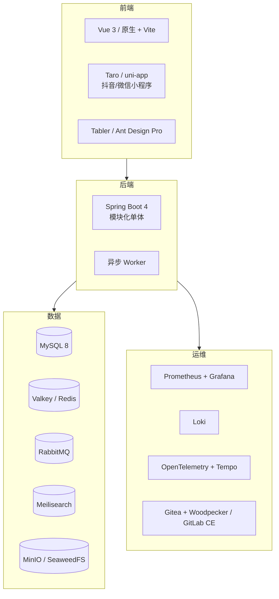

# BTR 开源技术选型

> 结论：**用开源做基础设施和商品化能力，自研赛事核心。**
> 原则：优先 Apache-2.0 / MIT / BSD；AGPL / SSPL / BUSL / FSL 商用前必须法务确认。
> 说明：许可证以各项目官方 LICENSE 为准，本文只做风险提示。

---

## 0. 一句话

**别重复造轮子：认证、存储、搜索、视频、证书、监控、CI 都用开源；但赛事模型、评审公信力、赞助履约、结算规则必须自己写。**

---

## 1. 选型原则

| 原则 | 说明 |
|---|---|
| 许可证优先 | Apache-2.0 / MIT / BSD 最安全；AGPL/SSPL/BUSL 慎用 |
| 社区活跃 | 最近 6 个月有提交、有版本、有安全公告 |
| 可替换 | 不把核心数据锁死在某个中间件 |
| 运维成本 | 4–6 人团队能维护，不引入过重组件 |
| 合规 | 支付、保险、征信、地图、短信必须用持牌/合规服务 |
| 自研边界 | 赛事规则、评审、赞助、结算、权限模型自研 |

---

## 2. 推荐架构



---

## 3. 分层清单

### 3.1 后端基础

| 用途 | 推荐 | 许可证（常见） | 说明 |
|---|---|---|---|
| 框架 | Spring Boot 4 | Apache-2.0 | 现有技术栈 |
| ORM | MyBatis-Plus | Apache-2.0 | 现有 |
| 迁移 | Flyway | Apache-2.0 | 替代手工 SQL |
| 定时锁 | ShedLock | Apache-2.0 | 多实例调度 |
| 分布式锁 | Redisson | Apache-2.0 | 防重复提交/并发 |
| 限流 | Bucket4j | Apache-2.0 | 接口限流 |
| 熔断 | Resilience4j | Apache-2.0 | 外部依赖降级 |
| API 文档 | springdoc-openapi | Apache-2.0 | OpenAPI 3 |
| 参数校验 | Jakarta Validation | Apache-2.0 | 标准 |
| 规则引擎 | Easy Rules | MIT | 轻量；复杂流程用 Flowable |
| 工作流 | Flowable | Apache-2.0 | 可选，别过度 |
| 状态机 | Spring StateMachine | Apache-2.0 | 可选；赛事状态机自研更可控 |

### 3.2 多租户与认证

| 用途 | 推荐 | 许可证 | 说明 |
|---|---|---|---|
| 认证授权 | Spring Security | Apache-2.0 | 现有 |
| JWT | JJWT | Apache-2.0 | 现有 |
| 租户隔离 | MyBatis-Plus TenantLine | Apache-2.0 | 行级隔离 |
| SSO | Keycloak | Apache-2.0 | 企业/协会 OIDC/SAML |
| 轻量 SSO | Casdoor | Apache-2.0 | 比 Keycloak 轻 |
| 权限模型 | 自研 RBAC | — | 租户/平台/赞助商三层 |
| 密码 | BCrypt | — | 现有 |

> 建议：P1 用 Spring Security + 自研租户；企业客户要 SSO 时再接 Keycloak。

### 3.3 数据、缓存、消息、搜索、存储

| 用途 | 推荐 | 许可证 | 说明 |
|---|---|---|---|
| 数据库 | MySQL 8 | GPLv2 + FOSS 例外 | 现有；自用不分发 |
| 缓存 | Valkey | BSD-3 | Redis 许可证变更后的开源替代 |
| 缓存（备选） | Redis 7 | RSALv2/SSPL | 商用需确认 |
| 消息 | RabbitMQ | MPL-2.0 | 邮件/导出/结算异步 |
| 消息（大流量） | Kafka | Apache-2.0 | 后期 |
| 搜索 | Meilisearch | MIT | 赛事/作品搜索 |
| 搜索（备选） | OpenSearch | Apache-2.0 | 日志/全文 |
| 对象存储 | MinIO | AGPL-3.0 | 自用可，商用需法务 |
| 对象存储（备选） | SeaweedFS | Apache-2.0 | 更安全 |
| 对象存储（备选） | Ceph | LGPL-2.1 | 重，后期 |
| CDC | Debezium | Apache-2.0 | 数据同步 |
| 连接池 | HikariCP | Apache-2.0 | 默认 |

> 对象存储如果对外提供 SaaS，MinIO 的 AGPL 需评估；不想折腾就用 SeaweedFS 或云 OSS。

### 3.4 支付、计费、商品

| 用途 | 推荐 | 许可证 | 说明 |
|---|---|---|---|
| 微信支付 | wechatpay-java | Apache-2.0 | 官方 SDK |
| 支付宝 | alipay-sdk-java | Apache-2.0 | 官方 SDK |
| 支付编排 | Hyperswitch | Apache-2.0 | 多支付渠道，可选 |
| 订阅计费 | Kill Bill | Apache-2.0 | 复杂订阅；P1 不需要 |
| 用量计费 | Lago | AGPL-3.0 | 商用需法务 |
| 发票 | 自研 + 税控服务 | — | 国内必须合规 |
| 电商引擎 | Medusa / Saleor / Sylius | MIT/BSD | 语言不同，集成成本高 |
| 电商（Java 参考） | lilishop / mall4j | Apache-2.0（需核实） | 参考，不建议直接套 |
| 电子签约 | DocuSeal | AGPL-3.0 | 商用需法务 |
| 电子签约（备选） | OpenSign | AGPL/其他 | 需核实 |

> **支付不要自研网关**：直接用持牌机构的 SDK/分账能力；平台不碰资金池。

### 3.5 视频、直播、内容

| 用途 | 推荐 | 许可证 | 说明 |
|---|---|---|---|
| 转码 | FFmpeg | LGPL/GPL（看编译） | 注意 GPL 构建 |
| 点播 | HLS + FFmpeg | — | 标准 |
| 播放器 | Plyr / Video.js / HLS.js | MIT/Apache-2.0 | 轻量 |
| 直播推流 | OBS | GPL-2.0 | 工具，不嵌入 |
| 直播服务器 | SRS | MIT | 轻量直播 |
| 直播服务器 | MediaMTX | MIT | RTSP/WebRTC |
| 互动直播 | LiveKit | Apache-2.0 | WebRTC |
| 图片处理 | imgproxy | Apache-2.0 | 裁剪/压缩 |
| 图片处理 | libvips | LGPL-2.1 | 高性能 |
| 内容审核 | 云服务 | — | 国内合规，别自建模型 |
| 短视频剪辑 | FFmpeg | — | 切片/封面 |

### 3.6 证书、文档、办公

| 用途 | 推荐 | 许可证 | 说明 |
|---|---|---|---|
| PDF 生成 | PDFBox | Apache-2.0 | 证书/报告 |
| PDF 生成（备选） | OpenPDF | LGPL/MPL | 注意 |
| PDF 生成（避免） | iText | AGPL-3.0 | 商用需买授权 |
| 二维码 | ZXing | Apache-2.0 | 证书验真 |
| 条码 | ZXing | Apache-2.0 | 签到/核销 |
| Office 预览 | LibreOffice headless | MPL-2.0 | 转换 PDF |
| Office 预览（前端） | docx-preview / SheetJS | MIT/Apache-2.0 | 轻量 |
| PDF 预览 | PDF.js | Apache-2.0 | 浏览器 |
| 在线 Office | OnlyOffice | AGPL-3.0 | 商用需法务 |
| 在线 Office（备选） | Collabora | MPL-2.0 | 需部署 |
| Excel 导出 | EasyExcel / POI | Apache-2.0 | 报名/成绩 |
| 图表 | ECharts | Apache-2.0 | 看板 |

### 3.7 前端、小程序、设计

| 用途 | 推荐 | 许可证 | 说明 |
|---|---|---|---|
| 构建 | Vite | MIT | 替代手工版本号 |
| 语言 | TypeScript | Apache-2.0 | 渐进迁移 |
| 框架 | Vue 3 / React | MIT | 二选一 |
| 组件 | Element Plus / Ant Design / Naive UI | MIT | 中后台 |
| 管理模板 | Tabler / Ant Design Pro | MIT | 快速搭后台 |
| 原生增强 | htmx / Alpine.js | MIT | 保留原生时用 |
| 小程序 | Taro / uni-app | MIT/Apache（核实） | 抖音/微信 |
| 富文本 | TipTap / wangEditor | MIT | 公告/规则 |
| 上传 | Uppy | MIT | 断点/进度 |
| 拖拽 | SortableJS / dnd-kit | MIT | 评分表排序 |
| 日历 | FullCalendar | MIT | 赛事日历 |
| 设计 | Penpot | MPL-2.0 | 设计协作 |
| 白板 | Excalidraw | MIT | 流程/架构图 |

### 3.8 可观测、运维、CI

| 用途 | 推荐 | 许可证 | 说明 |
|---|---|---|---|
| 指标 | Prometheus | Apache-2.0 | 标准 |
| 看板 | Grafana | AGPL-3.0 | 自用可，SaaS 需评估 |
| 日志 | Loki | AGPL-3.0 | 同上 |
| 追踪 | OpenTelemetry + Tempo | Apache-2.0/AGPL | Tempo 注意 |
| 追踪（备选） | Jaeger | Apache-2.0 | 安全 |
| APM | SkyWalking | Apache-2.0 | 国内生态 |
| 错误 | GlitchTip | MIT | Sentry 替代 |
| 错误（备选） | Sentry self-hosted | FSL | 商用需确认 |
|  uptime | Uptime Kuma | MIT | 监控 |
| 容器 | Docker | Apache-2.0 | 标准 |
| 编排 | K3s | Apache-2.0 | 多节点再上 |
| 网关 | APISIX / Kong | Apache-2.0 | 限流/鉴权 |
| 反向代理 | Nginx | BSD-2 | 现有 |
| CI | Gitea + Woodpecker | MIT/Apache | 轻量 |
| CI（备选） | GitLab CE | MIT | 重 |
| CD | Argo CD | Apache-2.0 | K8s 后 |
| IaC | OpenTofu | MPL-2.0 | Terraform 替代 |
| 配置 | Nacos / Apollo | Apache-2.0 | 可选 |
| 密钥 | Infisical / SOPS | MIT/MPL | Vault 是 BUSL，慎用 |
| 备份 | Restic | BSD-2 | 数据库/文件 |
| 压测 | k6 | AGPL-3.0 | 自用可 |
| 测试 | Testcontainers | MIT | 集成测试 |
| E2E | Playwright | Apache-2.0 | 主路径 |
| 代码质量 | SonarQube CE | LGPL-3.0 | 自用 |
| 安全扫描 | Trivy / Semgrep / ZAP | Apache/LGPL/Apache | CI 集成 |

### 3.9 安全与合规

| 用途 | 推荐 | 说明 |
|---|---|---|
| 依赖漏洞 | Dependency-Track / Trivy | CI |
| 密钥 | Infisical / SOPS | 不进 Git |
| WAF | ModSecurity + CRS | Nginx 前置 |
| 等保 | 云厂商合规能力 | 企业客户要求 |
| 实名 | 持牌服务商 | 不自己存身份证 |
| 短信 | 持牌服务商 | 不自己发 |
| 地图 | 高德/腾讯 | 不自己搭 |
| 电子签 | DocuSeal / 合规服务商 | 合同 |

### 3.10 协作与运营

| 用途 | 推荐 | 许可证 | 说明 |
|---|---|---|---|
| 文档 | VitePress / MkDocs | MIT | docs-as-code |
| Wiki | Wiki.js | AGPL-3.0 | 商用评估 |
| 客服 | Chatwoot | MIT | 工单/在线 |
| CRM | Twenty / EspoCRM | AGPL/GPL | 商用评估 |
| 通知 | Novu / Apprise | MIT/BSD | 多渠道 |
| 表单 | SurveyJS / Formbricks | MIT/AGPL | 报名表单 |
| 分析 | Umami / PostHog | MIT | 埋点 |
| BI | Superset / Metabase | Apache/AGPL | 看板 |
| 邮件 | Listmonk | AGPL | 营销邮件 |
| 状态页 | Uptime Kuma | MIT | 对外状态 |

---

## 4. 4–6 人团队的最小组合

```text
后端：Java 21 + Spring Boot 4 + MyBatis-Plus + Flyway + ShedLock + Redisson
数据库：MySQL 8 + Valkey
消息：RabbitMQ
搜索：Meilisearch
存储：SeaweedFS（或云 OSS）
前端：Vite + Vue 3 + TypeScript + Element Plus
管理后台：Tabler / Ant Design Pro
小程序：Taro（抖音/微信）
视频：FFmpeg + SRS + HLS.js / Plyr
证书：PDFBox + ZXing
监控：Prometheus + Grafana + Loki + OpenTelemetry
CI：Gitea + Woodpecker
测试：Testcontainers + Playwright + k6
文档：VitePress + springdoc-openapi
```

**先不上**：Kafka、K8s、ClickHouse、Keycloak、Flowable、OnlyOffice、Hyperswitch。等有明确瓶颈再加。

---

## 5. 许可证风险清单

| 许可证 | 风险 | 处理 |
|---|---|---|
| Apache-2.0 / MIT / BSD | 低 | 保留版权声明 |
| MPL-2.0 | 中 | 修改的文件需开源 |
| LGPL | 中 | 动态链接通常可，静态链接注意 |
| AGPL-3.0 | 高 | 网络服务也可能触发；商用前法务评估或买商业授权 |
| SSPL | 高 | 不能作为托管服务对外提供 |
| BUSL | 高 | 限制生产/托管使用 |
| FSL | 中高 | 限制竞争性使用 |
| GPL-2.0/3.0 | 高 | 分发/修改需开源 |

**高风险项目（务必核实）**：MinIO、Grafana、Loki、iText、OnlyOffice、DocuSeal、Lago、Metabase、Wiki.js、pretix、Hi.Events、n8n、Sentry、Vault、Terraform。

> 自用（不修改、不分发、不作为托管服务卖）通常风险低，但 SaaS 对外提供服务要逐项确认。

---

## 6. 不建议引入

| 组件 | 原因 |
|---|---|
| 完整电商引擎（Magento/Saleor/Medusa） | 与赛事模型耦合重，二次开发成本高于自研 |
| 通用工作流引擎（Camunda/Flowable） | 赛事状态机简单清晰，引入后更难维护 |
| 自建支付网关 | 牌照与合规风险，直接用持牌机构 |
| 自建短信/实名/地图 | 合规与成本都不划算 |
| 自建视频转码集群 | 先用 FFmpeg + 对象存储，量大再优化 |
| Elasticsearch | 数据量不大时 Meilisearch/MySQL FULLTEXT 足够 |
| Kubernetes | 单/双机用 Docker Compose + systemd 足够 |
| 微服务 | 模块化单体优先 |
| 低代码平台 | 会限制赛事规则与评审的深度 |

---

## 7. 自研 vs 开源边界

| 能力 | 开源 | 自研 |
|---|---|---|
| 认证 | Keycloak/Spring Security | 租户角色模型 |
| 支付 | 支付 SDK/分账 | 佣金/结算/退款规则 |
| 商品 | 参考电商引擎 | 赛事周边/参赛包/数字商品 |
| 视频 | FFmpeg/SRS/播放器 | 作品投稿/审核/双榜 |
| 证书 | PDFBox/ZXing | 证书模板/验真规则 |
| 搜索 | Meilisearch | 赛事/作品检索排序 |
| 监控 | Prometheus/Grafana | 业务指标 |
| 赛事 | — | 多轮/赛道/晋级/评审/赞助 |
| 评审 | — | 评分表/盲评/回避/仲裁 |
| 赞助 | — | 库存/投放/归因/结算 |

**一句话：通用能力买/用开源，赛事能力自己写。**

---

## 8. 落地顺序

| 阶段 | 引入 |
|---|---|
| P1 | Flyway、ShedLock、Redisson、springdoc、Meilisearch、SeaweedFS、Prometheus/Grafana/Loki、Gitea+Woodpecker、Testcontainers、Playwright |
| P1.5 | 支付 SDK、对账、电子签、Chatwoot |
| P2 | FFmpeg/SRS、PDFBox/ZXing、Superset、Taro 小程序 |
| P3 | OpenSearch/ClickHouse、Kafka、K8s、Keycloak、LiveKit |

---

## 9. 决策表

| 问题 | 建议 |
|---|---|
| 前端继续原生还是上框架？ | 渐进：Vite + Vue 3，先迁移公共组件 |
| 小程序用什么？ | Taro（字节/微信都能编） |
| 搜索用什么？ | Meilisearch |
| 对象存储用什么？ | 云 OSS 或 SeaweedFS；MinIO 需评估 AGPL |
| 支付用什么？ | 微信/支付宝官方 SDK + 持牌分账 |
| 电商自研还是开源？ | 自研轻量模块，别套完整电商引擎 |
| 监控用什么？ | Prometheus + Grafana + Loki + OTel |
| CI 用什么？ | Gitea + Woodpecker；团队大再上 GitLab |
| 要不要 K8s？ | 现阶段不要 |
| 要不要微服务？ | 不要，模块化单体 |

---

## 10. 结论

**开源能用，而且能省掉 60% 的重复工作。**
但记住三条：

1. **许可证先看**：AGPL/SSPL/BUSL 不要默认商用。
2. **核心自研**：赛事、评审、赞助、结算，别交给第三方。
3. **别过度引入**：4–6 人团队维护不了十几个中间件，先跑通再扩。
