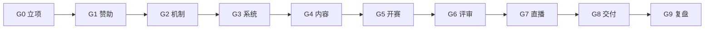
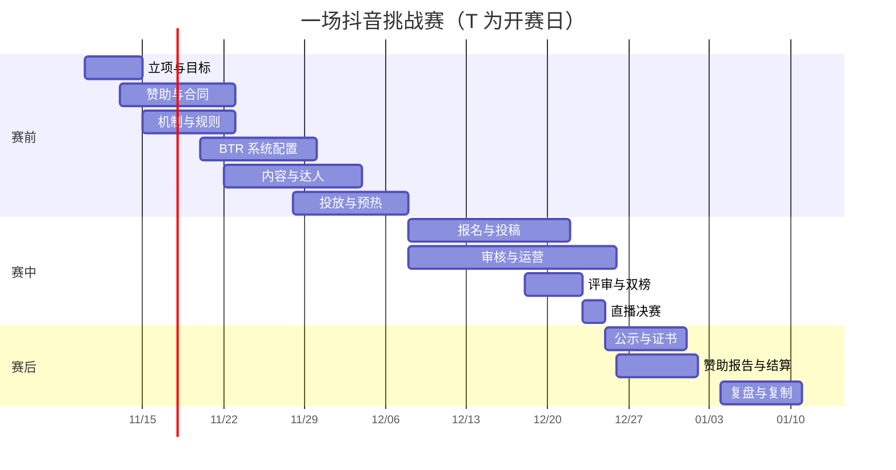

# 抖音挑战赛全流程 SOP（从立项到复盘）

> 适用：BTR 借力分发模式（抖音做流量/内容，BTR 做赛事系统）
> 周期：T-30 天立项 → T+30 天复盘，共约 8–9 周
> 用法：每个阶段有「输入 / 动作 / 产出 / 负责人 / 验收」，过门禁才进入下一阶段。

---

## 0. 总览



### 0.1 时间轴



### 0.2 阶段门禁

| 门禁 | 通过条件 | 不通过怎么办 |
|---|---|---|
| G0 立项 | 主目标、预算、负责人、时间确定 | 退回重定目标 |
| G1 赞助 | 至少 1 个赞助合同/意向 + 权益清单 | 降到无赞助试点 |
| G2 机制 | 规则、评分表、双榜、奖项定稿 | 不允许开赛 |
| G3 系统 | 报名→投稿→评审→榜单全链路演练通过 | 延期，不硬上 |
| G4 内容 | 官宣、达人、物料、投放就绪 | 至少保底 3 条内容 |
| G5 开赛 | 页面、审核、客服、监控就绪 | 延期 1–3 天 |
| G6 评审 | 评委到位、评分表锁定、异常处理完 | 延长评审 |
| G7 直播 | 彩排通过、双网络、备用方案 | 改录播 |
| G8 交付 | 榜单公示、证书、赞助报告 | 尾款暂缓 |
| G9 复盘 | 数据、问题、模板、下一步 | 不复制下一场 |

---

## 1. 阶段一：立项与目标（T-30 ~ T-25）

### 输入
- 赛事想法/往届资料
- 预算范围
- 潜在赞助商
- 可用达人/行业/企业/社群资源

### 动作
1. 确定**唯一主目标**：拉报名 / 收作品 / 做曝光 / 卖赞助。
2. 定义成功指标（见下表）。
3. 确定赛事定位：垂类、对象、地区、形式。
4. 盘点资源：人、钱、渠道、评委、场地。
5. 风险预审：合规、平台规则、版权、未成年人。
6. 指定负责人和 RACI。

### 产出
- 《一页纸立项书》（见附录 A）
- 目标与指标表
- 预算表
- 风险清单

### 验收
- 主目标只有一个。
- 预算与指标匹配。
- 每个角色有名字，不是“待定”。

---

## 2. 阶段二：赞助与合同（T-25 ~ T-15）

### 输入
- 立项书
- 赛事人群预估
- 往届数据（如有）

### 动作
1. 设计赞助包：联合 / 冠名 / 赛季。
2. 明确权益：Logo、话题联名、达人条数、直播口播、证书联名、数据报告。
3. 报价与底价，预留 20% 谈判空间。
4. 合同：排期、保量、素材授权、违约补偿、付款节点。
5. 收首款（建议 50%）。
6. 建立赞助商对接群与素材清单。

### 产出
- 赞助方案 PPT/一页纸
- 合同
- 权益清单（可验收）
- 首款凭证

### 验收
- 权益逐条可验收（数量、位置、时间）。
- 保量条款有补偿方案。
- 赞助商确认素材与审核流程。

---

## 3. 阶段三：机制与规则（T-20 ~ T-12）

### 输入
- 立项书
- 赞助权益
- 评审资源

### 动作
1. 定赛道/组别/参赛资格。
2. 定赛程：报名、投稿、评审、公示、直播。
3. 定评审：评分表、评委数量、盲评等级、聚合方式。
4. 定双榜：专业榜权重、人气榜口径、反刷规则。
5. 定奖项：专业奖、人气奖、赞助商奖。
6. 写规则页：资格、作品要求、版权、违规处理、申诉。
7. 法务/合规审核。

### 产出
- 赛事规则页
- 评分表
- 双榜计算公式
- 奖项表
- 申诉流程

### 验收
- 规则能回答选手 90% 的问题。
- 双榜口径无歧义。
- 违规与申诉有明确处理时限。

---

## 4. 阶段四：BTR 系统配置（T-15 ~ T-7）

### 输入
- 规则、评分表、奖项、赞助权益
- 视觉物料

### 动作

| # | 配置项 | 内容 | 负责人 |
|---|---|---|---|
| 1 | 赛事 | 标题、封面、简介、规则、时间 | 运营 |
| 2 | 报名 | 表单字段、资格校验、审核方式 | 运营 |
| 3 | 作品 | 视频/链接双提交、附件、授权声明 | 产品 |
| 4 | 话题 | 话题名、编号规则、提交入口 | 运营 |
| 5 | 评审 | 评分表、评委、盲评、分配 | 评审运营 |
| 6 | 双榜 | 专业/人气权重、反刷规则 | 产品 |
| 7 | 归因 | UTM、专属码、来源字段 | 投放 |
| 8 | 赞助位 | 冠名、Banner、榜单条、证书 Logo | 运营 |
| 9 | 证书 | 模板、变量、验真 | 运营 |
| 10 | 通知 | 报名成功、投稿成功、评审开始、成绩公布 | 产品 |

### 端到端演练（必须做）

```
匿名访问 → 注册/登录 → 报名 → 提交抖音链接 → 审核通过
→ 评委打分 → 人气折算 → 榜单展示 → 证书生成 → 赞助位展示 → 数据报表
```

### 产出
- 可用的赛事页、报名页、投稿页、榜单页
- 测试账号与测试数据
- 演练记录与问题清单

### 验收
- 全链路无阻断。
- 移动端 390px 可用。
- 赞助位与归因正常。
- 审核 SLA 可执行。

---

## 5. 阶段五：内容与达人（T-14 ~ T-3）

### 输入
- 规则、视觉、赞助素材
- 达人名单

### 动作
1. 官宣视频（15–30 秒）+ 竖屏海报 + 长图。
2. 达人 brief：必说话题、报名入口、奖项、禁忌。
3. 行业 KOL/社群主理人招募与培训。
4. 内容日历：每天发什么、谁发、带什么码。
5. 素材审核：品牌、平台规则、广告法。
6. 建立素材库与复用规范。

### 产出
- 官宣片 1 条 + 切片 5 条
- 海报 3 套
- 达人排期表
- 内容日历

### 验收
- 所有内容含话题、时间、报名入口。
- 达人内容 100% 过审。
- 至少 3 条保底内容。

---

## 6. 阶段六：投放与预热（T-10 ~ T-1）

### 输入
- 内容素材
- 预算
- 人群假设

### 动作
1. 建投放计划：目标、人群、地域、预算。
2. 20% 预算测试 3–5 条素材/人群（3 天）。
3. 放大有效组合（60%）。
4. 长尾/复投（20%）。
5. 落地页 A/B：首屏文案、按钮、奖项展示。
6. 每日看数据：CTR、报名成本、投稿成本。
7. 预热节奏：倒计时、评委官宣、奖品开箱、往届回顾。

### 产出
- 投放计划与预算表
- 素材测试结果
- 预热内容排期

### 验收
- 至少 1 条素材 CTR 达标。
- 报名成本在预算内。
- 落地页移动端 3 秒可操作。

---

## 7. 阶段七：报名与投稿运营（T-0 ~ T+14）

### 每日节奏

| 时间 | 动作 | 负责人 |
|---|---|---|
| 09:30 | 看板：报名/投稿/流量/异常 | 运营 |
| 10:00 | 审核队列清零（24h SLA） | 审核 |
| 11:00 | 达人内容发布/验收 | 达人 BD |
| 14:00 | 投放优化/换素材 | 投放 |
| 16:00 | 社群答疑/催稿 | 运营 |
| 18:00 | 日报 | 运营 |
| 20:00 | 直播/连麦/答疑（可选） | 内容 |

### 关键动作
1. 审核：内容合规、链接有效、授权完整。
2. 催稿：报名未投稿、投稿未通过、临近截止。
3. 异常：刷量、抄袭、侵权、违规内容。
4. 客服：FAQ、退款/取消、技术问题。
5. 数据：每日报名、投稿、来源、成本。
6. 榜单：人气榜每日更新，专业榜不提前泄露。

### 产出
- 每日日报
- 审核记录
- 异常处理记录
- 投稿池

### 验收
- 审核 24h 内完成率 ≥ 95%。
- 报名→投稿转化 ≥ 60%。
- 异常 24h 内处理。

---

## 8. 阶段八：评审与双榜（T+7 ~ T+12）

### 动作
1. 锁定评分表与评委分配。
2. 盲评：隐藏姓名/单位（按等级）。
3. 评委打分，系统算加权分。
4. 人气折算：播放/互动去水后按规则计算。
5. 反刷复核：异常账号、异常峰值。
6. 专业榜 + 人气榜生成。
7. 争议作品复核与留痕。
8. 生成公示名单。

### 产出
- 专业榜
- 人气榜
- 评分明细
- 异常报告
- 公示名单

### 验收
- 评分表锁定后无改动。
- 加权分与手工复核一致。
- 人气异常有处理记录。
- 公示名单可追溯。

---

## 9. 阶段九：直播决赛（T+12 ~ T+14）

### 赛前 48 小时
- 彩排 1 次，走完整流程。
- 检查：网络（主备）、声音、画面、榜单贴片、提词器、计时器。
- 确认：评委到场、选手连线、赞助商口播、抽奖合规。

### 直播流程（60–90 分钟）

| 时间 | 环节 | 负责人 |
|---|---|---|
| 0–5 | 开场、赛事介绍、赞助商口播 | 主持 |
| 5–15 | 规则、评委介绍 | 主持 |
| 15–55 | 作品展示 + 点评 + 打分 | 评委/技术 |
| 55–70 | 互动、抽奖、赞助商权益 | 运营 |
| 70–85 | 榜单公布、颁奖 | 主持 |
| 85–90 | 收尾、证书/回放入口 | 主持 |

### 产出
- 直播回放
- 高光切片 5–10 条
- 获奖名单
- 赞助露出截图/录屏

### 验收
- 直播无中断（或 5 分钟内恢复）。
- 打分与榜单实时一致。
- 赞助权益全部露出并留证。

---

## 10. 阶段十：公示、证书与结算（T+14 ~ T+20）

### 动作
1. 公示 7 天：榜单、分数、奖项、申诉入口。
2. 处理申诉：受理 → 复核 → 回复 → 结案。
3. 生成证书：批量 PDF + 验真二维码。
4. 发送通知：获奖、证书、感谢。
5. 赞助报告：曝光、互动、报名、投稿、内容量、ROI。
6. 内容资产交付：切片、海报、数据。
7. 尾款结算：按合同与验收清单。
8. 数据归档：赛事、作品、评分、日志。

### 产出
- 公示页
- 证书
- 赞助报告
- 尾款发票
- 归档包

### 验收
- 公示无重大异议。
- 证书可验真。
- 赞助权益验收单签字。
- 尾款到账。

---

## 11. 阶段十一：复盘与复制（T+21 ~ T+30）

### 动作
1. 数据复盘：曝光→报名→投稿→完赛→成本→ROI。
2. 达人复盘：谁带来报名/投稿，CPM/CPE。
3. 内容复盘：哪类素材有效。
4. 流程复盘：卡点、延期、事故。
5. 赞助复盘：权益完成度、续约意向。
6. 沉淀模板：规则、评分表、脚本、投放、报告。
7. 决定：复制 / 调整 / 停止；是否做小程序。
8. 更新 SOP 到 v2。

### 产出
- 复盘报告
- 模板包
- 下一场排期
- Go/No-Go 决策

### 验收
- 每个数字有来源。
- 每个问题有负责人和截止时间。
- 下一场能复用 70% 以上。

---

## 12. RACI

| 事项 | 赛事负责人 | 内容运营 | 投放 | 达人 BD | 评审运营 | 产品/技术 | 赞助商 |
|---|---|---|---|---|---|---|---|
| 立项/目标 | A | R | C | C | C | C | I |
| 赞助合同 | A | C | I | I | I | I | R |
| 规则/评分表 | A | C | I | I | R | C | I |
| 系统配置 | I | C | I | I | C | R | I |
| 内容/达人 | I | R | C | R | I | I | C |
| 投放 | I | C | R | C | I | C | I |
| 报名/投稿运营 | A | R | C | C | I | C | I |
| 评审/双榜 | I | I | I | I | R | C | I |
| 直播 | A | R | C | C | C | R | C |
| 公示/证书 | A | R | I | I | C | R | I |
| 赞助报告 | A | C | C | C | I | C | R |
| 复盘 | A | R | R | R | R | R | C |

> R=执行，A=最终负责，C=咨询，I=知会。

---

## 13. 完成定义（DoD）

### 一场赛事完成
- [ ] 有效投稿 ≥ 目标
- [ ] 评审 100% 完成
- [ ] 双榜生成且可追溯
- [ ] 公示满 7 天
- [ ] 证书可验真
- [ ] 赞助报告交付
- [ ] 尾款到账
- [ ] 数据归档
- [ ] 复盘报告完成

### 平台侧完成
- [ ] 赛事模板可复用
- [ ] 评分表可复用
- [ ] 内容模板可复用
- [ ] 归因数据完整
- [ ] 用户/作品资产沉淀
- [ ] SOP 更新

---

## 14. 风险与升级路径

| 风险 | 触发信号 | 升级动作 |
|---|---|---|
| 报名不足 | 开赛 3 天报名 < 目标 30% | 加投放/达人/延期 3 天 |
| 投稿不足 | 截止前 3 天 < 目标 50% | 催稿、延长、降低门槛 |
| 刷量 | 人气异常峰值 | 冻结榜单、人工复核 |
| 审核积压 | 队列 > 50 | 加人、临时延长 SLA |
| 赞助不满 | 权益未达保量 | 补量、加达人、延期 |
| 直播事故 | 断流 > 5 分钟 | 切备用网络/录播 |
| 合规问题 | 违规内容/投诉 | 下架、留证、法务介入 |

---

## 15. 附录 A：一页纸立项书

```text
赛事名称：
一句话定位：
主目标（只选一个）：
成功指标：
参赛对象：
时间：报名 __ / 投稿 __ / 评审 __ / 公示 __ / 直播 __
预算：
赞助商：
负责人：
关键资源：
主要风险：
不做的事：
```

## 16. 附录 B：赞助权益验收清单

```text
[ ] 赛事页 Logo
[ ] 话题联名
[ ] 官宣视频口播
[ ] 达人 __ 条
[ ] 直播口播 __ 次
[ ] 榜单赞助条
[ ] 证书 Logo
[ ] 邮件/站内信露出
[ ] 数据报告
[ ] 内容切片授权
[ ] 保量：曝光 __ / 点击 __ / 报名 __
```

## 17. 附录 C：日报模板

```text
日期：
曝光：
点击：
报名：
投稿：
审核通过：
异常：
花费：
CAC：
今日动作：
明日计划：
```

## 18. 附录 D：复盘模板

```text
赛事：
周期：
主目标：
投入：
曝光 / 互动 / 落地 / 报名 / 投稿 / 完赛：
CAC / 单作品成本：
达人 TOP3：
素材 TOP3：
赞助权益完成度：
问题：
改进：
是否复制：
是否做小程序：Go / No-Go
```

---

## 19. 报名费与商品（可选，P1.5/P2）

> 只有平台已开通交易能力时使用；免费赛事跳过本节。

### 19.1 赛前

- [ ] 确定是否收费、金额、早鸟/团体价
- [ ] 写清退款规则（截止前全退/截止后按比例）
- [ ] 确认收款主体（企业/协会授权/合作企业/主办方商户号）
- [ ] 选商品：官方周边 / 参赛包 / 数字商品 / 赞助商寄售
- [ ] 定价格、库存、发货时效、售后规则
- [ ] 商品页与报名页分离，不强制购买

### 19.2 赛中

- [ ] 每日核对支付成功/失败/退款
- [ ] 报名支付失败提醒与重试
- [ ] 商品订单发货、物流回传
- [ ] 数字商品下载链接有效
- [ ] 异常订单（刷单/套现）人工审核

### 19.3 赛后

- [ ] 报名费结算（T+7，扣佣金/通道费/退款）
- [ ] 商品结算（确认收货 T+7）
- [ ] 退款/售后结案
- [ ] 发票：平台服务费、报名费、商品分别开具
- [ ] 对账：支付机构流水 vs 平台订单
- [ ] 将交易数据并入赞助报告（可选）

### 19.4 红线

- 平台不沉淀资金，不做“二清”。
- 不把商品绑报名资格。
- 不虚标价格、不刷单。
- 未成年人支付需监护人同意。
- 退款必须原路退回。
