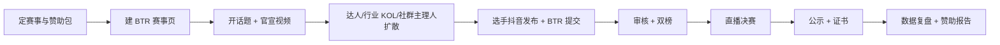

# 抖音挑战赛运营手册

> 适用模式：B · 借力分发（BTR 是赛事中台，抖音是投稿/传播/直播渠道）
> 适用赛事：企业创新、行业技能、品牌挑战、社区兴趣、短视频创作、美食、公益等可视频化赛事
> 原则：不依赖单一平台、不把点赞当评审、不做抖音-only 账号体系
> 说明：抖音开放平台与广告产品规则会变化，执行前以官方最新政策为准。

---

## 0. 一页流程



**核心链路**

> 抖音看到 → 点进 BTR 落地页 → 报名 → 发布作品带话题 → 回 BTR 提交链接 → 评审/人气 → 直播决赛 → 证书/榜单。

---

## 1. 角色与分工

| 角色 | 职责 | 配置 |
|---|---|---|
| 赛事负责人 | 目标、预算、赞助、最终决策 | 1 |
| 内容运营 | 话题、脚本、官宣、达人、剪辑 | 1–2 |
| 投放 | 巨量引擎、预算、素材测试 | 1（可外包） |
| 达人 BD | 选人、报价、合同、履约 | 1（可兼） |
| 评审运营 | 评委、评分表、双榜规则 | 1 |
| 技术/产品 | BTR 页面、投稿、归因、直播打分 | 1 |
| 赞助商对接 | 权益、素材、审核、报告 | 1 |
| 法务/合规 | 广告、版权、未成年人、投票 | 兼职 |

> 最小配置 3 人：内容运营 + 投放 + 赛事负责人；达人 BD 可先用行业 KOL/社群主理人替代。

---

## 2. 赛前：先想清楚三件事

### 2.1 赛事目标（只能选一个主目标）

| 目标 | 主指标 | 适合 |
|---|---|---|
| 拉报名 | 报名数、报名成本 | 新赛事、冷启动 |
| 收作品 | 有效投稿数、完赛率 | 作品赛、设计赛 |
| 做曝光 | 播放、互动、话题量 | 品牌赞助赛 |
| 卖赞助 | 赞助收入、ROI | 有赞助商 |

> 主目标超过一个，执行一定散。P1 建议：**先做「有效投稿数」**，因为它最能证明平台价值。

### 2.2 赞助包设计

| 档位 | 价格（示意） | 权益 |
|---|---|---|
| 联合赞助 | ¥30k–50k | Logo、话题联名、2 条达人、报告 |
| 冠名 | ¥80k–150k | 赛事冠名、直播口播、证书联名、5 条达人、投放素材 |
| 赛季包 | ¥200k–300k | 多场赛事、品牌挑战赛、人才榜、季度报告 |

**必须写进合同**：曝光量级、达人数量、直播场次、素材授权、数据报告、排期、违约补偿。

### 2.3 预算分配（示意）

| 项 | 占比 | 说明 |
|---|---|---|
| 达人 | 30% | 行业 KOL + 社群主理人 |
| 投放 | 30% | 短视频加热 + 直播投流 |
| 内容制作 | 15% | 官宣片、海报、剪辑 |
| 奖品/证书 | 15% | 赞助商可置换 |
| 运营/工具 | 10% | 审核、客服、直播技术 |

---

## 3. 赛事机制设计

### 3.1 话题命名

- 统一格式：`#BTR{赛事名}{年份}` + `#品牌名`
- 示例：`#BTR企业创新赛2027` `#XX品牌创意挑战`
- 话题简介写清：参赛方式、截止时间、BTR 报名链接。
- 话题不要带敏感词、绝对化用语、诱导性表述。

### 3.2 参赛方式（双提交）

1. 选手在抖音发布作品，带官方话题 + 赛事编号。
2. 选手回到 BTR 赛事页，提交：
   - 抖音链接
   - 作品标题/说明
   - 授权声明（允许赛事展示/剪辑）
   - 可选：源文件
3. BTR 审核通过后进入榜单。
4. 未在 BTR 提交的抖音作品，不进入评审（防止刷量）。

### 3.3 双榜规则

| 榜单 | 权重 | 决定 | 数据来源 |
|---|---|---|---|
| 专业榜 | 70% | 奖项 | 评委评分表 |
| 人气榜 | 30% | 人气奖/展示位 | 播放、点赞、评论、分享（去水） |

- 专业榜是主榜，人气榜只做副榜。
- 人气数据由 BTR 按规则折算，不直接展示平台原始点赞。
- 反刷：设备/IP/行为/时间聚类；异常账号剔除；人气奖可设人工复核。
- 明确写在规则页：**禁止付费刷量、互赞群、机器账号**。

### 3.4 奖项设计

- 专业奖：一/二/三等奖、最佳创意、最佳技术、最佳展示。
- 人气奖：最佳人气、最佳传播、行业传播奖。
- 赞助商奖：品牌选择奖（赞助商可提名，但需评委复核）。
- 所有奖项公示评委 composition 与评分维度。

### 3.5 赛程模板（4 周）

| 周 | 动作 |
|---|---|
| W1 | 官宣、报名开启、达人造势 |
| W2 | 投稿高峰、话题挑战、第一轮推荐 |
| W3 | 投稿截止、初审、人气榜 |
| W4 | 直播决赛、评审、公示、证书 |

---

## 4. 内容脚本模板

### 4.1 官宣视频（15–30 秒）

```
0–3s   钩子：一句话说清奖品/机会
3–8s   这是什么赛：主题、对象、门槛
8–15s  怎么参加：带话题 + BTR 报名（口播 + 字幕）
15–20s 时间节点 + 奖项
20–30s 行动号召：点击/扫码/评论区
```

**字幕必须出现**：话题名、截止时间、报名方式。

### 4.2 达人 brief（给 KOL/社群主理人）

- 必须口播：赛事名、话题、报名入口。
- 必须展示：BTR 页面/二维码/奖项。
- 创意自由：允许剧情、测评、vlog、挑战。
- 禁止：虚假承诺、绝对化用语、诱导充值、未成年人饮酒等。
- 交付：1 条主视频 + 1 条切片 + 3 张图。
- 发布后 24 小时内提供数据截图。

### 4.3 选手参赛模板

```
标题：作品名 + 一句话亮点
正文：灵感 / 过程 / 亮点 / 致谢
话题：#BTRxxx #品牌名
@BTR官方账号
```

### 4.4 直播决赛台本（60–90 分钟）

| 时间 | 环节 | 负责人 |
|---|---|---|
| 0–5 | 开场、赛事介绍、赞助商口播 | 主持 |
| 5–15 | 规则与评委介绍 | 主持 |
| 15–55 | 作品展示 + 评委点评 + 打分 | 评委/技术 |
| 55–70 | 观众互动、抽奖、赞助商权益 | 运营 |
| 70–85 | 榜单公布、颁奖 | 主持 |
| 85–90 | 收尾、证书/回放入口 | 主持 |

---

## 5. 达人合作

### 5.1 选人标准

| 维度 | 建议 |
|---|---|
| 领域匹配 | 与赛事主题一致（设计/科技/行业/美食） |
| 粉丝量 | 社群主理人 1k–1w；垂类达人 1w–50w；头部按预算 |
| 互动率 | ≥ 3% 优先，不看纯粉丝数 |
| 内容质量 | 有剧情/测评/教程能力，不是纯口播 |
| 风险 | 无违规历史、无争议言论、粉丝画像匹配 |
| 报价 | 按 CPM/CPE 或一口价，签合同 |

### 5.2 合作方式

- 社群主理人/企业大使：按效果付费（专属码报名/投稿），低成本铺量。
- 垂类达人：一口价 + 效果奖金。
- 评委/专家：专业背书，直播连麦。
- 赞助商达人：品牌提供，BTR 负责赛事植入。

### 5.3 归因

- 每个达人一个专属码/链接（UTM）。
- 报名表单加「从哪里看到」字段。
- 直播挂载 BTR 页面/小程序。
- 报告区分：自然、达人、投放、站内。

---

## 6. 投放（巨量引擎）

### 6.1 目标选择

| 目标 | 适用 | 优化指标 |
|---|---|---|
| 视频加热 | 官宣/达人内容 | 播放、互动 |
| 落地页/线索 | 报名 | 表单提交、报名 |
| 直播投流 | 决赛 | 观看、停留、转化 |
| 小程序推广 | 小程序阶段 | 访问、报名 |

### 6.2 人群与地域

- 地域：赛事覆盖企业/城市优先。
- 年龄：按赛事受众（社会赛事 22–45）。
- 兴趣：设计、编程、行业、美食等。
- 排除：已报名用户（减少浪费）。
- 不做敏感属性定向。

### 6.3 预算节奏

- 20% 测试素材/人群（3 天）。
- 60% 放大有效组合。
- 20% 长尾/复投。
- 单条素材跑量下降 30% 即换。

### 6.4 落地页

- 首屏：赛事名、奖品、时间、报名按钮。
- 中段：赛道、评委、往届、赞助商。
- 底部：FAQ、隐私政策、主办方信息。
- 移动端优先，3 秒内可操作。

---

## 7. 直播决赛

### 7.1 技术清单

- 推流：OBS/直播伴侣，备用 4G/5G。
- 画面：主机位 + 特写 + 榜单贴片。
- 声音：领夹麦 + 备用麦。
- 提词器、计时器、打分表。
- 直播助理：盯评论、上链接、截屏、记录异常。
- 录屏：全程备份，用于切片与复盘。

### 7.2 互动与转化

- 每 10 分钟一次口播报名/投票入口。
- 抽奖要求：关注 + 评论 + 报名（合规）。
- 赞助商口播 2–3 次，不打断评审。
- 直播后 24 小时内发高光切片。

---

## 8. 审核与合规

| 项 | 要求 |
|---|---|
| 广告标识 | 赞助内容标「赞助/广告」，不伪装官方 |
| 绝对化用语 | 禁止「第一/最强/国家级」等 |
| 未成年人 | 监护人同意；不诱导充值/打赏 |
| 投票 | 不得付费投票、不得诱导充值；人气仅作副榜 |
| 版权 | 选手授权赛事展示/剪辑；BGM 用平台曲库 |
| 隐私 | 手机号/单位不公开展示；简历需授权 |
| 内容 | 违法、低俗、暴力、歧视、赌博一律拒绝 |
| 平台规则 | 以抖音社区规范与开放平台政策为准 |

**审核流程**：机器初审 → 人工复核 → 申诉 → 终审；全程留痕。

---

## 9. 数据与归因

### 9.1 指标定义

| 指标 | 定义 |
|---|---|
| 播放量 | 视频有效播放 |
| 完播率 | 看完/播放 |
| 互动率 | (赞+评+转)/播放 |
| 落地 CTR | 点击 BTR 链接/播放 |
| 报名转化 | 报名/落地访问 |
| 投稿转化 | 有效投稿/报名 |
| CAC | 总投入/新增报名 |
| 单作品成本 | 总投入/有效作品 |
| 赞助 eCPM | 赞助收入/曝光×1000 |
| 赞助 ROI | 赞助带来价值/赞助金额 |

### 9.2 归因方式

- 抖音主页/视频挂载 BTR 链接（带 UTM）。
- 二维码（达人专属、海报专属）。
- 报名表单「来源」字段。
- 专属优惠码/报名码。
- 直播挂载与口播暗号。

### 9.3 报表节奏

- 日报：播放、点击、报名、投稿、异常。
- 周报：达人排行、素材排行、转化漏斗。
- 赛后：赞助报告（曝光/互动/报名/作品/内容量/ROI）。

---

## 10. 复盘模板

```text
赛事：
周期：
主目标：
投入：
曝光 / 互动 / 落地 / 报名 / 投稿 / 完赛：
CAC / 单作品成本：
达人贡献 TOP3：
素材贡献 TOP3：
赞助权益完成度：
问题：
下次改进：
是否做小程序：Go / No-Go
```

---

## 11. 30/60/90 天排期

| 阶段 | 重点 | 产出 |
|---|---|---|
| 0–30 天 | 1 场试点赛 + 1 个赞助 | 跑通链路、拿到基线 |
| 31–60 天 | 3 场同垂直赛事 + 达人矩阵 | 可复制模板、成本下降 |
| 61–90 天 | 赛季包 + 直播决赛 | 赞助报告、Go/No-Go |

---

## 12. Checklist

### 赛前

- [ ] 赛事目标与主指标确定
- [ ] 赞助合同/权益清单
- [ ] BTR 赛事页、报名、投稿、双榜配置
- [ ] 话题名、编号规则、审核规则
- [ ] 官宣视频、海报、达人 brief
- [ ] 投放计划与预算
- [ ] 合规审核（广告/未成年人/版权）
- [ ] 客服与 FAQ

### 赛中

- [ ] 每日数据看板
- [ ] 达人内容验收
- [ ] 投稿审核 SLA（24h）
- [ ] 异常流量监控
- [ ] 赞助商露出检查
- [ ] 直播彩排

### 赛后

- [ ] 榜单公示与申诉窗口
- [ ] 证书生成
- [ ] 赞助报告
- [ ] 高光切片
- [ ] 复盘会
- [ ] 下一场复制清单

---

## 13. 常见坑

| 坑 | 后果 | 规避 |
|---|---|---|
| 只发话题不收链接 | 无法评审、无法防刷 | 双提交 |
| 把点赞当主榜 | 刷量、专业性崩 | 双榜，专业为主 |
| 达人只看粉丝量 | 钱花了没转化 | 看互动率与画像 |
| 落地页太长 | 转化低 | 首屏报名 |
| 审核不及时 | 选手流失 | 24h SLA |
| 直播无备用网络 | 事故 | 双线路 + 录播 |
| 赞助权益没留证 | 尾款难收 | 截图/录屏/报告 |
| 不做归因 | 无法证明 ROI | 专属码 + UTM |
| 过早做小程序 | 审核卡壳、成本高 | 先 H5 验证 |

---

## 14. 附：可直接复用的文案

### 14.1 话题简介

```
#BTR{赛事名}{年份} 正式开启！
主题：{主题}
对象：{对象}
参与：抖音发布作品带话题，并到 BTR 赛事页提交链接
时间：{开始}–{截止}
奖项：{奖项}
报名：{链接}
```

### 14.2 报名页首屏

```
{赛事名}
{一句话价值}
报名截止：{日期}
[立即报名]
已有 {N} 人参加 · {M} 件作品
```

### 14.3 赞助商报告开头

```
{赞助商} × {赛事}
投放周期：{起止}
曝光：{X}  互动：{Y}  报名：{Z}  作品：{W}
内容资产：{N} 条视频 / {M} 张图
ROI：{...}
```
