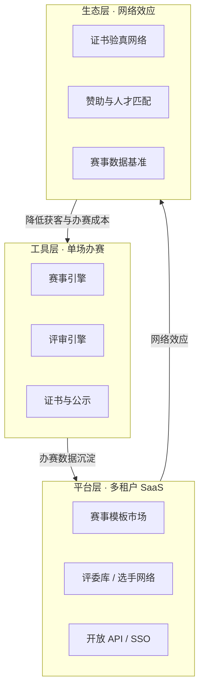
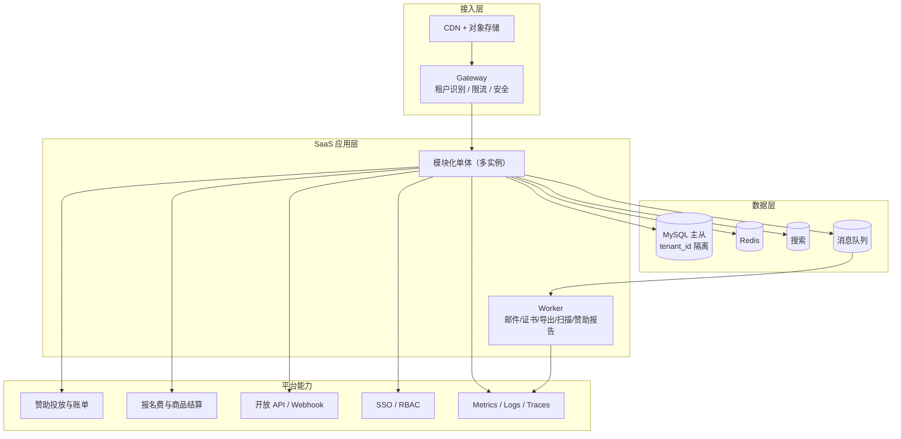
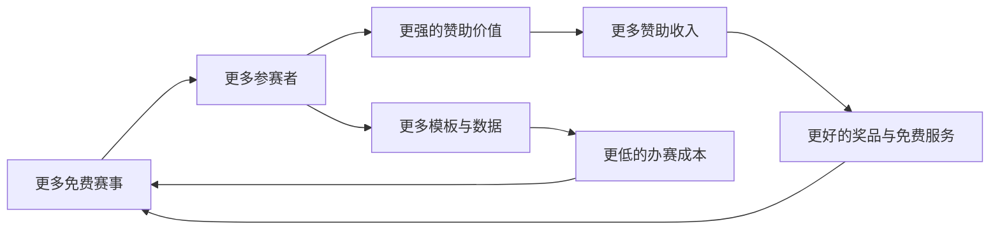
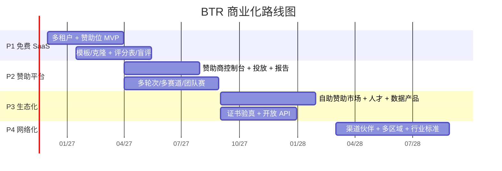

# BTR 满血版 2.0 · 赛事云与赛事生态

> 重写说明：上一版是工程蓝图，回答「怎么建」；本版按平台化/商业化重写，回答三个问题——**靠什么赢、靠什么赚钱、怎么长成网络**。
> 定位：不是「赛事管理后台」，而是**赛事基础设施**。让办一场赛，像开一家店一样简单。

---

## 0. 一句话

**BTR = 赛事操作系统 + 赛事云 + 赛事生态。**

- 对主办方：30 分钟办一场赛，模板复用、评审可信、结果可传播。
- 对评委：一个账号接全国赛事，信用可积累。
- 对选手：一个身份参加所有赛事，职业档案可验证。
- 对赞助商：精准触达参赛人群。
- 对协会/机构：一个统一赛事门户，数据成为资产。

目标不是多一个功能，而是成为**赛事行业的默认入口**。

---

## 1. 为什么是现在

| 维度 | 变化 |
|---|---|
| 需求 | 企业、行业协会、政府/园区、品牌、社区赛事数量持续增长，但工具仍停留在「问卷 + 网盘 + Excel + 微信群」 |
| 供给 | AI 把开发成本打下来，小团队也能做出平台级产品 |
| 信任 | 评审不透明、证书无验证、成绩难追溯，已经成为赛事规模化的瓶颈 |
| 空白 | 市场缺一个「赛事版 Shopify + 评委版 Uber + 证书版 Credly」的组合 |

**时机判断**：谁先把「赛事资产（模板/评委/选手/证书）」沉淀成网络，谁就拿到复利。

---

## 2. 市场与客户

### 2.1 客户分层

| 客群 | 典型场景 | 痛点 | 赞助/商业化潜力 |
|---|---|---|---|
| 中大型企业 | 创新赛、黑客松、技能赛 | 活动没沉淀、评审不专业、数据不可用 | 很高（服务/赞助/采购） |
| 行业协会 / 学会 | 行业技能赛、案例赛 | 评审靠人情、证书无验证、会员服务弱 | 高（会员/赛事服务） |
| 赛事执行公司 / 营销代理 | 客户赛事代运营 | 每场重复搭系统、客户要数据 | 高（白标/项目分成） |
| 政府 / 园区 | 创新创业赛、人才赛 | 多轮次、多赛道、公信力、审计 | 高（项目制） |
| 品牌 / 商场 / 媒体 | 品牌挑战赛、UGC 赛 | 传播不可测、转化不可归因 | 很高（赞助/挑战赛） |
| 社区 / 兴趣社群 | 摄影、跑步、电竞、才艺 | 报名/投票/收款零散 | 中（交易佣金） |
| 培训机构 | 招生赛、作品赛 | 需要品牌页、线索收集、证书 | 高（自费/联名） |

### 2.2 切入点

**先打透一个垂直场景：企业创新赛 / 黑客松。**
理由：预算明确、赞助意愿强、视频传播好、评审要求高，可复制到行业协会与品牌挑战赛。

---

## 3. 价值主张（按角色）

| 角色 | 现在 | 用了 BTR |
|---|---|---|
| 主办方 | Excel + 网盘 + 微信群，办一次累一次 | 模板 30 分钟建赛，全流程自动推进 |
| 评委 | 邮件收作品，手工算分 | 一屏打分，标准统一，进度可见 |
| 选手 | 到处找赛事，报名表填 N 遍 | 一个账号，订阅提醒，成长档案 |
| 赞助商 | 曝光靠横幅，效果靠感觉 | 精准人群、可量化曝光与简历触达 |
| 协会/机构 | 赛事散落，数据不留存 | 统一门户，赛事资产与数据沉淀 |
| 证书接收方 | 无法验证真伪 | 扫码验真，链上/编号可查 |

---

## 4. 三层飞轮

- **工具层**解决「办得成」，靠免费获客。
- **平台层**解决「办得快」，靠模板与网络降低边际成本。
- **生态层**解决「离不开」，靠证书、赞助、数据形成壁垒。

---

## 5. 产品矩阵（八个引擎）

| 引擎 | 一句话 | 壁垒 |
|---|---|---|
| 赛事引擎 | 系列赛 / 多轮次 / 多赛道 / 团队赛 | 模型复杂度，复制成本高 |
| 评审引擎 | 评分表 / 盲评 / 回避 / 校准 / 仲裁 / 申诉 | 公信力与审计，难被替代 |
| 参赛者网络 | 发现 / 组队 / 作品集 / 成长档案 | 用户资产与复访 |
| 赛事资产市场 | 模板 / 评分表 / 页面主题 / 证书模板 | 创作者生态，越用越丰富 |
| 赞助与传播 | 公开主页 / SEO / 分享 / 赞助位 / 人才榜 | 流量与广告主 |
| 平台底座 | 多租户 / 赞助投放 / 交易结算 / 公平额度 / API / Webhook / SSO | 切换成本 |
| 数据智能 | 漏斗 / 基准 / 评委匹配 / 异常检测 / 报告 | 数据网络效应 |
| 服务网络 | 评委接单 / 服务商 / 培训认证 | 双边市场 |

---

## 6. 商业化设计：平台使用免费，交易与赞助变现

### 6.1 为什么平台免费

- **赛事供给是稀缺的**：收费会直接劝退中小企业、协会和社区主办方，规模起不来。
- **主办方预算差异大**：订阅制会把小赛事挡在门外，交易抽佣更顺。
- **社会赛事客单价更高**：报名费、商品、赞助都能产生流水，平台按结果收费。
- **免费换规模，规模换赞助**：只有先把赛事和参赛者聚起来，赞助才有价值。
- **免费不等于无成本**：用公平使用额度（存储/短信/证书）控制滥用，不做付费墙。

### 6.2 三层收入

| 层级 | 收入 | 说明 | 占比目标（3 年） |
|---|---|---|---|
| 核心 | 赞助 | 冠名、广告位、联名证书、赛季合作 | 50% |
| 第二 | 报名费佣金 | 代收报名费，按 2%–5% 抽成 | 20% |
| 第三 | 商品 | 赛事周边、参赛包、赞助商商品、数字商品 | 15% |
| 第四 | 人才与数据 | 招聘、人才榜、简历授权、行业报告 | 5% |
| 第五 | 服务与生态 | 赞助执行、赛事服务、白标/私有化、模板/插件分成 | 10% |

### 6.3 赞助产品（卖什么）

| 产品 | 内容 | 计价 | 客户 |
|---|---|---|---|
| 年度赞助会员 | 全年库存优先权、数据后台、专属客户成功 | ¥30k / ¥100k / ¥300k 每年 | 品牌、企业 |
| 赛事冠名 | 单场/赛季冠名、Logo、证书联名、颁奖露出 | ¥20k–200k / 场 | 企业、机构 |
| 广告位 | 首页、赛事列表、详情、榜单、证书、邮件 | CPM ¥20–50 或 CPT | 品牌 |
| 人才招聘 | 职位发布、简历授权、人才榜、行业招聘专场 | ¥5k–50k / 季 | HR、招聘平台 |
| 数据报告 | 行业洞察、赛事影响力、人群画像 | ¥10k–50k / 份 | 赞助商、机构 |
| 赞助执行 | 策划、执行、传播、内容 | 项目金额 15%–25% 服务费 | 赞助商 |
| 联名证书 | 证书品牌露出 + 验真页品牌位 | 包含在冠名内 | 赞助商 |

**可售库存**

- 公开站首页 Banner / 推荐位
- 赛事列表原生推荐
- 赛事详情页冠名与品牌卡
- 榜单页赞助条
- 证书 PDF 与验真页
- 站内信 / 邮件模板底部
- 优秀作品展 / 人才榜
- 赛事日历 / 赛季专题

### 6.3.1 报名费与商品（新增）

**报名费代收**

- 主办方可选是否收费；免费赛事保持 0 元。
- 平台按报名费抽成 **2%–5%**（建议 3%），另计支付通道费（约 0.6%）。
- 资金走持牌支付机构，平台**不碰资金池**，用分账/直付模式结算给主办方。
- 支持早鸟价、团体价、优惠码、退款规则。
- 默认退款策略：报名截止前全额退，截止后按规则退，平台佣金按比例退回。

**商品**

| 类型 | 例子 | 模式 | 毛利 |
|---|---|---|---|
| 赛事周边 | T 恤、徽章、帆布袋、手办 | 预售/按需印刷 | 25%–40% |
| 参赛包 | 号码布、纪念品、资料袋 | 预售 + 现场领取 | 20%–35% |
| 数字商品 | 证书打印、作品集印刷、高清回放 | 按需生产 | 40%+ |
| 赞助商商品 | 样品、联名款、优惠券 | 寄售/兑换 | 10%–20% |
| 奖牌奖杯 | 定制奖牌、奖杯 | 按需定制 | 20%–30% |

**三条原则**

1. **不压库存**：先做预售、按需印刷（POD）、赞助商寄售，不自建仓。
2. **不碰资金池**：支付、分账、退款全部走持牌机构，避免“二清”合规风险。
3. **不强制消费**：报名费与商品分离，商品不得绑定报名资格。

### 6.4 定价与分成（示意）

| 合作方式 | 价格 | 说明 |
|---|---|---|
| 单场冠名 | ¥20k–80k | 适合区域品牌、单校赛事 |
| 赛季包 | ¥100k–300k | 锁定一个垂直赛季的全部赛事 |
| 年度会员 | ¥30k–300k | 全年曝光 + 数据 + 优先权 |
| 效果加价 | CPM / CPC / CPA | 超出保量部分按效果结算 |
| 主办方分成 | 赞助收入 10%–30% | 激励主办方开放赞助位、配合传播 |

> **主办方免费，但可以赚钱**：开放赞助位的主办方获得分成或奖品池，形成供给端激励。

### 6.5 单位经济模型（示意，需真实数据校准）

| 指标 | 目标 |
|---|---|
| 赞助商 ACV | ¥120,000/年 |
| 赞助毛利率 | ≥ 80% |
| 报名费 take rate | 3%（区间 2%–5%） |
| 商品毛利率 | 25%–40% |
| 综合毛利率 | ≥ 65% |
| 赞助商 CAC 回收期 | ≤ 12 个月 |
| 赞助商续约率 | ≥ 70% |
| 库存填充率 | ≥ 60% |
| eCPM | ¥20–50 |
| 赞助 ROI 可量化 | 曝光 / 点击 / 报名 / 简历 / 核销 |

### 6.6 冷启动（没有规模时怎么卖）

1. **先做垂直赛事集群**：计算机、设计、创新创业，三个方向各打 10 场。
2. **卖赛季包，不卖单场**：单场流量小，打包成「XX 行业技能赛季」或「XX 城市创新赛季」。
3. **保量 + 补偿**：承诺最低曝光，不足部分补量或延期。
4. **标杆案例**：3 个赞助商案例 + 数据报告，形成销售素材。
5. **渠道**：赛事执行公司、行业协会、MCN、营销代理。
6. **自营赞助**：平台自己先冠名 1–2 场，验证产品与数据。

> 关键不是「有广告位」，而是**能证明赞助商花出去的钱带来了什么**。

---

## 7. 满血产品能力

### 7.1 赛事引擎

- 多租户：企业/协会/机构独立空间、独立域名、独立品牌。
- 系列赛 → 赛事 → 轮次 → 赛道 → 组别 → 团队 → 作品。
- 晋级规则：Top N、分数线、评委提名、人工调整、复活赛/外卡。
- 赛事模板与克隆：往届一键复制，改时间即可复用。
- 批量：审核、分配、提醒、导出、发证。

### 7.2 评审引擎

- 评分表：维度、权重、分值区间、版本化。
- 盲评：L1 隐姓名 / L2 隐单位 / L3 全匿名。
- 回避与冲突检测：同单位、同导师、历史合作。
- 校准：Z-Score、中位数、去极值、加权、Borda。
- 仲裁：主席复核、改分留痕、前后值审计。
- 申诉：提交 → 受理 → 复核 → 回复 → 结案，全程可查。
- AI 辅助：查重、完整性、摘要、敏感内容；**不自动裁决**。

### 7.3 参赛者网络

- 赛事发现：搜索、标签、日历、推荐、往届回顾。
- 组队：邀请链接、成员角色、队长移交、队伍审核。
- 作品：草稿、版本历史、多附件、在线预览、分享。
- 通知：站内信 + 邮件 + 短信/微信（可选）。
- 成长：参赛记录、获奖、技能标签、公开主页。
- 证书：模板化、编号、二维码验真。

### 7.4 赛事资产市场

- 模板：赛制、评分表、奖项、时间轴、页面主题、证书样式。
- 创作者：官方 + 机构 + 服务商，可分成。
- 评价与排行：下载量、评分、适用场景。
- 这是**复利资产**：用得越多，新客户建赛成本越低。

### 7.5 传播与商业化

- 赛事公开主页：品牌页、赛道、时间线、赞助商。
- SEO + 分享海报 + 二维码 + 结构化数据。
- 赞助位：首页、榜单、证书、邮件。
- 人才榜：优秀选手/作品，企业可检索（需授权）。
- 数据报告：赛事影响力报告，作为赞助商增值权益提供。

### 7.6 平台底座

- 赞助：库存、投放、归因、账单、发票；公平使用额度。
- 交易：报名费代收、佣金、分账结算、退款、商品订单、售后。
- 开放 API：OAuth2、scope、限流、沙箱。
- Webhook：赛事/报名/作品/评分/结果事件。
- SSO：OIDC/SAML，对接企业/协会统一身份。
- 插件：奖项规则、聚合策略、通知渠道、表单字段。

### 7.7 数据智能

- 漏斗：曝光 → 详情 → 报名 → 提交 → 完赛。
- 基准：同类赛事的报名转化、完赛率、评审周期。
- 评委匹配：按领域标签推荐评委。
- 异常检测：刷票、抄袭、异常分数。
- 复盘报告：赛事结束自动生成。

### 7.8 服务网络

- 评委库：认证评委、信用档案、接单。
- 服务商：赛事执行、设计、摄影、直播。
- 培训认证：赛事运营官、认证评委。

---

## 8. 平台架构

**多租户策略**

- 默认行级隔离：所有业务表带 `tenant_id`，MyBatis-Plus 租户插件自动注入。
- 大客户独立库：`tenant.datasource` 路由。
- 租户级配置：品牌、域名、邮件、模板、公平使用额度。
- 数据导出与删除：满足「数据可携带」与合规要求。

---

## 9. 增长飞轮

增长杠杆：

1. **免费供给**：主办方零成本办赛，先把赛事密度做起来。
2. **公开页 SEO**：每场赛事都是一个可被搜索的落地页，也是赞助库存。
3. **证书传播**：每张证书都是一个带二维码的广告位与验真入口。
4. **模板市场**：创作者带来新主办方，主办方带来新模板。
5. **赞助案例**：每个赞助案例都是下一次销售的素材。
6. **评委网络**：评委把平台带到自己的行业、公司或协会。

> 飞轮的核心顺序：**先有赛事和参赛者，再谈赞助；没有规模，赞助卖不动。**

---

## 10. 路线图（24 个月）

| 阶段 | 时间 | 产品目标 | 商业目标 |
|---|---|---|---|
| P1 免费 SaaS | 0–4 月 | 多租户、赞助位 MVP、模板/克隆、评分表、盲评、证书、通知 | 30 个免费租户、100 场赛事、5,000 参赛者、3 个赞助试点 |
| P2 赞助平台 | 4–8 月 | 赞助商控制台、投放与归因、主办方分成、报名费代收/佣金、多轮次/团队赛 | 100 个租户、300 场赛事、20,000 参赛者、10 个赞助商、赞助收入 100 万 |
| P3 生态化 | 8–14 月 | 自助赞助市场、商品商城、人才榜、数据报告、证书验真、开放 API | 300 个租户、100,000 参赛者、50 个赞助商、赞助收入 500 万 |
| P4 网络化 | 14–24 月 | 渠道体系、多区域、行业标准 | 1,000 个租户、500,000 参赛者、150 个赞助商、赞助收入 2,000 万 |

> 数字是目标，不是承诺；每阶段用真实赞助续约率、库存填充率与参赛者规模校准。

---

## 11. 指标体系

| 层级 | 指标 |
|---|---|
| 北极星 | 月度活跃参赛者（MAU） |
| 供给 | 租户数、赛事数、作品数、赛事复办率 |
| 赞助 | 赞助收入、赞助 GMV、赞助商数、ACV、续约率、库存填充率、eCPM |
| 交易 | 报名费 GMV、take rate、支付成功率、退款率；商品 GMV、客单价、退货率、商品毛利率 |
| 效果 | 曝光、点击、CTR、报名转化、简历查看、核销率、赞助 ROI |
| 生态 | 评委数、证书签发量、模板复用率、API 调用量 |
| 信任 | 申诉率、审计覆盖率、可用性、证书验真次数 |
| 效率 | 建赛耗时、评审按时率、单件打分耗时 |

> 免费模式下不看 ARR 的「租户订阅」，只看**赞助收入**与**可售库存**；参赛者规模是赞助定价的锚。

---

## 12. 组织与预算

| 角色 | 人数 | 职责 |
|---|---|---|
| 产品/创始人 | 1 | 战略、赞助产品、定价 |
| 后端 | 2 | 赛事/评审/多租户/赞助投放 |
| 前端 | 2 | 主办方/选手/评委/公开页 |
| 设计 | 1 | 设计系统、模板、赞助素材规范 |
| 测试/运维 | 1 | 质量、发布、稳定性 |
| 赞助销售/BD | 2 | 品牌客户、赛季包、渠道 |
| 客户成功 | 1 | 主办方服务、活动运营 |
| 合计 | 10 | 24 个月 |

预算重点：人力 60%、赞助销售与市场 20%、云与短信 10%、合规与法务 5%、备用 5%。

> 免费模式下，**销售是收入引擎**：没有 BD，赞助库存卖不出去；没有客户成功，主办方不复办。

---

## 13. 竞争与壁垒

| 壁垒 | 说明 |
|---|---|
| 免费供给 | 主办方零成本，赛事密度天然高于收费产品 |
| 赛事模型 | 多轮/多赛道/团队/晋级，复制成本高 |
| 评审公信力 | 审计、申诉、校准，客户不敢轻易换 |
| 参赛者网络 | 一个账号参加所有赛事，迁移成本高 |
| 赞助需求网络 | 赞助商为「可验证的参赛人群」付费，规模越大越难被替代 |
| 资产网络 | 模板、评委、选手、证书形成的网络效应 |
| 品牌信任 | 证书验真与赛事背书 |

**大厂为什么不容易打**：

- 通用表单/直播/云资源不会为「赛事规则 + 评审公信力」做深。
- 大厂更愿意卖流量，不愿意做脏活累活的赛事运营与主办方服务。
- 赞助商要的是**垂直、精准、可验证**的参赛人群，不是泛流量。

> 免费是获客武器，赞助是变现引擎，公信力是护城河。

---

## 14. 风险与合规

| 风险 | 应对 |
|---|---|
| 没有规模，赞助卖不动 | 先做垂直赛事集群，卖赛季包，保量补偿 |
| 赞助收入集中 | 单客户收入占比 ≤ 25%，发展中小赞助商 |
| 广告伤害体验 | 原生植入、频次控制、主办方可关闭、参赛者可反馈 |
| 支付合规（二清） | 只与持牌支付机构合作，使用分账/直付，平台不沉淀资金 |
| 报名费退款纠纷 | 规则前置、原路退回、平台介入、留痕 |
| 商品库存与物流 | 先预售/POD/寄售，不自建仓；超卖赔付 |
| 商品售后与税务 | 7 天无理由（法定例外）、商家开票、平台佣金开票 |
| 主办方/场地方政策限制 | 赞助披露、禁止品类清单、场地与主办方审批 |
| 数据隐私 | 只用聚合数据；简历与画像需本人授权；可撤回 |
| 未成年人数据 | 监护人同意、最小化收集、区域合规 |
| 赛事公平性争议 | 评审可解释、申诉闭环、全程审计 |
| 免费导致滥用 | 公平使用额度、实名/机构认证、异常限流 |
| 收入季节性 | 年度包 + 淡季内容 + 企业招聘季补充 |
| 大客户定制拖垮产品 | 定制走插件/配置，不进主干 |

**禁止品类**：博彩、网贷、烟草、成人内容、违规培训等；赞助内容需审核。

---

## 15. 90 天启动计划

| 周 | 事项 | 产出 |
|---|---|---|
| 1–2 | 签 5 个免费主办方（企业/协会/品牌）+ 3 个赞助意向 | 赛事供给 + 赞助 LOI |
| 3–4 | 多租户 + 赞助位 MVP | 可开通租户、可挂赞助位 |
| 5–6 | 模板 + 克隆 + 证书 | 30 分钟建赛 |
| 7–8 | 评分表 + 盲评 + 通知 | 一场完整赛事跑通 |
| 9–10 | 公开主页 + 曝光/点击埋点 | 可传播、可度量 |
| 11–12 | 3 场真实赛事 + 首份赞助报告 | 赞助效果可证明 |

---

## 16. 不做什么

- 不做主办方订阅付费——免费是核心策略，不是促销。
- 不做通用广告平台——先做赛事原生赞助，别和头部广告系统硬碰。
- 不接不合规广告——博彩、网贷、烟草、成人内容一律不碰。
- 不刷曝光/买流量——赞助数据必须真实，否则没有续约。
- 不做通用低代码/建站平台——会失去赛事纵深。
- 不接大客户深度定制进主干——用插件和配置解决。
- 不提前国际化——先把一个区域打透。

---

## 17. 收尾

**BTR 的终局不是「更好用的赛事后台」，而是赛事行业的基础设施：**

> 主办方免费办赛，选手按主办方规则参赛，评委免费接单，赞助商为「触达这群人」付费，证书在这里被验证。

先用免费拿下赛事密度，再用数据和案例拿下赞助预算，最后用证书和标准拿下行业话语权。
