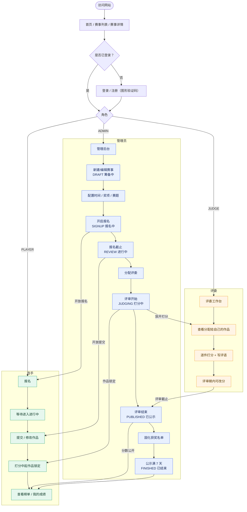
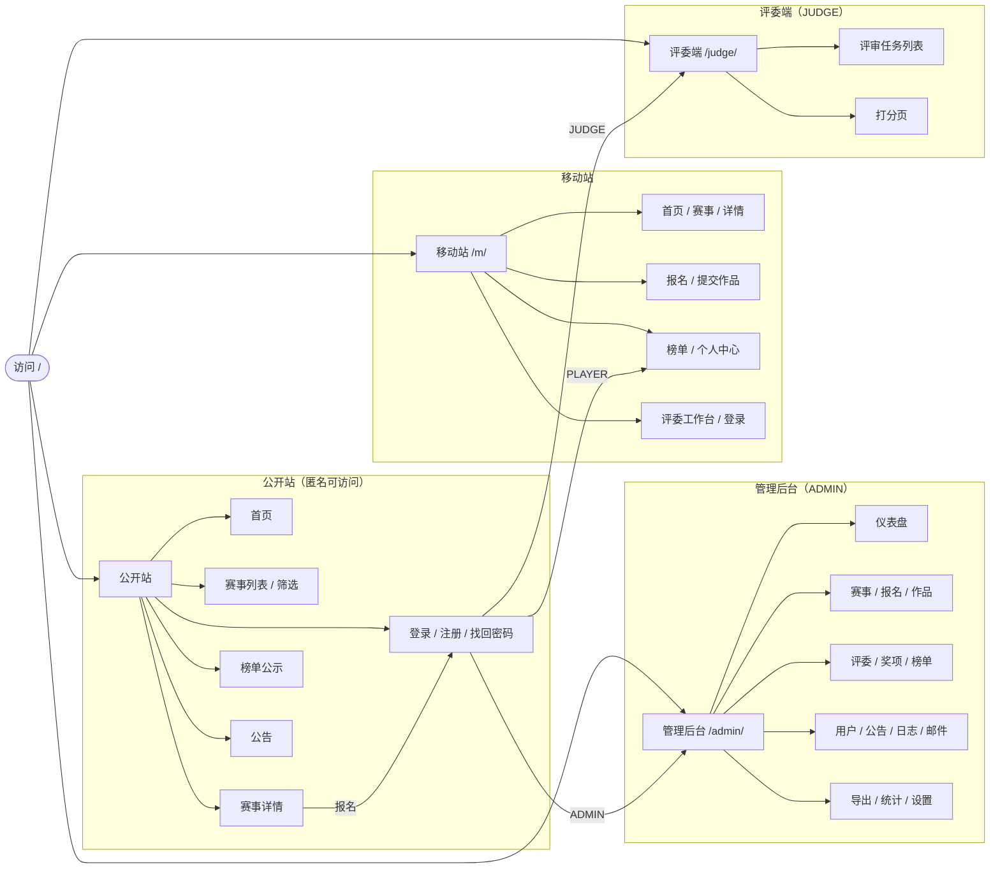
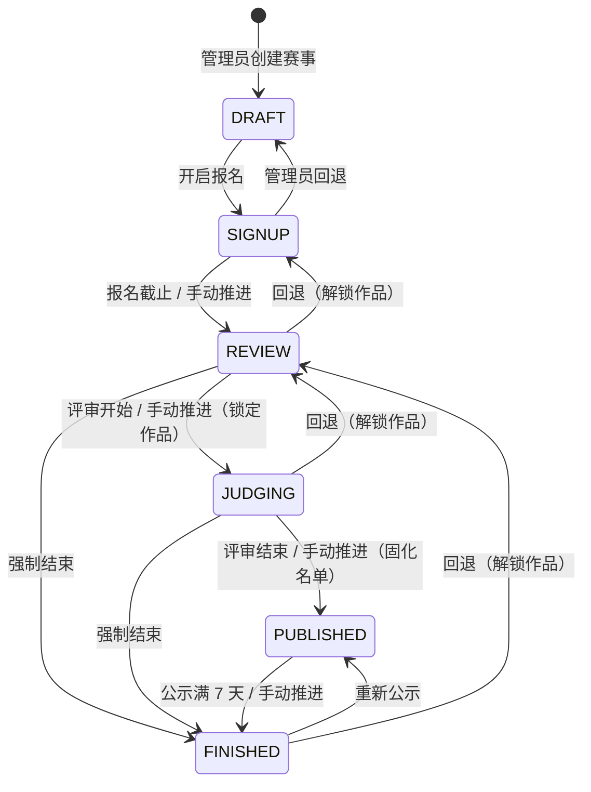
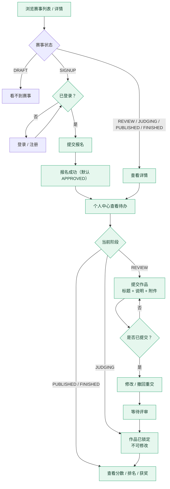
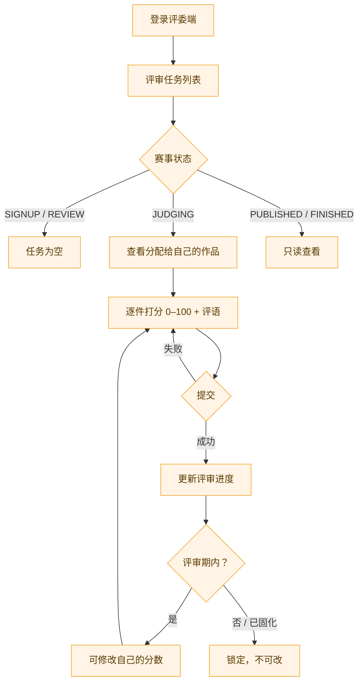
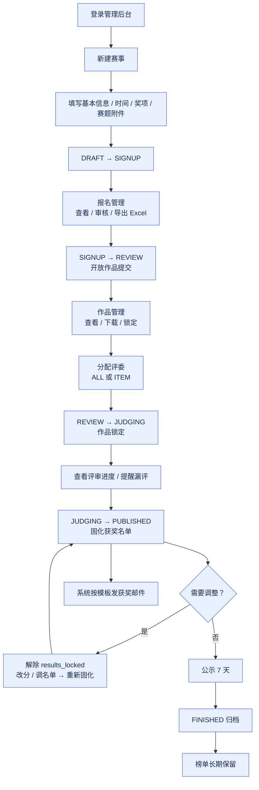
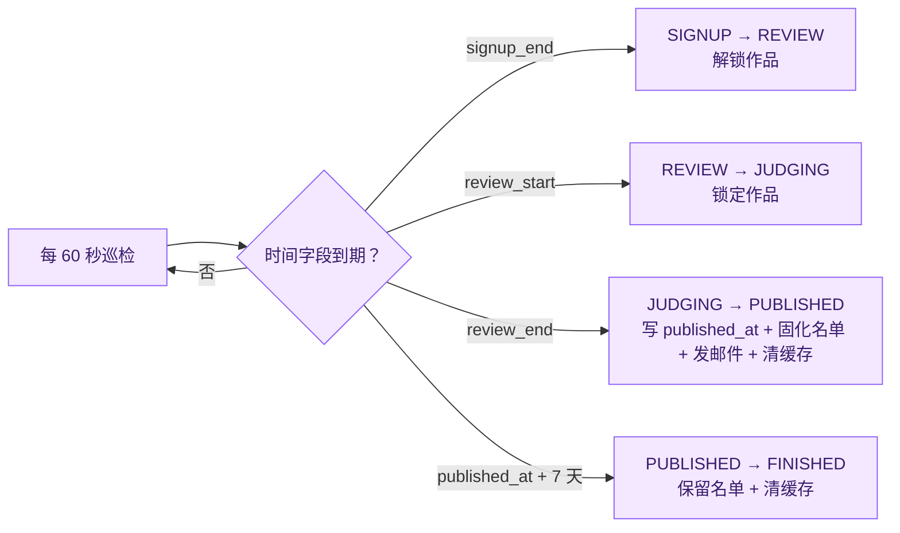

# BTR 赛事平台 · 网站使用流程图

> 依据《开发文档》《软件功能说明》《前端可用性改造方案》整理。
> 约定：流程图以**当前已实现的规则**为准（作品提交仅 REVIEW 阶段开放），文档中已存在的表述差异在文末「待确认点」标出。

---

## 0. 一图看懂（纯文本速览）

```
管理员   建赛事 ──→ 开报名 ──→ 报名截止 ──→ 开评审 ──→ 固化名单 ──→ 公示 ──→ 归档
           DRAFT      SIGNUP      REVIEW       JUDGING    PUBLISHED   FINISHED
选手                 报名        提交/改作品    作品锁定     看榜单/成绩
评委                                         打分/写评语
系统                            状态机定时巡检  清榜单缓存   发获奖邮件   满7天自动结束
```

---

## 1. 端到端主线（角色 × 阶段）



---

## 2. 角色入口与页面地图



---

## 3. 赛事状态机（系统核心）



**状态与用户可做的事**

| 状态 | 选手 | 评委 | 公众可见 |
|---|---|---|---|
| DRAFT 筹备中 | 不可见 | 不可见 | 无 |
| SIGNUP 报名中 | 报名 / 取消报名 | — | 赛事信息 |
| REVIEW 进行中 | 提交 / 修改作品 | 还不能打分 | 无作品、无分数 |
| JUDGING 打分中 | 作品锁定 | 打分、写评语、改分 | 作品可见，分数不可见 |
| PUBLISHED 已公示 | 查看成绩 | 只读 | 作品 + 分数 + 榜单 |
| FINISHED 已结束 | 查看成绩 | 只读 | 作品 + 分数 + 榜单（长期保留） |

---

## 4. 选手使用流程



**边界说明**

- 报名默认自动通过，管理员可改为 `PENDING / APPROVED / CANCELED`。
- 同一赛事同一用户只能有一条报名（`user_id + contest_id` 唯一）。
- 作品按报名记录 upsert，**没有独立的「新建多条作品」**。
- 作品删除为「撤回」，是否允许取决于赛事阶段（当前实现：REVIEW 可撤回，锁定后不可）。

---

## 5. 评委使用流程



**规则**

- 只能看到分配给自己的作品，看不到其他评委的分数。
- 「整体分配（ALL）」动态跟随新提交作品；「按作品分配（ITEM）」精确绑定。
- 管理员改分写 `adjusted_score`，与评委原始分并存，算分时以 `COALESCE(adjusted_score, score)` 为准。

---

## 6. 管理员运营流程



---

## 7. 系统自动动作（无需人工）



---

## 8. 关键边界与异常分支

| 场景 | 系统行为 |
|---|---|
| 非公开赛事（`is_public=false`） | 公众接口一律 404，管理员可预览 |
| 未登录点「报名」 | 跳转登录，登录后回到原赛事 |
| 报名已截止后再报名 | 拒绝，提示「报名已截止」 |
| 非 REVIEW 阶段提交作品 | 拒绝（JUDGING 起作品锁定） |
| 评委未分配就进入工作台 | 任务列表为空 |
| 分数未公示时查看榜单 | JUDGING 只返回作品，不返回分数/排名 |
| 结果已固化后再改分 | 拒绝，需先解除锁定 |
| 公示满 7 天 | 自动转 FINISHED，榜单保留 |
| 邮件服务未配置 | 邮件降级为 SKIPPED，不阻塞业务 |
| Redis 不可用 | 榜单缓存降级为进程内缓存 |

---

## 9. 待确认点（与文档表述相关）

1. **SIGNUP 阶段是否可提交作品**：《前端可用性改造方案》§3.1 把 SIGNUP 已报名的主按钮写成「提交作品」，但后端仅 REVIEW 开放。本图按后端规则绘制。
2. **是否支持「保存草稿」**：《软件功能说明》提到草稿，但数据模型无 DRAFT 状态、接口也只有 upsert。本图未画草稿分支。
3. **评委在 PUBLISHED 阶段能否打分**：开发文档说任务可见，实现记录只说 JUDGING / FINISHED 可打分。本图按「PUBLISHED 只读」绘制。
4. **REVIEW 的中文名**：代码语义是「作品提交期」，前端辅助文案却写「作品评审中」。本图统一称「进行中」。
