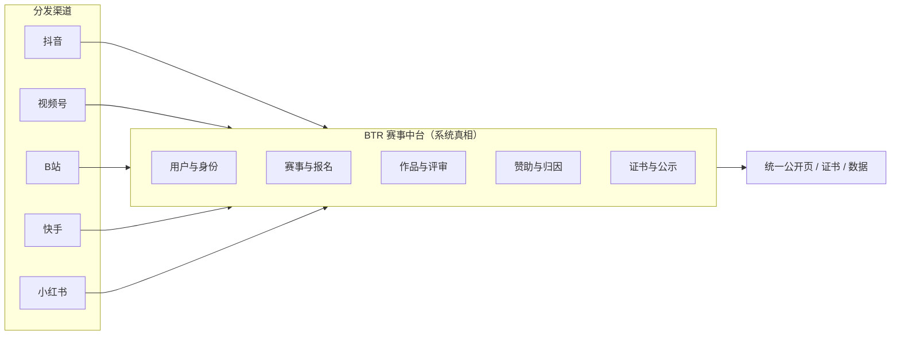

# BTR 视频平台生态策略：借流量，不依附

> 问题：BTR 是否应该依附抖音等视频平台？
> 结论：**短期以抖音为第一分发渠道，长期保持平台中立；视频平台是获客与内容渠道，不是系统底座。**
> 前提：主办方免费、赞助商付费的商业模式不变。

---

## 0. 一句话结论

**依附流量，不依附平台。**

- 可以依附：抖音的注意力、内容生态、达人、直播、广告预算。
- 不能依附：抖音的账号体系、数据、规则、单一入口、单一收入。
- 系统必须留在自己手里：用户、赛事、作品、评审、证书、赞助数据。

---

## 1. 为什么视频平台是天然入口

| 维度 | 说明 |
|---|---|
| 注意力 | 短视频/直播是参赛者与观众的主要时间入口 |
| 内容形态 | 设计、舞蹈、美食、机器人、黑客松路演，天然适合视频 |
| 传播 | 挑战赛、话题、投票、直播决赛，自带裂变 |
| 赞助 | 品牌要的就是视频曝光与 UGC，和 BTR 的赞助模式高度契合 |
| 获客 | 平台流量比自建社区便宜，冷启动快 |
| 证据 | 作品视频化后，评审更直观，公示更可信 |

**关键判断**：视频平台不是「渠道之一」，而是**赛事内容的第一现场**。但「第一现场」不等于「唯一系统」。

---

## 2. 三种依附模式

| 模式 | 做法 | 好处 | 风险 | 适合 |
|---|---|---|---|---|
| A. 深度依附 | 只做抖音小程序，账号/流量/支付全在抖音 | 起量最快 | 被封/改规则即死；数据拿不到；品牌弱 | 短期冲量、代运营 |
| B. 借力分发 | BTR 是赛事中台，抖音是投稿/传播/直播渠道 | 兼顾增长与资产 | 需要适配层，运营更重 | **推荐** |
| C. 完全自建 | 自建视频社区，不接平台 | 数据完全自有 | 获客极难、成本高 | 不建议早期 |

**推荐 B**：抖音优先，但不排他；一套赛事内核，多个分发适配器。

---

## 3. 抖音生态具体怎么打

> 具体接口与权限以抖音开放平台最新政策为准；以下为策略层设计。

### 3.1 四种切入方式（按投入从轻到重）

| 方式 | 做法 | 投入 | 适合阶段 |
|---|---|---|---|
| 话题挑战赛 | 主办方在抖音发话题，选手带话题发布，BTR 收录链接/截图 | 低 | 验证期 |
| H5 + 分享 | BTR 做视频投稿页，抖音只负责分享引流 | 低 | P1 |
| 抖音小程序 | 报名、投稿、投票、榜单、证书都在小程序 | 中高 | 验证成功后 |
| 直播决赛 | 抖音直播 + BTR 实时打分/榜单 | 中 | 有赞助商时 |

**建议路径**：话题挑战赛 → H5 视频投稿 → 小程序 → 直播决赛。不要一上来做小程序。

### 3.2 挑战赛机制

- 每场赛事一个官方话题（如 `#BTR企业创新赛2027`）。
- 选手在抖音发布作品，带话题 + 赛事编号；在 BTR 提交视频链接与授权。
- BTR 通过链接/编号/UTM 归因，避免平台内数据黑箱。
- 设两个榜：
  - **专业榜**：评委按评分表打分（主榜）。
  - **人气榜**：平台互动数据（副榜，防刷）。
- 人气与专业分开，避免“会跳舞的赢过会写代码的”。

### 3.3 小程序定位

- 小程序是**前端入口**，不是系统：
  - 登录：抖音授权 + 可选绑定 BTR 账号。
  - 数据：通过 BTR API 读写，赛事与评审仍在 BTR。
  - 不做独立数据孤岛。
- 审核与类目风险：赛事/投票/证书可能涉及资质，提前准备材料。
- 保留 H5 兜底：小程序被拒/被封时，二维码直接跳 H5。

### 3.4 直播与达人

- 决赛直播：BTR 提供实时打分、榜单、弹幕互动、奖项公布。
- 达人合作：行业 KOL、社群主理人、评委专家；用专属码/链接归因。
- 赞助商植入：直播间口播、背景板、抽奖、优惠码。
- 内容二次剪辑：赛事高光片段授权给主办方/赞助商传播。

### 3.5 投放与归因

- 赞助商可在巨量引擎投放，落地页指向 BTR 赛事页/小程序。
- BTR 侧统一归因：UTM、二维码、专属码、报名来源字段。
- 报表区分：自然流量 / 达人 / 付费投放 / 站内推荐。
- 反作弊：设备、IP、行为、提交时间聚类。

---

## 4. 多平台适配矩阵

| 平台 | 内容优势 | 适合赛事 | 接入方式 | 优先级 |
|---|---|---|---|---|
| 抖音 | 短视频、直播、挑战赛 | 设计、舞蹈、美食、科技路演 | 小程序/H5/话题 | P0 |
| 微信视频号 | 社交裂变、企业/行业/社群触达 | 行业赛、公益活动 | H5/公众号/小程序 | P1 |
| B站 | 中长视频、ACG、技术 | 编程、动画、鬼畜、知识类 | H5/投稿链接 | P1 |
| 快手 | 下沉市场、本地 | 地方赛、技能赛 | H5/话题 | P2 |
| 小红书 | 图文/生活方式 | 设计、穿搭、生活方式 | H5/笔记 | P2 |
| YouTube | 国际、长视频 | 国际赛、公开课 | H5/嵌入 | P3 |

**原则**：一套赛事内核，多个「发布适配器」；不为每个平台做一套产品。

---

## 5. 产品改造（视频优先）

| 能力 | 说明 |
|---|---|
| 视频投稿 | 竖屏/横屏、封面、字幕、时长限制、转码、审核 |
| 链接投稿 | 选手提交抖音/B站链接 + 授权声明，BTR 抓取封面/标题 |
| 挑战赛话题 | 赛事绑定话题、编号规则、参赛作品聚合 |
| 双榜 | 专业榜（评委）+ 人气榜（互动，防刷） |
| 直播决赛 | 直播嵌入、实时打分、榜单、奖项公布 |
| 内容审核 | 机器审核 + 人工复核 + 申诉 |
| 版权与授权 | 作品授权书、二次传播范围、撤回机制 |
| 归因 | UTM、二维码、专属码、来源字段 |
| 分享物料 | 竖屏海报、证书卡片、作品卡片、二维码 |
| 数据 | 播放、互动、跳转、报名、提交、转化 |

**注意**：视频存储与转码成本高，必须走对象存储 + CDN + 异步转码，并设公平额度。

---

## 6. 商业模式：赞助商为什么更愿意买

| 赞助产品 | 视频平台加持后的卖点 |
|---|---|
| 赛事冠名 | 话题挑战赛 + 直播 + 证书联名，曝光更完整 |
| 品牌挑战赛 | 品牌命题、UGC 投稿、达人参与、数据报告 |
| 直播决赛 | 实时观看、口播、抽奖、优惠码 |
| 人才榜 | 从作品视频直接看能力，招聘转化更高 |
| 数据报告 | 播放/互动/报名/提交全链路，不再只有曝光 |
| 内容授权 | 高光片段二次传播，品牌素材库 |

**收入结构不变**：赞助 75%、人才与数据 15%、服务 10%。

**新增成本**：视频存储/CDN、转码、内容审核、达人合作、平台服务费。定价时必须计入。

---

## 7. 依附抖音的五个真实风险

| 风险 | 说明 | 应对 |
|---|---|---|
| 规则风险 | 小程序类目、投票、证书、抽奖可能被限制 | H5 兜底；提前报审；不把唯一入口放平台 |
| 流量风险 | 算法波动、限流、账号处罚 | 多平台 + 自有渠道（邮件/社群/SEO） |
| 数据风险 | 只拿到 openid，拿不到用户画像 | 自有账号体系；授权绑定；数据可导出 |
| 商业风险 | 平台抽成、广告涨价、达人成本 | 合同锁价；多渠道；自营内容 |
| 竞争风险 | 平台自己做赛事工具，或扶持竞品 | 做深评审/证书/赞助履约，做平台不愿做的脏活 |

**红线**：

- 不做抖音-only 账号体系。
- 不把赛事数据只存在小程序。
- 不把点赞数当唯一评审依据。
- 不买假流量、不刷互动。
- 不签早期排他协议。
- 不为抖音单独 fork 一套产品。

---

## 8. 90 天验证计划

| 周 | 事项 | 产出 |
|---|---|---|
| 1–2 | 选 1 个垂直（如企业创新/行业技能），定 3 场赛事 | 赛事清单 |
| 3–4 | H5 视频投稿 + 抖音话题 + 二维码归因 | 可投稿、可归因 |
| 5–6 | 签 1 个赞助商，做品牌挑战赛 | 首份赞助合同 |
| 7–8 | 达人/行业 KOL + 直播决赛 | 一场完整直播赛 |
| 9–10 | 数据复盘：播放→报名→提交→成本 | 单赛事 ROI 报告 |
| 11–12 | 决策：是否做抖音小程序 | Go/No-Go |

**Go 条件**

- 单场视频播放 ≥ 50 万，报名转化 ≥ 2%。
- 获客成本低于自建渠道 30%。
- 赞助商 ROI 可证明（曝光/点击/报名/内容量）。
- 内容审核与版权流程跑通。

**No-Go 信号**

- 流量靠投放硬买，自然推荐几乎为零。
- 报名转化 < 0.5%。
- 赞助商只认曝光，不认赛事数据。
- 平台审核频繁卡壳。

---

## 9. 关键指标

| 层级 | 指标 |
|---|---|
| 流量 | 播放、互动、主页访问、话题参与 |
| 转化 | 落地页 CTR、报名率、提交率、完赛率 |
| 成本 | CAC、单作品获客成本、视频存储/转码成本 |
| 赞助 | 曝光、点击、报名、内容量、eCPM、ROI |
| 依赖度 | 抖音流量占比（目标 12 个月内 < 60%） |
| 资产 | 自有账号数、邮件/社群触达、复访率 |

---

## 10. 最终建议

1. **战略**：抖音优先，但不排他；BTR 做赛事中台，平台做分发。
2. **产品**：先 H5 + 话题挑战赛，验证后再做小程序；永远保留 H5 兜底。
3. **数据**：自有账号 + 统一归因 + 可导出，拒绝数据黑箱。
4. **商业**：把「挑战赛 + 直播 + 达人 + 数据」打包卖给赞助商，而不是只卖广告位。
5. **组织**：配 1 名内容运营/达人BD，1 名投放/数据，缺这两类人做不动视频生态。
6. **底线**：不签排他、不做单一入口、不刷量、不把评审交给点赞。

> 抖音是放大器，不是地基。地基是赛事规则、评审公信力、用户资产和赞助履约能力。
